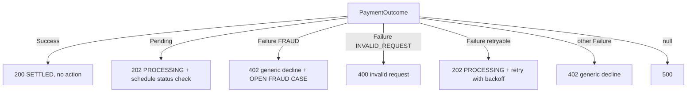

# Explanations - Sealed Types and Pattern Matching

Package root: `explanations.sealed`. A single focused example: `PaymentOutcome` sealed into `Success`, `Failure`, `Pending`,
and `PatternMatchingDemo` showing every pattern-matching form Java 21 offers over it.

## Overview
A focused companion to module07: one sealed type (`PaymentOutcome`) and every pattern-matching form over it. New:
`OutcomeResponder`, a realistic decision function that maps each outcome to the client-facing API response and the internal
follow-up action. It encodes a security rule in the type-driven switch: **a fraud decline must be indistinguishable from an ordinary decline**.

## Learning objectives
- Read and write all pattern-matching forms (type, record, nested, guarded, `null`, `instanceof`).
- Use guards to express business rules next to the case they refine, and order cases from specific to general.
- Separate *what the client sees* from *what the system does*, and avoid leaking sensitive decision details.

## Prerequisites
- Records and sealed interfaces (module07).

## Java version notes
| Form | Java 17 | Java 19/20 | Java 21 |
|---|---|---|---|
| `instanceof` type pattern | final | final | final |
| `switch` type patterns, guards (`when`), `case null` | preview | preview | **final** |
| Record (deconstruction) patterns, nested | not available | preview | **final** |
Compiled with `--release 21`, no preview flags needed.

## Why sealed + records
A payment has a closed set of outcomes. Modelling that as a sealed interface means:
- the compiler enforces exhaustive handling (no `default` hiding a forgotten case),
- each outcome carries exactly the data it needs (auth code vs decline reason vs retry time),
- records give validation (compact constructors), equality and `toString` for free,
- the code reads like the business rule.

## The seven forms (`PatternMatchingDemo`)
| # | Form | Example |
|---|---|---|
| 1 | type pattern switch | `case Success s -> ...` |
| 2 | record deconstruction | `case Success(String id, BigDecimal settled, String auth, Instant at) -> settled` |
| 3 | guards | `case Failure f when f.retryable() -> ...` then unguarded `case Failure f` |
| 4 | null case | `case null -> 500` |
| 5 | instanceof pattern | `if (o instanceof Failure f && f.retryable())` |
| 6 | nested patterns | `e instanceof Envelope(var trace, Failure(var id, var reason, var r))` |
| 7 | fold over ADT | loop + `instanceof Success(var id, var settled, ...)` |

## BAD vs GOOD
```java
// BAD: instanceof chain with a default that silently swallows new outcomes
if (o instanceof Success) ... else if (o instanceof Failure) ... else return "unknown";
// GOOD: exhaustive switch - adding `Reversed` breaks compilation here, which is what you want
return switch (o) { case Success s -> ...; case Failure f -> ...; case Pending p -> ...; };
```
```java
// BAD: enum + nullable fields for variant data
enum Status { SUCCESS, FAILURE, PENDING } String authCode; Reason reason; Instant checkAfter; // which are valid when?
// GOOD: one record per variant; invalid combinations cannot be constructed
```

## Rules that bite
- Guards do not count toward exhaustiveness; an unguarded case for the type must exist.
- Dominance: a general pattern before a specific one is a compile error (`case Failure f` before `case Failure f when ...`).
- `switch` on a sealed type throws NPE on `null` unless `case null` is present.
- Permitted subclasses must be `final`, `sealed` or `non-sealed`; records are implicitly final.
- Sealed subtypes must live in the same module (or same package in the unnamed module).

## Key Takeaways
- Use sealed interfaces + records for closed domain outcomes; use `switch` patterns to consume them.
- Prefer deconstruction patterns when you only need components; type patterns when you call methods.
- Put `case null` in only when null is a legitimate input; otherwise let the NPE surface the bug.
- This is the modern replacement for the Visitor pattern in Java.

## Cheat Sheet
| Need | Write |
|---|---|
| closed hierarchy | `sealed interface X permits A, B, C` |
| data variant | `record A(...) implements X` |
| exhaustive dispatch | `switch (x) { case A a -> ...; case B b -> ...; case C c -> ...; }` |
| destructure | `case A(var p, var q) -> ...` |
| condition | `case A a when a.p() > 0 -> ...` |
| null-safe | `case null -> ...` or `case null, default -> ...` |

## 10 Interview Q&A
1. **Why not an enum?** Enums cannot carry per-variant fields with different shapes; sealed records can.
2. **What happens when you add a permitted subtype?** Every exhaustive switch without `default` fails to compile until updated.
3. **Can a sealed interface permit a non-final class?** Yes, if it is declared `sealed` or `non-sealed`.
4. **Difference between `case A a` and `case A(var x, var y)`?** The first binds the whole object; the second deconstructs components (record pattern).
5. **What does `when` do to exhaustiveness?** Nothing; guarded cases are ignored when the compiler checks coverage.
6. **How does the compiler treat `null` in a pattern switch?** Throws `NullPointerException` unless a `case null` exists.
7. **Can patterns be nested?** Yes, arbitrarily: `Envelope(var t, Failure(var id, var reason, var r))`.
8. **Are sealed types reflective?** `Class.isSealed()` and `getPermittedSubclasses()` expose the hierarchy.
9. **When is the Visitor pattern still better?** When the hierarchy is open to third parties or operations must be added without recompiling consumers.
10. **How do sealed types interact with generics?** Fine: `sealed interface Result<T,E> permits Ok, Err` (see module05).

## Exercises for the reader
1. Add `Reversed(paymentId, originalAuthCode)` and fix every compile error the switches report.
2. Write `PatternMatchingDemo.retryDelay(PaymentOutcome)` returning `Optional<Duration>` using only deconstruction patterns.
3. Replace `isFinal` with a `switch` and compare readability.

---

## Production deep dive: `OutcomeResponder`

**Why it matters.** Response mapping is where sensitive decisions leak. "Declined: suspected fraud" teaches attackers which
card or device signals to change. Here the fraud and insufficient-funds responses are *equal objects* (tested), while the
internal action differs (`OpenFraudCase`). A retryable provider error is reported as "processing" (202), because telling the
customer "failed" when a retry may succeed leads them to pay twice through another channel.

**Case ordering.** Guarded cases (`when reason == FRAUD`, `when retryable`) must come before the unguarded `case Failure f`.
The compiler rejects an unguarded case that dominates later ones, which is another safety net.

**Edge cases (tested).** A `Pending` check time in the past yields a zero delay (never negative); amounts are rendered with
`toPlainString()` (`1E+1` becomes `10`); `null` maps to 500 instead of an NPE.

## Common pitfalls
- `default ->` in a switch over a sealed type, which hides newly added outcomes.
- Putting guards after a general case (compile error) or encoding rules as nested `if`s inside one case.
- Returning internal reasons (FRAUD, sanctions hit, risk score) in API messages or error codes.
- Forgetting `case null` and relying on a `NullPointerException` from the switch.
