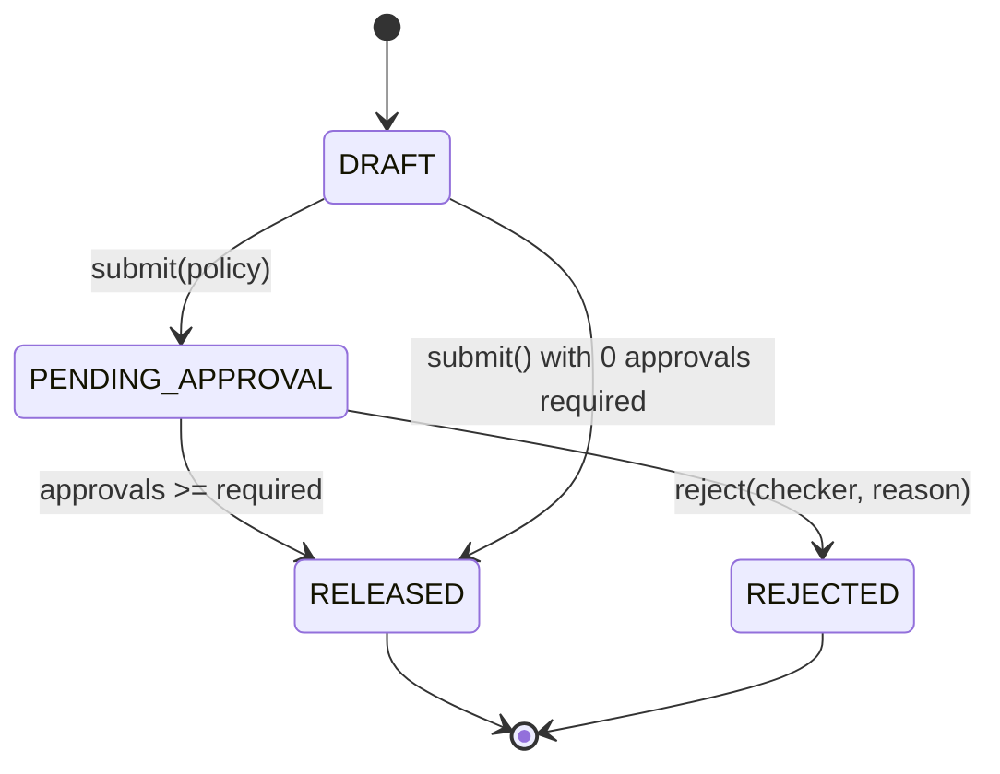
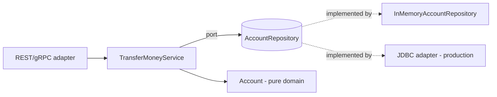

# Module 01 - OOP and Clean Design (SOLID)

Package root: `module01`. Domain: payments, wallets, fees, fraud checks.

## Overview
This module is the design foundation for everything that follows. Concurrency, collections and JVM tuning only pay off
when the domain model underneath is clean. The module covers classic OOP (abstraction, encapsulation, composition,
polymorphism) and SOLID, then moves to the production patterns used by real payment platforms:
**aggregates with invariants**, **maker-checker approval (separation of duties)**, **domain events**, and a
**hexagonal (ports and adapters) use case** with optimistic locking and idempotency.

## Learning objectives
After this module you should be able to:
- Name a design smell in a payment codebase (SRP, OCP, LSP, ISP, DIP) and refactor it live.
- Design an aggregate whose invariants cannot be bypassed by callers (`ddd.PaymentInstruction`).
- Explain why separation of duties belongs in the domain model and not in a controller.
- Lay out a use case so the domain has no framework or persistence dependencies (`hexagonal.*`).
- Explain how optimistic locking plus an idempotency key turns "retry on failure" into a safe operation.

## Prerequisites
- Java classes, interfaces, records and enums.
- Basic `BigDecimal` usage; `module01.immutability.Money` is reused here (module02 goes deeper).
- No concurrency background is needed. The one concurrent test only *uses* a thread pool (module09 explains it).

## Java version notes
| Feature used | Status | Where |
|---|---|---|
| Records, sealed interfaces, `instanceof` patterns | **Java 17** (final) | `ddd.PaymentEvent`, `hexagonal.Account` |
| Pattern matching for `switch` | **Java 21** final (preview in 17-20) | `polymorphism.FeeCalculator` |
| Module compiled with `--release 21 --enable-preview` | build setting | `pom.xml`; all *new* code compiles on 17 too |

## Why this matters at Revolut-level interviews
Interviewers rarely ask "what is encapsulation". They hand you a `PaymentService` that does five things
and ask what you would change. Being able to *name* the smell (SRP violation, fat interface, hard-wired
dependency) and refactor it live is the skill under test.

## The four pillars, payments edition

| Pillar | Package | Example |
|---|---|---|
| Abstraction | `module01.abstraction` | `PaymentProcessor` template method; `CardPaymentProcessor` and `BankTransferProcessor` supply only `settle()` |
| Encapsulation | `module01.encapsulation` | `BankAccount` hides `balance`, exposes `deposit/withdraw`, returns defensive copies of history |
| Inheritance vs Composition | `module01.composition` | `FraudEngine` HAS-A list of `FraudCheck` rules rather than a subclass per rule |
| Polymorphism | `module01.polymorphism` | sealed `PaymentMethod`; subtype dispatch vs exhaustive `switch` pattern matching |

Immutability (`module01.immutability`) is the fifth pillar in fintech: `Money` normalises scale so
`10.0 GBP` equals `10.00 GBP`, and `Transfer` validates in its compact constructor.

## SOLID: BAD vs GOOD

### S - Single Responsibility
**BAD** `solid.srp.bad.PaymentService` validates, writes SQL strings, formats e-mails and logs.
```java
public void pay(String customerEmail, BigDecimal amount) {
    // validation ... persistence ... notification ... logging - four reasons to change
}
```
**GOOD** `solid.srp.good.PaymentService` orchestrates a `PaymentValidator`, a `PaymentRepository` and a `Notifier`.
Each can be tested and replaced independently.

### O - Open/Closed
**BAD** `solid.ocp.bad.FeeCalculator` has a `switch(type)` with a `default: return ZERO`.
A typo like `"CRAD"` yields a zero fee silently.
**GOOD** `solid.ocp.good.FeeCalculator` iterates `List<FeePolicy>`; adding a fee type = adding a class.
Unknown types throw.

### L - Liskov Substitution
**BAD** `FixedDepositAccount extends Account` but throws from `withdraw()`. `SweepService` written against
`Account` crashes at runtime.
**GOOD** split the contract: `ReadableAccount` and `WithdrawableAccount`. `FixedDepositAccount` implements
only `ReadableAccount`, so passing it to `SweepService` is a compile error.

### I - Interface Segregation
**BAD** `PaymentGateway` has charge/refund/settle/report/rotateKeys; `RefundOnlyGateway` stubs four methods
with `UnsupportedOperationException`.
**GOOD** `Charger`, `Refunder`, `Settler`. `RefundService implements Refunder` only; `FullGateway` implements all three.

### D - Dependency Inversion
**BAD** `TransferService` does `new MySqlLedger()`; untestable without MySQL.
**GOOD** `TransferService(Ledger ledger)`; `Ledger` is an interface owned by the high-level module.

## Exercises in this module
1. **Wallet** (`module01.exercise1`): encapsulated balance, non-negative invariant, cross-currency rejection,
   movement history, thread-safe via `synchronized`. Test proves exact totals with 10 threads.
2. **Fee strategies** (`module01.exercise2`): `FeeStrategy` with `PercentageFee`, `FlatFee`, `TieredFee`;
   `CardFeeContext` applies a 50 % discount for `CustomerTier.PREMIUM`, and the strategy can be swapped at runtime.
3. **Your turn**: add a `CryptoFeePolicy` to `solid.ocp.good` without touching `FeeCalculator`.

## Key Takeaways
- Favour composition; inheritance is for *is-a* with a stable contract.
- `final` fields + no setters + defensive copies = immutable enough for concurrency.
- Sealed types + pattern matching give you exhaustive polymorphism without `default`.
- A `default` branch that returns a "safe" value is a bug in fintech. Fail loudly.
- Inject dependencies through constructors; depend on interfaces you own.
- `BigDecimal` for money, always; set the scale explicitly.

## Cheat Sheet
| Smell | Principle | Fix |
|---|---|---|
| class with "and" in its description | SRP | split collaborators |
| `switch` on type string | OCP | strategy/policy list or sealed types |
| subclass throws `UnsupportedOperationException` | LSP | split the interface |
| implementors stub methods | ISP | role interfaces |
| `new ConcreteDependency()` inside a service | DIP | constructor injection |
| public setter on money field | Encapsulation | operations that preserve invariants |

## 10 Interview Q&A
1. **Composition vs inheritance?** Composition reuses behaviour by delegation and is changeable at runtime; inheritance couples subclass to superclass internals. Prefer composition unless there is a true is-a relationship with a stable contract.
2. **How does LSP relate to exceptions?** A subtype must not throw new checked exceptions or `UnsupportedOperationException` for operations the supertype promises. Strengthening preconditions breaks substitutability.
3. **Why is `switch` on a type string an OCP violation?** Every new type edits the switch; the class is never closed. Use a registry of policies or a sealed hierarchy.
4. **What makes a class immutable?** `final` class, `final` fields, no setters, defensive copies in/out, no leaking `this` from the constructor.
5. **Is a record immutable?** Shallowly. Its components are `final`, but a `List` component can still be mutated unless you copy it in the compact constructor.
6. **Template method vs strategy?** Template method fixes the algorithm skeleton in a superclass; strategy injects the varying part as an object. Strategy is more flexible and testable.
7. **Why sealed interfaces?** Exhaustive `switch` without `default`; the compiler fails when a new subtype is added and a case is missing.
8. **How do you unit-test a DIP-compliant service?** Inject an in-memory fake (`InMemoryLedger`). No mocking framework needed.
9. **What does ISP buy you in a microservice?** Clients compile against only the methods they use, so you can version and deploy capabilities independently.
10. **Where does validation belong?** At the boundary (constructor / factory) so that an object can never exist in an invalid state; downstream code does not re-validate.

## Exercises for the reader
1. Add `blockedMerchants(Set<String>)` to `StandardChecks` and prove with a test that it composes with the others.
2. Make `BankAccount` lock-free using `AtomicReference<BigDecimal>` and a CAS loop; keep the history consistent.
3. Convert `CardFeeContext` to accept a `Map<CustomerTier, BigDecimal>` of discounts without breaking existing tests.

---

## Production deep dive

### Example 1: maker-checker approval (`module01.ddd`)
| Class | Role |
|---|---|
| `PaymentInstruction` | Aggregate root: DRAFT -> PENDING_APPROVAL -> RELEASED / REJECTED |
| `ApprovalPolicy` | Value object: 0, 1 or 2 independent approvals depending on amount (inclusive limits) |
| `PaymentEvent` | Sealed, immutable events: `Submitted`, `ApprovalRecorded`, `Released`, `Rejected` |
| `UserId`, `SeparationOfDutiesException` | Identity of operators; violation of the four-eyes rule |



**Why it matters.** Banking regulators and auditors require that no single person can create *and* release a high-value
payment. If the rule lives in a controller, a batch job or a new API endpoint can skip it. Inside the aggregate it cannot be skipped.

**Expected behaviour.**
- `<= autoApproveLimit` is released straight through (two events: `Submitted`, `Released`).
- The maker approving their own payment throws `SeparationOfDutiesException`. So does a checker approving twice.
- A rejection needs a non-blank reason, because auditors ask "why". Terminal states throw `IllegalStateException` on any further action.
- `pullEvents()` drains the events exactly once. `approvers()` returns an unmodifiable copy.

**Edge cases and failure scenarios.**
- *Boundary amounts:* limits are inclusive (`1000.00` needs 0 approvals, `1000.01` needs 1), and tests pin this down.
- *Mixed currencies:* `ApprovalPolicy` rejects limits in different currencies. In production you would hold one policy per currency, or convert with an explicitly dated FX rate.
- *Two checkers approving concurrently:* the aggregate is not thread-safe on purpose. Each approval is a separate transaction, and the repository's version check rejects the loser, who reloads and retries.
- *Lost events:* if you save the aggregate and then publish events in a separate step, a crash in between loses or duplicates them. Persist events in the same DB transaction (transactional outbox, module15 `P16`).

**Trade-offs.** A richer aggregate means more logic in the domain and fewer "anaemic" services, but the aggregate must stay
small: one payment, not "all payments of a customer". Otherwise every write contends on one version number.

### Example 2: hexagonal transfer use case (`module01.hexagonal`)

**Why it matters.** The domain (`Account`) has no imports from frameworks or persistence, so it is unit-testable in microseconds.
Correctness guarantees that only a database can give (atomic multi-row commit, version checks, a unique idempotency key) are
expressed as a *contract on the port* (`AccountRepository.commit`) rather than being scattered through the service.

**Expected behaviour.**
1. `isProcessed(key)` is the fast path for client retries and returns `DUPLICATE` without touching balances.
2. Load both accounts and apply the domain rules (`debit` throws `InsufficientFundsException`, which is never retried).
3. `commit` is all-or-nothing. A version mismatch throws `OptimisticLockException`, and the service retries the whole read-modify-write up to `maxAttempts` times.
4. A concurrent commit with the same key throws `DuplicateCommandException`, and the service reports `DUPLICATE`.

**Edge cases.** Same source and destination (rejected in `TransferCommand`); failed commands do *not* consume the key, so the
client can retry after topping up; a hot account under contention can exhaust retries, and the conflict is surfaced rather
than spun on forever.

**Trade-offs: optimistic vs pessimistic locking.**
| | Optimistic (version column) | Pessimistic (`SELECT ... FOR UPDATE`) |
|---|---|---|
| Low contention | Best: no locks held | Lock overhead on every call |
| Hot account (merchant settlement) | Retry storms | Better: requests queue on the row lock |
| Deadlock risk | None | Must lock rows in a fixed order (by id) |
| Long transactions | Many conflicts | Lock held for the whole duration |

## In-memory vs production guarantees
`InMemoryAccountRepository` uses one `synchronized` monitor to *simulate* a DB transaction. That is correct **inside one JVM
only**: it gives no durability, no isolation across service instances, and no protection if two pods run the same code.
In production the same contract is implemented by:
- one relational transaction containing both `UPDATE ... WHERE version = ?` statements and the idempotency-key `INSERT`;
- a `UNIQUE` constraint on the idempotency key, which is the real "exactly once" guard;
- a transactional outbox for the domain events, so state changes and published events never diverge.

## Common pitfalls
- **Anaemic domain:** `account.setBalance(account.getBalance().subtract(x))` in a service. Every caller must remember the invariant.
- **Checking the four-eyes rule in the UI only.** An API call bypasses it.
- **Leaking mutable internals:** returning the live `approvers` set lets a caller add a fake approver.
- **Retrying business failures:** `InsufficientFunds` is not transient. Retry only conflicts and timeouts.
- **Unbounded retry loops** on optimistic conflicts turn contention into a CPU and DB storm.
- **Sensitive data in exception messages:** `InsufficientFundsException` deliberately omits the balance, because messages end up in logs.
- **Publishing events before commit:** consumers act on a payment that is later rolled back.

## Production checklist
- [ ] Invariants enforced in constructors and aggregate methods, never only in callers.
- [ ] Maker != checker, and each checker approves at most once, enforced in the domain and covered by tests.
- [ ] Every state-changing command carries an idempotency key, backed by a unique DB constraint.
- [ ] Optimistic conflicts are retried with a bound; business errors are not retried.
- [ ] Domain events are immutable, contain no secrets, and are persisted atomically with state.
- [ ] Domain package has no framework, JDBC or HTTP imports (an ArchUnit test can enforce this).
