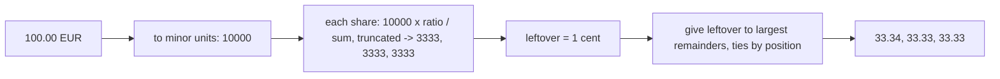

# Module 02 - equals/hashCode, Value Objects and Immutability

Package root: `module02`. Domain: accounts, payment keys, FX quotes, config.

## Overview
Every hash-based collection, cache, idempotency store and deduplicator in a payment system depends on correct
`equals`/`hashCode`, and every safely shared object depends on immutability. This module shows the classic bugs
(missing `hashCode`, asymmetric `equals`, mutable keys, `BigDecimal` scale) and then three production concerns:
**sensitive data in value objects** (`sensitive.CardNumber`), **defensive copying of arrays and collections inside records**
(`defensive.SignedSettlementBatch`), and **allocating money without losing a cent** (`allocation.MoneyAllocator`).

## Learning objectives
- State and test the `equals`/`hashCode` contract, and explain what breaks in `HashMap`/`HashSet` when it is violated.
- Build value objects that validate on construction, normalise their state and are safe as map keys.
- Recognise the three record traps: shallow immutability, array components, and `toString` leaking secrets.
- Split monetary amounts deterministically so the parts always sum to the whole (needed for reconciliation).

## Prerequisites
- Module01 (`Money`, encapsulation). Familiarity with `HashMap` buckets helps (module03 goes deep).

## Java version notes
| Feature | Status | Where |
|---|---|---|
| Records, compact constructors, `instanceof` patterns | **Java 17** final | all packages |
| `HexFormat` | Java 17 API | `defensive.SignedSettlementBatch` |
| Module compiled with `--release 17` | build setting | nothing here needs Java 20/21 |

## The contract everyone gets asked
`equals` must be reflexive, symmetric, transitive, consistent, and `x.equals(null)` is false.
If `a.equals(b)` then `a.hashCode() == b.hashCode()`. Breaking the second rule is the single most
common production bug with `HashMap`, `HashSet`, `ConcurrentHashMap`, and every cache built on them.

## BAD vs GOOD

### Missing hashCode
```java
// BAD - module02.equalshashcode.BrokenAccount
@Override public boolean equals(Object o) { ... iban.equals(...) }
// hashCode() not overridden -> identity hash -> HashSet.contains() returns false
```
```java
// GOOD - module02.equalshashcode.Account
@Override public boolean equals(Object o) { ... iban.equals(...) }
@Override public int hashCode() { return iban.hashCode(); }
```

### Asymmetric equals (`AsymmetricCard`)
A subclass comparing an extra field while the superclass does not breaks symmetry:
`plain.equals(scheme) == true` but `scheme.equals(plain) == false`. Fix: make value classes `final`,
or use `getClass()` comparison, or (best) use records.

### Mutable keys (`module02.mutablekey`)
```java
map.put(key, TEN);
key.setOrderId("o2");   // hash drifts
map.get(key);           // null  - entry is orphaned in the old bucket
map.size();             // 1     - memory leak in long-running services
```
GOOD: `record PaymentKey(String merchantId, String orderId)`.

### BigDecimal scale trap (`module02.valueobjects.Money`)
`new BigDecimal("1.0").equals(new BigDecimal("1.00"))` is **false**, `compareTo` says 0.
`Money` normalises scale in the constructor with `RoundingMode.UNNECESSARY`, so sub-penny input is rejected.

### Records are shallowly immutable (`module02.records`)
`LeakyPayment(String id, List<String> tags)` keeps the caller's list. `Payment` does `tags = List.copyOf(tags)`
in the compact constructor.

### Immutability (`module02.immutability`)
BAD `MutableFxQuote`: setters, leaks `Date` and `List`. GOOD `FxQuote`: `final` fields, `Instant`,
`List.copyOf`, `withRate()` returns a new instance.

## Exercises
1. **PaymentLedger (HashMap bug)** - `PaymentRef` overrides `equals` only. `find()` returns empty and duplicates
   are stored twice. `PaymentLedgerFixed` uses a record key and `putIfAbsent` for idempotency.
2. **ConfigHolder** - aliases the caller's map, exposes it via getter; `Collections.unmodifiableMap` is a *view*.
   `ImmutableConfig` uses `Map.copyOf` and a `with()` method.
3. **Reader**: make `Email` reject disposable domains without breaking equality semantics.

## Key Takeaways
- Override both or neither. Use the same fields in both.
- Records solve 90 % of value-object boilerplate; still validate and copy in the compact constructor.
- Never mutate an object after using it as a key. Prefer immutable keys.
- `BigDecimal.equals` is scale-sensitive; normalise or compare with `compareTo`.
- `Collections.unmodifiableX` is a view; `List.copyOf` / `Map.copyOf` are copies.
- Immutable objects are inherently thread-safe and can be freely cached and shared.

## Cheat Sheet
| Question | Answer |
|---|---|
| Fields in hashCode but not equals? | Allowed but useless |
| Fields in equals but not hashCode? | **Bug** |
| `instanceof` or `getClass()`? | `instanceof` if class is final or equality is "by contract"; `getClass()` to forbid subclass equality |
| Records and inheritance? | Records cannot extend classes; they are implicitly final |
| `Objects.hash` cost | Allocates a varargs array; fine unless on a hot path |
| Cache hashCode? | Only for immutable objects (String does it) |

## 10 Interview Q&A
1. **What happens if hashCode is inconsistent with equals?** Equal objects can land in different buckets; `get` fails, duplicates appear in sets.
2. **Can two unequal objects have the same hashCode?** Yes, that is a collision; HashMap resolves it via `equals` within the bucket.
3. **Why is `Objects.hash(a, b)` sometimes avoided?** Varargs allocation plus boxing on hot paths; hand-roll `31 * h + ...` if measured.
4. **Why do records make good map keys?** Final, structural equals/hashCode generated from all components, no setters.
5. **What is wrong with `Date` in a value object?** It is mutable; return a copy or use `java.time` types.
6. **How does `BigDecimal` break value semantics?** Scale is part of equality. `1.0 != 1.00`. Normalise scale or use `compareTo`.
7. **Is `Collections.unmodifiableList(list)` immutable?** No, it is a read-only view over a possibly mutating list.
8. **How do you make a class immutable with a mutable dependency?** Copy on the way in, copy or wrap on the way out, never expose the reference.
9. **Why should value objects be `final`?** To keep `equals` symmetric; subclasses cannot redefine equality.
10. **Thread-safety of immutable objects?** Safe publication is guaranteed by `final` fields (JMM final-field semantics) even without synchronisation.

## Exercises for the reader
1. Add an `Iban` value object with checksum validation (mod-97) and prove equality after normalising whitespace/case.
2. Write a `HashMap` stress test: insert 10 000 `PaymentRef`s then look them all up; count misses.
3. Implement `ConfigHolder.v2` using a builder that validates that `fx.spread.bps` is an integer in [0, 10000].

---

## Production deep dive

### Example 1: `sensitive.CardNumber`, a value object holding secret data
**Why it matters.** A record prints all of its components in `toString()`. `log.info("charging {}", card)` or an exception
message such as `"invalid " + request` would write a full PAN (card number) to logs, which breaches PCI-DSS. `CardNumber`:
- validates once (12-19 digits, Luhn checksum) and **never echoes the invalid value** in the exception message;
- overrides `toString()` to mask everything except the last 4 digits, which is also safe when nested in a `Map`/`List`;
- keeps value equality (formatting is normalised: `"4111 1111 ..."` equals `"4111111111111111"`);
- provides `matches()` using `MessageDigest.isEqual`, a comparison that does not exit early and so avoids timing side channels.

**Limitation (read this).** Holding a clear PAN in a `String` keeps it on the heap until GC, and it can appear in heap dumps.
Real systems tokenise the PAN at the edge (vault/HSM), so most services only ever see a token. This class is the
*minimum* hygiene for code that must touch PANs, not a replacement for a PCI-scoped vault.

### Example 2: `defensive.SignedSettlementBatch`, records with arrays and lists
| Trap | Default record behaviour | Fix in this class |
|---|---|---|
| `List` component | Stores the caller's list (aliasing) | `List.copyOf` (also rejects `null` elements) |
| `byte[]` component | Stores the caller's array **and** the accessor returns it | `clone()` in the constructor and in the accessor |
| `equals`/`hashCode` with an array | Reference equality, so two identical batches differ | `Arrays.equals` / `Arrays.hashCode` |
| `toString` with an array | Prints `[B@1b6d3586` | Prints a short hex prefix |

**Why it matters.** A signature that can be mutated after verification is a tampering vector. A batch that is not
`equals` to its own copy breaks deduplication of re-sent settlement files.

### Example 3: `allocation.MoneyAllocator`, splitting without losing money

**Expected behaviour.** The sum of the parts always equals the total (proven by a 2,000-case randomised test with a fixed seed).
Zero-ratio parties receive nothing, and negative totals (refund splits) work too. Currency scale is respected (JPY has 0 decimals).
**Edge cases.** All ratios zero or any negative ratio is rejected. A total smaller than the number of parts gives some parts zero.
**Trade-off.** Largest remainder is fair and deterministic. Some businesses instead require "the first party absorbs the
rounding" or "the bank absorbs the rounding". That is a business rule, so make it explicit and documented, never accidental.

## Money handling quick reference
| Need | Do | Don't |
|---|---|---|
| Construct from text | `new BigDecimal("0.10")` | `new BigDecimal(0.1)` (gives `0.1000000000000000055...`) |
| From a `double` you cannot avoid | `BigDecimal.valueOf(d)` | `new BigDecimal(d)` |
| Compare amounts | `compareTo` | `equals` (scale-sensitive) |
| Division | `divide(x, scale, RoundingMode.HALF_EVEN)` | `divide(x)` (throws on 1/3) |
| Store in DB | `NUMERIC(19,4)` + currency column | `FLOAT`/`DOUBLE` |
| Rounding for banking | `HALF_EVEN` (banker's), unless the regulation says otherwise | Rounding at every intermediate step |

## Common pitfalls
- A record with a secret component and the default `toString`.
- Exception messages that include the invalid input (PANs, IBANs, emails), which ends up in logs and APM tools.
- `Collections.unmodifiableList(list)` treated as immutable: it is a view, and the owner can still change it.
- Array components in records; `java.util.Date` fields; getters returning internal mutable collections.
- Splitting money with `divide` and rounding each part independently, which loses or creates cents.
- Mutating an object after using it as a `HashMap`/`ConcurrentHashMap` key.

## Production checklist
- [ ] Value objects are `final`/records, validate in the constructor and normalise state (scale, case, whitespace).
- [ ] `equals` and `hashCode` use the same fields; tested with `HashSet.contains` on an equal copy.
- [ ] Mutable inputs copied in, mutable outputs copied out; arrays handled explicitly.
- [ ] Sensitive values are masked in `toString` and exception messages; PANs tokenised where possible.
- [ ] Monetary splits sum exactly to the original; the rounding policy is documented.
