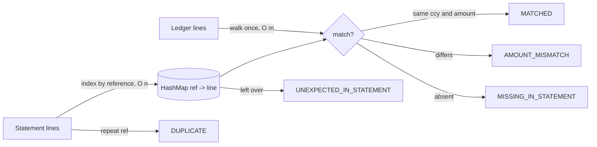

# Module 03 - Collections and HashMap Internals

Package root: `module03`. Domain: transaction lists, settlement queues, fee tiers, FX pairs, account caches, ledgers.

## Overview
Choosing the right collection decides whether an end-of-day job finishes in seconds or hours. This module explains
how `HashMap` actually works (hash spreading, buckets, treeification, resize), when `TreeMap`, `LinkedHashMap`,
`ArrayDeque` and `PriorityQueue` win, and then applies them to two core banking tasks:
**statement reconciliation** (`reconciliation.StatementReconciler`) and **point-in-time balances with back-valued postings**
(`history.BalanceHistory`). All collections here are single-threaded. Module04 covers concurrent ones.

## Learning objectives
- Explain `HashMap` lookup, collision handling, treeification and resizing, and pre-size maps correctly.
- Pick a collection by access pattern (index, key, order, range, priority) and justify it with Big-O.
- Turn an O(n x m) matching problem into O(n + m) with a hash index.
- Use `NavigableMap` (`floorEntry`, `tailMap`, `subMap`) for time-based financial queries.

## Prerequisites
- Module02 (`equals`/`hashCode` contract): every hash-based structure here depends on it.

## Java version notes
| Feature | Status | Where |
|---|---|---|
| Records, `Stream.toList()` | **Java 17** (`toList` since 16) | `reconciliation`, tests |
| Collections APIs used | Java 8+ | everywhere; module compiled with `--release 17` |
| Sequenced collections (`getFirst`, `reversed`) | **Java 21** only, not used here | mention only: would simplify `LinkedHashMap` LRU code |

## Choosing a collection (the 10-second answer)
| Need | Use | Why |
|---|---|---|
| Indexed list, iteration | `ArrayList` | contiguous memory, O(1) get, cache friendly |
| Stack / queue / deque | `ArrayDeque` | faster than `LinkedList`, never use `Stack` |
| Ordering by priority | `PriorityQueue` | binary heap, O(log n) offer/poll |
| Key lookup | `HashMap` | O(1) average |
| Sorted keys, range queries | `TreeMap` | red-black tree, O(log n), `floorEntry`, `subMap` |
| Insertion/access order | `LinkedHashMap` | LRU in 10 lines |
| Set semantics | `HashSet` / `TreeSet` | wrappers around the maps |

## HashMap internals (`module03.hashmapinternals`)
1. `h = key.hashCode()`
2. spread: `h ^ (h >>> 16)` so high bits influence the index
3. `index = (n - 1) & h` with `n` a power of two
4. bucket is a linked list; **treeified** to a red-black tree when the bucket reaches 8 nodes and the table has at least 64 slots (`TREEIFY_THRESHOLD`, `MIN_TREEIFY_CAPACITY`); untreeified below 6
5. resize at `size > capacity * 0.75`; the table doubles and each bucket splits in two (lo/hi lists) without rehashing

`ColliderKey` has a constant `hashCode`; the test inserts 100 of them to force treeify and shows lookups still work.
Because it implements `Comparable`, tree lookups are O(log n); without it the tree degrades to tie-break by identity.

`HashMapInternals.capacityFor(expected)` shows why `new HashMap<>(expected)` is **wrong** when you want no resize:
you need `expected / 0.75` rounded up to a power of two.

## BAD vs GOOD
```java
// BAD: ConcurrentModificationException
for (String tx : txs) if (tx.endsWith("-declined")) txs.remove(tx);
// GOOD
txs.removeIf(tx -> tx.endsWith("-declined"));
```
```java
// BAD: three map operations, racy on a concurrent map
Integer c = counts.get(k); counts.put(k, c == null ? 1 : c + 1);
// GOOD
counts.merge(k, 1, Integer::sum);
```

## Exercises
1. **FxPairMap** - composite record key `Pair(base, quote)`; direct, inverse (`1/r`) and cross-rate via USD.
2. **EventFrequencyAnalyzer** - three versions of counting (`get/put`, `getOrDefault`, `merge`), deterministic top-N, `TreeMap` and `LinkedHashMap` views.
3. **AccountCache v1/v2/v3** - unbounded `HashMap`; `LinkedHashMap(accessOrder=true)` + `removeEldestEntry`; hand-rolled `HashMap` + doubly linked list with O(1) operations.

`module03.ledgers.TransactionLedger` combines all three structures and exposes a reconciliation invariant.

## Key Takeaways
- Default to `ArrayList` and `ArrayDeque`; `LinkedList` almost never wins.
- `HashMap` iteration order is unspecified and changes after resize: never depend on it.
- `TreeMap.floorEntry` is the idiomatic tool for tiered pricing and "balance as of".
- `LinkedHashMap` in access-order mode is a complete LRU cache.
- Pre-size maps using `expected / loadFactor`, not `expected`.
- Bad `hashCode` turns O(1) into O(n) (or O(log n) after treeify, if `Comparable`).

## Cheat Sheet
| Operation | ArrayList | LinkedList | ArrayDeque | HashMap | TreeMap |
|---|---|---|---|---|---|
| get(i) | O(1) | O(n) | - | - | - |
| add at end | O(1)* | O(1) | O(1)* | - | - |
| add at head | O(n) | O(1) | O(1)* | - | - |
| contains/get key | O(n) | O(n) | O(n) | O(1)* | O(log n) |
| range query | - | - | - | - | O(log n + k) |
`*` amortised / average.

## 10 Interview Q&A
1. **How does HashMap handle collisions?** Linked list per bucket, becomes a red-black tree at 8 nodes when the table has 64+ slots.
2. **Why is the table size a power of two?** `(n-1) & hash` replaces modulo; resize can split buckets with one bit test.
3. **What does the load factor control?** Memory vs collision trade-off; 0.75 is the default balance.
4. **Is HashMap ordered?** No. `LinkedHashMap` keeps insertion/access order, `TreeMap` keeps sorted order.
5. **What is the complexity of `TreeMap.get`?** O(log n) with comparisons; keys must be `Comparable` or you supply a `Comparator`.
6. **How would you implement an LRU cache?** `LinkedHashMap(cap, 0.75f, true)` + `removeEldestEntry`, or HashMap + doubly linked list for full control.
7. **Why is `ArrayList.remove(int)` O(n)?** It shifts the tail left with `System.arraycopy`.
8. **What is fail-fast iteration?** `modCount` check throws `ConcurrentModificationException` on structural change during iteration; it is best effort, not a guarantee.
9. **`PriorityQueue` iteration order?** Heap order, not sorted. Only `poll()` gives sorted output.
10. **When would you pick `LinkedList`?** Almost never; `ArrayDeque` for deque ops, `ArrayList` otherwise. Possibly when you hold a `ListIterator` and remove in the middle repeatedly.

## Exercises for the reader
1. Add a `TreeMap`-based `between(Instant, Instant)` to `AccountCacheV3` tracking last access time (LRU with TTL).
2. Measure `ArrayList` vs `LinkedList` for 1M `add(0, x)` calls and explain the result.
3. Write a `MultiCurrencyLedger` keyed by `(accountId, currency)` record and reconcile per currency.

---

## Production deep dive

### Example 1: `reconciliation.StatementReconciler`
Every bank reconciles its internal ledger against external statements (correspondent banks, card schemes, payment rails)
at least daily. Unexplained differences ("breaks") must be investigated, so regulators expect reconciliation evidence.


**Expected behaviour.** Amounts are compared with `compareTo` (so `10.0` equals `10.00`), and the currency must match too.
Duplicates on either side are reported rather than silently overwritten, because a duplicate usually means a re-sent file or a
double booking. Output order follows the ledger (`LinkedHashMap`) so reports are diffable; the summary is an `EnumMap`.

**Edge cases and failure scenarios.**
- *Timing breaks:* a payment booked at 23:59 may appear on tomorrow's statement. Real engines carry unmatched items
  forward for N days before escalating. This class reports a single day only.
- *Many-to-one matches:* one statement line can settle several ledger lines (netting). That needs grouping by settlement
  reference first (see module06 `SettlementReport`).
- *Memory:* 200k lines is trivial. Hundreds of millions need streaming from sorted files or a database join instead.

**Trade-offs.** A hash join is O(n + m) with O(n) memory. A sort-merge join is O(n log n) with streaming memory, which is
better when both sides arrive sorted from the database.

### Example 2: `history.BalanceHistory`
**Why it matters.** Interest accrual, minimum-balance fee waivers and statements need the balance *as of a value date*,
not "now". Corrections are often **back-valued**: booked today with last week's value date.

| Operation | `TreeMap` method | Cost |
|---|---|---|
| Balance on any date (including quiet days) | `floorEntry(date)` | O(log n) |
| Apply a back-valued posting | `tailMap(valueDate, true)` | O(log n + k) |
| Minimum balance over a period | `subMap(from, true, to, true)` | O(log n + k) |

**Edge cases.** Dates before the first posting return zero. A minimum over a period includes the balance carried *into* the
period, even when the period contains no postings (a classic off-by-one bug in fee-waiver code).

## In-memory vs production
Both classes are **read models**: the source of truth is the ledger table. In production, reconciliation reads from
immutable, timestamped snapshots so it can be re-run for audit, and `BalanceHistory` is rebuilt from ledger entries or kept as a
materialised `daily_balance` table updated in the *same* transaction as the posting.

## Common pitfalls
- Nested-loop matching (O(n x m)): fine in tests, a 6-hour batch in production.
- `BigDecimal.equals` for amount matching flags `10.0` vs `10.00` as a break.
- Overwriting duplicates in a `HashMap` (`put`) hides double bookings. Use `putIfAbsent` and report.
- Iterating a `HashMap` to produce a report gives unstable ordering. Use `LinkedHashMap` or `TreeMap`.
- Storing one row per calendar day per account, which multiplies storage by about 365 for dormant accounts.
- Mutating a key's `hashCode` fields while it is in a map (see module02).

## Production checklist
- [ ] Maps pre-sized for known volumes; keys are immutable value objects.
- [ ] Matching compares amounts with `compareTo` and checks currency.
- [ ] Duplicates and unmatched items on both sides are reported, never dropped.
- [ ] Report ordering is deterministic.
- [ ] Time-based queries use value date (not booking date) where the business rule demands it.
