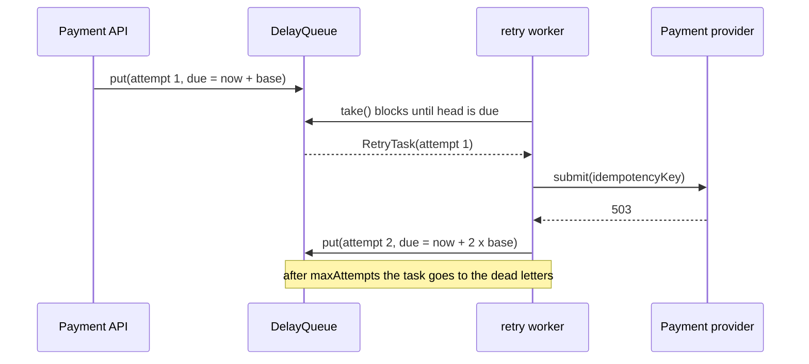

# Module 04 - Concurrent Collections

Package root: `module04`. Domain: balances, idempotency keys, payment event pipelines, fraud rules, rate limiting.

## Overview
Concurrent collections are the workhorses of in-memory financial infrastructure: balance caches, idempotency stores,
event queues, retry schedulers and rate limiters. This module shows what each collection guarantees (per-call atomicity,
weakly consistent iteration, blocking and back-pressure), what it does **not** guarantee (atomic *sequences* of calls,
consistent multi-key snapshots, durability, cross-JVM safety), and how to close those gaps. New production-style examples:
a **`DelayQueue` retry scheduler**, a **double-entry ledger with consistent snapshots**, and a **stampede-proof FX rate cache**.

## Learning objectives
- Use `ConcurrentHashMap` atomic operations (`compute*`, `merge`, `putIfAbsent`, `replace(k, old, new)`) correctly.
- Explain weak consistency of CHM iteration, `size()` and bulk operations, and know when a lock is still needed.
- Build producer-consumer and delayed-retry workflows with bounded `BlockingQueue`s and `DelayQueue`.
- Memoize expensive loads without stampedes, cached failures or long work inside a bin lock.
- Decide when an in-memory structure is not enough and a database transaction, row lock or partitioned single writer is required.

## Prerequisites
- Module09 (threads, `synchronized`, executors) and module10 (happens-before). Module03 for single-threaded collections.

## Java version notes
| Feature | Status | Where |
|---|---|---|
| `java.util.concurrent` collections, `LongAdder`, `CompletableFuture` | Java 8+ | all packages |
| Records, pattern matching for `instanceof` | **Java 17** | `ledger`, `cache`, `delay` |
| `Thread.ofPlatform()` builder | **Java 21** final (preview in 19/20) | `queues.PaymentEventPipeline`, `delay.PaymentRetryScheduler` |
| Module compiled with `--release 21` | build setting | replace `Thread.ofPlatform()` with `new Thread(...)` to run on 17 |

## The one rule
**A thread-safe collection makes each *call* atomic, not your *sequence* of calls.**
`map.get(k)` followed by `map.put(k, v+1)` is a race on `ConcurrentHashMap` exactly as on `HashMap`;
the only difference is that CHM will not corrupt its internal structure.

## BAD vs GOOD
```java
// BAD - module04.chm.BrokenBalanceStore: check-then-act on CHM
BigDecimal current = balances.get(id);
balances.put(id, current.add(amount));      // lost update
```
```java
// GOOD - module04.chm.BalanceStore
balances.merge(id, amount, BigDecimal::add);                 // atomic credit
balances.computeIfPresent(id, (k, bal) -> {                   // atomic debit with invariant
    if (bal.compareTo(amount) < 0) throw new InsufficientFundsException(...);
    return bal.subtract(amount);
});
balances.replace(id, expected, newValue);                     // CAS-style optimistic update
```

## What is in the module
| Package | Class | Lesson |
|---|---|---|
| `chm` | `BalanceStore` | `putIfAbsent`, `merge`, `computeIfPresent`, `replace(k,old,new)` retry loop; `values()` is weakly consistent |
| `chm` | `BrokenBalanceStore` | get+put loses updates (test shows total <= expected) |
| `idempotency` | `IdempotencyCache` | `compute` claims the key once; TTL + lazy/eager purge; 32 concurrent callers run the operation once |
| `queues` | `PaymentEventPipeline` | `ArrayBlockingQueue` back-pressure (`put` blocks, `offer(timeout)` reports), poison pill shutdown; `ConcurrentLinkedQueue` never blocks |
| `cow` | `FraudRuleRegistry` | `CopyOnWriteArrayList`: snapshot iteration, writes copy the array, read-mostly only |
| `races` | `LostUpdateDemo` | HashMap vs CHM get+put vs `merge` vs `LongAdder` |
| `ratelimiter` | `SlidingWindowRateLimiter` | per-key timestamp deque + CHM; exact limit under 16 threads |

## Rate limiter design notes
- **Fixed window** - cheap, but allows 2x burst at the boundary.
- **Sliding log** (this module) - exact, O(limit) memory per key, O(evictions) per call.
- **Sliding counter / token bucket** - O(1) memory, approximate; see module15 P07 and module17.
- Per-key `synchronized(deque)` keeps contention local; the CHM only guards the key -> deque mapping.
- `purgeIdleKeys()` matters: without it the map grows with every customer id ever seen.

## Key Takeaways
- Use `compute*/merge/putIfAbsent/replace` for compound actions; never get-then-put.
- Functions passed to `compute*` must be short, side-effect-free and must **not** touch the same map (deadlock / `IllegalStateException: Recursive update`).
- `size()`, `isEmpty()`, iteration on CHM are weakly consistent; fine for monitoring, not for money.
- Bounded blocking queues give back-pressure; unbounded ones trade it for an OOM risk.
- `CopyOnWriteArrayList` for listeners/rules; `Collections.synchronizedList` or a lock for write-heavy lists.
- `LongAdder` beats `AtomicLong` under heavy contention for counters you only read occasionally.

## Cheat Sheet
| Need | Pick |
|---|---|
| Concurrent map | `ConcurrentHashMap` (never `Hashtable`/`synchronizedMap` for throughput) |
| Sorted concurrent map | `ConcurrentSkipListMap` |
| Bounded producer/consumer | `ArrayBlockingQueue` / `LinkedBlockingQueue(capacity)` |
| Lock-free unbounded queue | `ConcurrentLinkedQueue` |
| Hand-off | `SynchronousQueue` |
| Delayed delivery | `DelayQueue` |
| Read-mostly list/set | `CopyOnWriteArrayList` / `CopyOnWriteArraySet` |
| Hot counter | `LongAdder` |

## 10 Interview Q&A
1. **How does CHM achieve thread safety in Java 8+?** CAS on bin heads for inserts into empty bins, `synchronized` on the first node of a non-empty bin, no global lock; reads are lock-free volatile reads.
2. **Why can't you `put(k, get(k)+1)` on CHM?** Two separate atomic operations; a writer may interleave. Use `merge`.
3. **Can `computeIfAbsent` deadlock?** Yes if the mapping function modifies the same map (recursive update) or blocks for long - it holds the bin lock.
4. **Is `size()` accurate on CHM?** It is an estimate under concurrent modification (uses `LongAdder`-style counter cells).
5. **BlockingQueue `put` vs `offer` vs `add`?** `put` blocks, `offer` returns false (or times out), `add` throws when full.
6. **How do you stop consumers cleanly?** Poison pill per consumer, or interrupt + `take()` throws `InterruptedException`.
7. **When is `CopyOnWriteArrayList` wrong?** Frequent writes or large lists: each write is O(n) allocation.
8. **Sliding window vs token bucket?** Sliding log is exact but O(limit) memory; token bucket is O(1) and allows controlled bursts.
9. **How do you make an idempotent payment endpoint?** Client sends an idempotency key; server claims it atomically (`compute`/`putIfAbsent` or a DB unique constraint) and returns the stored response for retries.
10. **`LongAdder` vs `AtomicLong`?** `AtomicLong` CAS-spins on one cell; `LongAdder` stripes across cells and sums on read. Prefer `LongAdder` for write-heavy counters.

## Exercises for the reader
1. Add a `transfer(from, to, amount)` to `BalanceStore` that is atomic across two keys (hint: lock ordering or a two-phase reserve).
2. Make `IdempotencyCache` store in-flight markers so a second caller waits on a `CompletableFuture` instead of blocking inside `compute`.
3. Replace the deque in `SlidingWindowRateLimiter` with a fixed-size ring buffer and measure the allocation difference.

---

## Production deep dive

### Example 1: `delay.PaymentRetryScheduler` (`DelayQueue`)

**Why it matters.** Downstream rails (card schemes, SEPA gateways, PSPs) have transient outages. One worker thread plus a
`DelayQueue` serves thousands of pending retries without a sleeping thread per payment.
**Expected behaviour.** Backoff is `base x 2^(attempt-1)` capped at `maxDelay` (no overflow at large attempt numbers). A throwing
submitter does not kill the worker. Exhausted tasks land in `deadLetters()`. `shutdown()` *returns* pending tasks for persistence.
**Failure scenarios.**
- *JVM crash:* every pending retry is lost. Production stores `next_attempt_at` in a DB row (polled with `SKIP LOCKED`) or uses a broker with delayed redelivery.
- *Non-idempotent downstream:* a timeout does not mean failure. The first attempt may have succeeded, so the same idempotency key is sent on every attempt.
- *Thundering herd:* many payments failing at the same instant retry at the same instant. Add jitter (module12 `AsyncRetry`).
**Gotcha.** `DelayQueue.drainTo` only moves **expired** elements, so `shutdown()` iterates and removes instead.

### Example 2: `ledger.InMemoryDoubleEntryLedger`
**Why it matters.** Double-entry bookkeeping makes errors *detectable*: the sum of all balances is constant, and each account's
entries explain its balance. A concurrency bug shows up as a broken invariant rather than a silently wrong number.

| Concern | Mechanism | Why not just CHM? |
|---|---|---|
| Atomic two-account update | per-account `ReentrantLock`, acquired in id order | `compute` is atomic for **one** key only |
| No deadlock A->B vs B->A | global lock ordering | n/a |
| Consistent snapshot of all balances | `ReentrantReadWriteLock`: transfers take read, snapshot takes write | CHM iteration may see the debit without the credit |
| Duplicate submissions | `putIfAbsent(ref)` claim; released on business failure | n/a |

**Tests prove:** 12 threads x 2,000 random transfers across overlapping accounts finish (no deadlock), money is conserved,
no account goes negative, every account's entries explain its balance, and an auditor thread taking snapshots *during* the
traffic never sees an inconsistent total. Sixty-four concurrent submissions of the same reference post exactly once.
**Trade-offs.** The snapshot pauses writers briefly (fine for periodic audits, not for per-request reads). A duplicate that
arrives while the original is still in flight gets `DUPLICATE` even if the original later fails, so clients should query the status
rather than assume success.

### Example 3: `cache.FxRateCache` (memoizer)
**Why it matters.** At market open, hundreds of quote requests hit a cold cache simultaneously. Without a memoizer each one
calls the rate provider (a stampede), which can trip its rate limit and take pricing down.
**Mechanism.** `compute` atomically installs a `CompletableFuture`; the winner loads **outside** the bin lock; all others
`join()` the same future. Failures are removed with `remove(key, entry)` (only *our* entry), so they are not cached for the TTL.
**Edge cases.** An entry is stale exactly at `loadedAt + ttl`. `invalidate` supports push updates. A quote shown to a customer
must carry its own quote id and expiry, so the executed rate equals the quoted rate even if the cache refreshes meanwhile.

## When a concurrent collection is NOT enough
| Requirement | In-memory tool | What production needs |
|---|---|---|
| Atomic update of one key in one JVM | CHM `compute`/`merge` | same, or a DB conditional `UPDATE ... WHERE balance >= ?` |
| Atomic update of several keys | ordered locks (this module) | one DB transaction; row locks in a fixed order |
| Survive a restart | nothing | DB / log / broker persistence |
| Several service instances | nothing: each JVM has its own map | DB constraints, partitioned single writer (Kafka key = account), or a lease-based distributed lock **with fencing tokens** |
| Exactly-once effect | `putIfAbsent` claim | unique constraint on the idempotency key + transactional outbox; consumers deduplicate |
| Audit trail | in-memory entry list | append-only ledger table, immutable and retained per regulation |

> An in-memory Java structure **never** guarantees consistency across processes or machines. Treat every class in this
> module as a building block *inside* one node, behind a durable source of truth.

## Common pitfalls
- `get` then `put` on CHM (lost update); `containsKey` then `put` (double insert).
- Long or blocking work (HTTP, DB) inside `compute`/`computeIfAbsent`: it holds the bin lock and stalls unrelated keys.
- Modifying the same map inside its own `compute` function: `IllegalStateException: Recursive update`, or a livelock.
- Treating `size()`, `isEmpty()` or iteration totals as exact for accounting.
- Unbounded `LinkedBlockingQueue` / `ConcurrentLinkedQueue` as a work queue: no back-pressure, ending in an OOM.
- `CopyOnWriteArrayList` for write-heavy data: O(n) copy per write.
- Caching exceptions in a memoizer; never expiring entries (stale FX rates, memory leak).
- Retrying money movement without an idempotency key.

## Production checklist
- [ ] Every compound action is a single atomic call or guarded by an explicit lock.
- [ ] Multi-key invariants use ordered locking (or the DB), and tests assert the invariant under contention.
- [ ] Queues are bounded; the rejection or back-pressure behaviour is defined and monitored (queue depth metric).
- [ ] Retry state is persisted; retries are bounded, backed off with jitter and idempotent; dead letters are alerted on.
- [ ] Caches have TTL plus invalidation, do not cache failures, and expose hit/miss/load-time metrics.
- [ ] Documentation states clearly which guarantees are per-JVM and which come from the database or broker.
