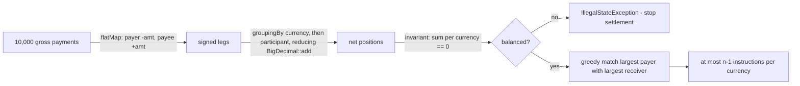

# Module 06 - Streams and Functional Programming

Package root: `module06`. Domain: transaction statements, risk reports, FX conversion batches.

## Overview
Streams are how most reporting, reconciliation, risk and statement code is written in modern Java. They are also a
common source of subtle money bugs: `double` sums, `toMap` collisions, side effects that silently do not run,
and parallel streams sharing mutable state. This module builds the mental model (lazy, vertical, single-use pipelines),
covers every important collector, and applies them to **multilateral netting for settlement** (`settlement.NettingEngine`)
and an **AML structuring rule** (`aml.StructuringDetector`).

## Learning objectives
- Predict execution order and laziness of a pipeline, and know which operations are stateful barriers.
- Use `groupingBy`/`partitioningBy`/`toMap`/`teeing`/`reducing` with correct downstream collectors and map factories.
- Aggregate `BigDecimal` exactly and deterministically (ordering matters for audit reports).
- Decide when a parallel stream helps and when it is wrong (shared state, I/O, common pool contention).
- Use `Optional` correctly (as a return type, never as a field, parameter or collection element).

## Prerequisites
- Lambdas and functional interfaces; module03 collections; module02 `BigDecimal` rules.

## Java version notes
| Feature | Status | Where |
|---|---|---|
| Streams, collectors, `Optional` | Java 8+ | everywhere |
| `Collectors.teeing` | Java 12 | `collectors` |
| `Stream.toList()` (unmodifiable), `mapMulti` | Java 16 | `aml`, tests |
| Records as grouping keys | **Java 17** | `aml.StructuringDetector.AccountDay` |
| Gatherers (`Stream.gather`) | Java 22+ preview, **not** available in 17/20/21 | mention only |

## Mental model
A stream is a lazy pipeline: *source -> intermediate ops -> terminal op*. Elements flow **one at a time**
through all stages (vertical processing) until a stateful barrier (`sorted`, `distinct`) or the end.
Nothing runs without a terminal operation, and a stream can be consumed once.

## Map of the module
| Package | Contents |
|---|---|
| `basics` | `filter/map/flatMap/sorted/reduce/max/anyMatch`, `IntStream`, top-N by grouped volume |
| `collectors` | `groupingBy` (with downstream + map factory), `partitioningBy`, `toMap` with/without merge, `joining`, `teeing`, nested grouping, custom `summingBigDecimal` collector |
| `lazy` | execution trace proving laziness, infinite `Stream.iterate` + `limit`, `sorted` barrier, single-use |
| `parallel` | associativity requirement, shared-state bug, `collect` vs `forEach`, dedicated `ForkJoinPool` |
| `pitfalls` | `double` for money, `toMap` NPE on null values, `Optional.get`, side effects elided by `count()` |
| `exercise1` | `RiskReport` per account with flagging |
| `exercise2` | `AccountSummary` monthly statement |
| `exercise3` | `FxConversionResult` batch conversion with partial failure |

## BAD vs GOOD
```java
// BAD: throws IllegalStateException on the second transaction for account A
txs.stream().collect(Collectors.toMap(Transaction::accountId, Transaction::amount));
// GOOD
txs.stream().collect(Collectors.toMap(Transaction::accountId, Transaction::amount, BigDecimal::add));
```
```java
// BAD: shared mutable state from parallel forEach -> lost elements / AIOOBE
List<Integer> out = new ArrayList<>(); range(0, n).parallel().forEach(out::add);
// GOOD
range(0, n).parallel().boxed().collect(toList());
```
```java
// BAD: 0.1 + 0.2 = 0.30000000000000004
amounts.stream().mapToDouble(Double::parseDouble).sum();
// GOOD
amounts.stream().map(BigDecimal::new).reduce(BigDecimal.ZERO, BigDecimal::add);
```
```java
// BAD: since Java 9, count() may skip map() entirely when the size is known
values.stream().map(v -> { counter++; return v; }).count();
```

## Parallel streams: when
Yes: large in-memory `ArrayList`/array/range, CPU-bound, stateless, associative reduction, no I/O, you measured.
No: small collections, I/O or blocking calls (starves the common pool), `LinkedList`/`Iterator` sources, order-dependent logic,
anything in a latency-sensitive request path shared with other code using the common pool.

## Key Takeaways
- Streams are lazy; `peek` for debugging only; side effects belong in `forEach`/`collect`.
- `reduce` needs an identity and an associative, stateless operation. `BigDecimal::add` is fine; `(a,b) -> a-b` is not.
- `toMap` throws on duplicate keys and NPEs on null values; always pass a merge function.
- `groupingBy` with a downstream collector replaces most manual map-building.
- `Collectors.teeing` does two aggregations in one pass.
- Use `Optional.orElseThrow(Supplier)` with a message, never bare `get()`.
- Loops are fine. Streams are for declarative transformations, not for everything.

## Cheat Sheet
| Need | Stream idiom |
|---|---|
| sum money | `.map(Tx::amount).reduce(ZERO, BigDecimal::add)` |
| group + sum | `groupingBy(key, reducing(ZERO, mapper, BigDecimal::add))` |
| group + count | `groupingBy(key, counting())` |
| two buckets | `partitioningBy(predicate)` |
| key -> value | `toMap(k, v, merge)` |
| top-N | `.sorted(cmp.reversed()).limit(n)` |
| first match | `.filter(p).findFirst()` |
| flatten | `.flatMap(List::stream)` |
| avoid boxing | `IntStream`/`LongStream`/`mapToInt` |
| CSV | `.collect(joining(",", "[", "]"))` |

## 10 Interview Q&A
1. **Intermediate vs terminal operations?** Intermediate return a stream and are lazy (`filter`, `map`, `sorted`); terminal trigger execution (`collect`, `reduce`, `forEach`, `count`).
2. **What is a stateful intermediate op?** One that needs to see all/previous elements: `sorted`, `distinct`, `limit`, `skip`. They break pure vertical processing.
3. **Why must `reduce`'s operator be associative?** Parallel execution splits the source and combines partial results in an arbitrary tree; non-associative ops give different answers.
4. **Which thread pool do parallel streams use?** The common `ForkJoinPool` (parallelism = cores - 1). Blocking in it starves every other parallel stream in the JVM.
5. **How do you sum `BigDecimal` with a collector?** There is no `summingBigDecimal`; use `reducing(ZERO, mapper, BigDecimal::add)` or a custom `Collector.of`.
6. **What does `Collectors.toMap` do on duplicate keys?** Throws `IllegalStateException` unless you provide a merge function.
7. **`findFirst` vs `findAny`?** `findFirst` respects encounter order (slower in parallel); `findAny` returns any element.
8. **Why avoid side effects in lambdas?** The runtime may reorder, elide (`count()`), or run them concurrently; results become non-deterministic.
9. **`Stream.iterate` vs `Stream.generate`?** `iterate` builds each element from the previous (needs `limit`/`takeWhile`); `generate` uses a supplier.
10. **When is a `for` loop better?** Index-based logic, early exit with complex state, hot paths where allocation matters, or when the stream version is harder to read.

## Exercises for the reader
1. Add `RiskReport.byCurrency` producing `Map<String, List<AccountRisk>>` with `groupingBy` + downstream `collectingAndThen`.
2. Implement `AccountSummary.dailyRunningBalance` returning a `TreeMap<LocalDate, BigDecimal>` using a sequential scan (why not a stream?).
3. Make `FxConversionResult.convertAll` parallel and prove with a test that totals are identical to the sequential run.

---

## Production deep dive

### Example 1: `settlement.NettingEngine` (multilateral netting)

**Why it matters.** Clearing houses and treasury teams settle *net* positions: fewer transfers, lower liquidity
needs and lower fees. A wrong net position means real money sent to the wrong bank.
**Expected behaviour.** Positions are grouped per currency (never netted across currencies), flat participants are
dropped, and `TreeMap` factories make output ordering deterministic. A randomised test with 10,000 payments proves that
replaying the instructions reproduces exactly the net positions.
**Failure scenarios.** An unbalanced input (corrupt or partial file) throws instead of producing instructions. Settlement
must stop, not "settle what we can". Netting is only legally valid under a netting agreement; this is the arithmetic, not the legal construct.

### Example 2: `aml.StructuringDetector`
**Why it matters.** Splitting cash deposits to stay under a reporting threshold is itself a reportable offence in most
jurisdictions. Detection rules like this feed case management for human analysts.
**Techniques.** A record `AccountDay` as a composite grouping key (no `accountId + "|" + date` strings), filtering *before*
grouping to shrink the data, ordering alerts by total and then a stable key, and `Optional` only as a return type.
**Edge cases.** The band is inclusive at the bottom and exclusive at the threshold (tested at `8999.99` / `9000` / `9999.99`).
Non-cash deposits and different days are not combined. Production rules use rolling windows across days and channels.
**Security and privacy.** Alerts contain personal data and are subject to "tipping-off" restrictions: never expose them to
the customer, log them minimally, and restrict access by role.

## Stream rules for money
| Rule | Why |
|---|---|
| Sum with `reduce(BigDecimal.ZERO, BigDecimal::add)` or `reducing(...)` | `mapToDouble().sum()` loses cents |
| Use `toMap(k, v, merge)` or `groupingBy` | `toMap` without a merge function throws on duplicate keys |
| Use `TreeMap::new` / `LinkedHashMap::new` factories for reports | `HashMap` order is unspecified and changes |
| No side effects in `map`/`filter`/`peek` | they may be elided (`count()` on a sized stream skips `peek`) |
| Parallel only for CPU-bound, large, associative work, measured | the common pool is shared by the whole JVM |
| Don't `.get()` an `Optional` | use `orElseThrow(() -> new DomainException(...))` |

## Common pitfalls
- `Collectors.summingDouble` on amounts, or `BigDecimal.doubleValue()` inside a pipeline.
- `groupingBy` producing a `HashMap`, then the report order flips between runs.
- `Collectors.toMap` NPE when a value is `null`.
- Blocking I/O (HTTP, DB) inside a parallel stream: it starves the common `ForkJoinPool` for unrelated code.
- Reusing a consumed stream (`IllegalStateException`).
- Long pipelines nobody can debug. Extract named methods and intermediate records.

## Production checklist
- [ ] Money aggregations are exact (`BigDecimal`) and checked by an invariant (totals, zero-sum).
- [ ] Output ordering is deterministic for anything a human or auditor compares.
- [ ] No hidden side effects; no parallel streams without a benchmark and a dedicated pool.
- [ ] Large datasets are processed in streaming fashion from the DB, not materialised in memory.
