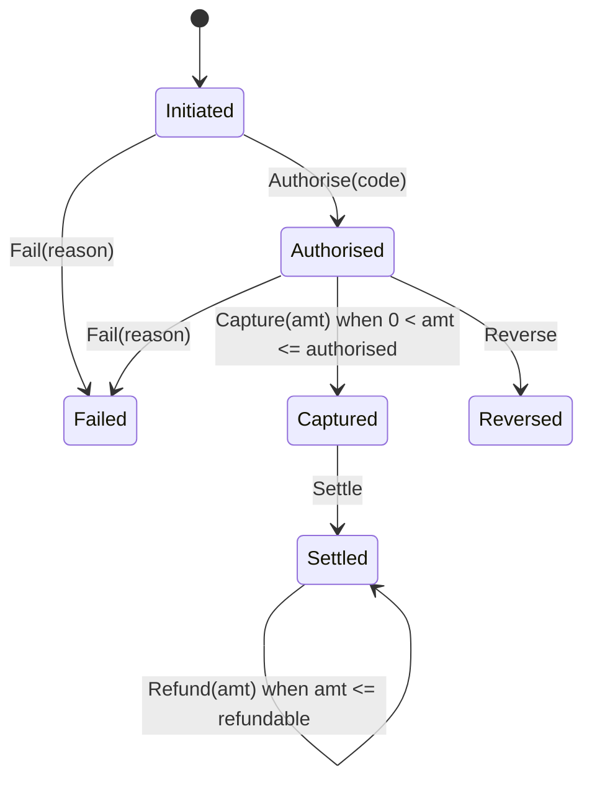

# Module 07 - Modern Java (17 and 21 language features)

Package root: `module07`. Domain: payment requests, payment results, payouts, fee tiers.
The POM sets `maven.compiler.source/target` properties to 17 but the compiler plugin overrides them to 21, so this module
also uses record patterns and pattern-matching `switch`, which became final in Java 21.

## Overview
Java 17 is the baseline LTS of most banks today; Java 21 is the next LTS. Java 19 and 20 were short-lived feature releases in
which several of today's key features were *previews*. This module shows each feature with a payments use case, and
clearly labels what compiles on 17, what needs 21, and what was preview-only in 19/20. New examples: a **sealed transaction
lifecycle state machine** written twice (Java 21 record patterns vs Java 17 `instanceof`, proven equivalent), and a
**text-block ISO 20022 message renderer** that is safe against XML injection.

## Learning objectives
- Model domain states as sealed hierarchies of records so illegal states are unrepresentable.
- Write exhaustive `switch` expressions with record patterns and `when` guards (21), and the Java 17 equivalent.
- Use text blocks safely: formatting, escaping, and why string templating untrusted data is an injection risk.
- Explain the Java 17 -> 20 -> 21 feature timeline when migrating a codebase.

## Prerequisites
- Module01/02 (value objects), module05 (generics, sealed `Result`).

## Java version map (read this before using a feature)
| Feature | Java 17 | Java 19 / 20 | Java 21 |
|---|---|---|---|
| Records, sealed classes, `instanceof` patterns, text blocks, switch expressions | **final** | final | final |
| Pattern matching for `switch` (`case Type t when ...`, `case null`) | preview (2nd) | preview (3rd/4th) | **final** (JEP 441) |
| Record patterns (`case Point(var x, var y)`) | not available | preview (JEP 405 / 432) | **final** (JEP 440) |
| Virtual threads | not available | preview (JEP 425 / 436) | **final** (JEP 444), see module13 |
| Sequenced collections | not available | not available | **final** (JEP 431) |
| Unnamed variables `_` | not available | not available | preview in 21, final in 22 |

This module's POM compiles with `source/target 21`. `lifecycle.TransactionLifecycle#applyJava17` shows the 17-compatible
form of the same logic.

## Features and where to find them
| Feature | Since | Class | Fintech use |
|---|---|---|---|
| Records | 16 | `records.Money`, `records.PaymentRequest` | immutable DTOs/value objects, compact-constructor validation, local records in streams |
| Sealed types | 17 | `sealed.PaymentResult` | closed set of outcomes, exhaustive handling |
| `instanceof` patterns | 16 | `patterns.PatternMatching#routeInstanceof` | no cast boilerplate, flow scoping |
| Record patterns + `switch` patterns | 21 | `patterns.PatternMatching#describe`, `sealed.ResultHandler` | nested deconstruction, guards (`when`), `case null` |
| Switch expressions | 14 | `switches.SwitchExpressions` | no fall-through, exhaustive enums, `yield` |
| Text blocks | 15 | `textblocks.TextBlocks` | JSON/SQL templates, `formatted`, `\` and `\s` escapes |
| Java 8 vs 17 | - | `java8vs17.Java8Vs17` | `List.of`, `var`, `Optional.or`, `takeWhile`, `toList`, `String.lines/strip/repeat`, records vs classes |

## BAD vs GOOD
```java
// Java 8: cast after instanceof, silent fall-through on missing break
if (o instanceof Card) { Card c = (Card) o; ... }
switch (tier) { case STANDARD: n = 1; /* forgot break */ case PLUS: n = 3; break; }
```
```java
// Java 17/21
if (o instanceof Card c && c.scheme().equals("AMEX")) ...
int n = switch (tier) { case STANDARD -> 1; case PLUS -> 3; case PREMIUM, METAL -> 10; };
```
```java
// instanceof chain with default that hides a missing case
if (r instanceof Success) ... else if (r instanceof Declined) ... else return "unknown";
// exhaustive switch over a sealed type: adding a subtype is a compile error here
return switch (r) { case Success s -> ...; case Declined d -> ...; case Pending p -> ...; case Failed f -> ...; };
```

## Records: what interviewers probe
- Compact constructor assigns to *parameters*; the fields are assigned afterwards. Normalise/validate there.
- Records are shallowly immutable: `List.copyOf` your collection components.
- You can add static factories, instance methods, nested records, implement interfaces; you cannot add instance fields or extend a class.
- An accessor override must return the component type exactly; expose an `Optional` view under another name (`optionalReference()`).
- Records are implicitly `final` and have a canonical constructor; `equals` compares components (BigDecimal scale matters!).

## Sealed + switch: exhaustiveness rules
- Selector is a sealed interface/enum -> no `default` required; compiler checks all permitted subtypes.
- Guards (`when`) do not count toward exhaustiveness; an unguarded case for the same type must follow.
- `case null` must be explicit or the switch throws `NullPointerException`.
- Dominance: a more specific pattern must come before a more general one, or compilation fails.

## Key Takeaways
- Records + sealed interfaces = algebraic data types; pair them with switch patterns for safe domain modelling.
- Avoid `default` in switches over sealed/enum types so new cases fail at compile time.
- Text blocks keep SQL/JSON readable; still use parameters, never string-concatenate user input.
- `List.of`/`Map.of` are immutable and reject nulls; `Arrays.asList` is fixed-size but mutable in place.
- `var` is for local inference; keep it where the right-hand side makes the type obvious.
- `Stream.toList()` returns an unmodifiable list; `Collectors.toList()` makes no such promise.

## Cheat Sheet
| Idiom | Java 8 | Java 17/21 |
|---|---|---|
| immutable list | `unmodifiableList(new ArrayList<>(...))` | `List.of(...)` |
| data class | 40 lines | `record` |
| type test | `instanceof` + cast | `instanceof T t` / `case T t ->` |
| closed hierarchy | docs + `default` | `sealed ... permits` |
| multi-line string | `+ "\n" +` | `"""` text block |
| conditional switch | statement + `break` | expression + `->` + `yield` |
| optional fallback | `isPresent()/get()` | `or()`, `orElseThrow()`, `ifPresentOrElse()` |

## 10 Interview Q&A
1. **Can a record have a mutable field?** No instance fields beyond components; components are `final`. The referenced object may still be mutable, so copy collections.
2. **Difference between compact and canonical constructor?** Compact omits the parameter list and assigns fields implicitly after the body; canonical is explicit. Use compact for validation/normalisation.
3. **Why sealed instead of an enum?** Variants can carry different data (`Success` has an auth code, `Declined` a reason); enums share one shape.
4. **What does `permits` do if omitted?** Permitted subclasses are inferred from the same compilation unit (file).
5. **Can a sealed interface have non-final implementations?** Yes: `final`, `sealed`, or `non-sealed` must be declared on each permitted subtype; records are implicitly final.
6. **What does a switch do with `null`?** Throws NPE unless `case null` (or `case null, default`) is present.
7. **Why can't you fall through in arrow switches?** Arrow form has no fall-through by design; use `case A, B ->` for shared bodies.
8. **How does a text block treat indentation?** Common leading whitespace (relative to the closing delimiter and least-indented line) is removed; trailing spaces are stripped unless escaped with `\s`.
9. **`List.of()` vs `Arrays.asList()`?** `List.of` is fully immutable and null-hostile; `Arrays.asList` is a fixed-size view over the array that allows `set`.
10. **Is `var` dynamic typing?** No, it is compile-time inference; the variable has exactly one static type.

## Exercises for the reader
1. Add `PaymentResult.Reversed(paymentId, originalAuthCode)` and fix every compile error the compiler reports.
2. Write `Money.allocate(int parts)` that splits a sum without losing pennies (largest remainder) and test with 100.00 / 3.
3. Convert `PatternMatching.routeOld` callers to a single switch with record patterns and a `case null`.

---

## Production deep dive

### Example 1: sealed lifecycle state machine (`module07.lifecycle`)

**Why it matters.** A card transaction is not "paid or not paid". Holds, partial captures (hotel, fuel), reversals and
partial refunds all exist, and over-capture or over-refund is direct financial loss. Each state is a record carrying only
the fields that are valid in that state, so "a reversed transaction with a capture amount" cannot even be constructed.

**Java 21 version** (`apply`): one `switch` over a local `record Transition(state, cmd)`, deconstructed with nested
record patterns. Guards (`when amt.compareTo(auth) <= 0`) keep business limits next to the transition they protect.
The final `case Transition t` handles every illegal pair. Because `TxState` and `TxCommand` are sealed, adding a new
state forces you to revisit this switch.

**Java 17 version** (`applyJava17`): the same rules with `instanceof` patterns. It works, but the compiler cannot
check exhaustiveness, which is exactly the class of bug sealed types plus `switch` patterns eliminate.
A test runs **every (state, command) pair through both implementations** and asserts identical results (or identical
exceptions). This is a cheap, powerful technique when migrating logic between Java versions.

**Edge cases.** Capturing zero or more than authorised, refunding more than the remaining refundable amount, any command
on a terminal state (`Reversed`, `Failed`). All throw, and none mutate anything, because the function is pure.

**Production notes.** The transition function is pure, so it can be replayed from an event log (event sourcing) and used
identically by the API and by a reconciliation job. Persist the state with a version column. Two concurrent refunds must not
both pass the `refundable` guard, so that check needs the DB row lock or optimistic version (module01 `hexagonal`).

### Example 2: text blocks and injection (`module07.messages.CreditTransferMessage`)
- Text blocks remove incidental indentation and keep a trailing newline. Tests pin both behaviours.
- **Security:** `TEMPLATE.formatted(name)` with `name = "</Nm></Dbtr><Cdtr><Nm>Mallory"` would forge a second creditor.
  Every free-text field is XML-escaped, control characters are dropped, and lengths are truncated to scheme limits (140).
- `BigDecimal.toString()` may produce `1E+3`. Use `toPlainString()` in messages and files.
- Production: use a schema-bound marshaller and validate against the official XSD. Templates are for tests and docs.

## Common pitfalls
- `default ->` in a switch over a sealed type: it silently swallows newly added states. Prefer exhaustive cases.
- Records exposing mutable components (`List`, arrays). See module02.
- Using `--enable-preview` features in production code: preview APIs can change or disappear between releases (they did between 19, 20 and 21).
- Pattern variables shadowing fields, or overly clever nested patterns nobody can review.
- String-formatting SQL, XML or JSON with untrusted input, regardless of how nice text blocks look.

## Production checklist
- [ ] State machines are explicit: sealed states, pure transition function, illegal transitions tested.
- [ ] Monetary guards (capture <= authorised, refund <= refundable) are enforced in the transition *and* backed by DB concurrency control.
- [ ] No preview features in production builds; the target Java version is documented in the POM and README.
- [ ] All generated messages escape untrusted text and are validated against their schema.
