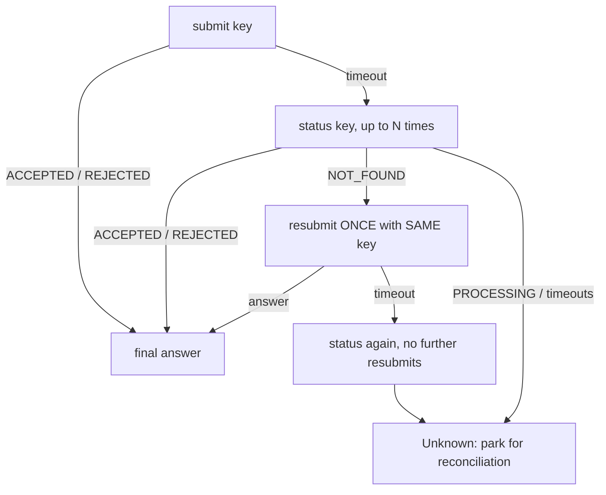

# Module 08 - Exceptions and Error Handling

Package root: `module08`. Domain: payment failures, provider outages, ledger resources, API error bodies.

## Overview
In payments, error handling *is* business logic. A swallowed exception can mean a lost payment; a retried
non-idempotent call can mean a double payment; an exception message can leak a card number into logs. This module
covers the exception hierarchy, wrapping and translation, try-with-resources, retry plus circuit breaker, and API error
bodies. It then adds three production concerns: **accumulating validation at the API boundary**, **log sanitisation**
(PCI/GDPR), and the hardest one, **ambiguous outcomes**: what to do when a payment call times out.

## Learning objectives
- Design a domain exception hierarchy with error codes and retryability, and translate technical exceptions at boundaries.
- Choose between exceptions and result values (fail-fast invariants vs accumulated validation).
- Never leak sensitive data through exception messages or logs; defend against log injection.
- Handle timeouts on money movement correctly: query status by idempotency key, resubmit only when provably safe, park unknowns.

## Prerequisites
- Module01 (domain design), module07 (sealed types and switch).

## Java version notes
| Feature | Status | Where |
|---|---|---|
| try-with-resources, multi-catch, suppressed exceptions | Java 7+ | `resources`, `circuitbreaker` |
| Sealed result types, records, enhanced `switch` | **Java 17** | `validation`, `ambiguity` |
| Helpful NullPointerException messages (on by default) | Java 15+ | runtime behaviour, see pitfalls |
| Module compiled with `--release 21` | build setting | new code uses only Java 17 features |

## The hierarchy
```
Throwable
 +- Error                         -> LedgerCorruptedError (never catch; fail fast)
 +- Exception (checked)           -> IOException, TimeoutException (caller must handle)
     +- RuntimeException          -> PaymentException (domain root, unchecked, has code() + retryable())
         +- InsufficientFundsException   402, not retryable
         +- InvalidPaymentException      400, not retryable
         +- PaymentProviderException     502/503, retryable flag, wraps the technical cause
```

## BAD vs GOOD
```java
// BAD: swallow
try { return client.authorise(id); } catch (Exception e) { return null; }
// BAD: lose the cause
catch (Exception e) { throw new PaymentProviderException("failed: " + e.getMessage(), null, false); }
// GOOD: translate at the boundary, classify, keep the cause, restore interrupts
catch (SocketTimeoutException | TimeoutException e) { throw new PaymentProviderException("timeout", e, true); }
catch (InterruptedException e) { Thread.currentThread().interrupt(); throw new PaymentProviderException("interrupted", e, true); }
catch (RuntimeException e) { throw e; } // do not double-wrap
```
```java
// BAD: leaks on failure
LedgerConnection c = new LedgerConnection(...); c.write(entry); c.close();
// GOOD
try (LedgerConnection c = new LedgerConnection(...)) { c.write(entry); }
```

## try-with-resources facts proven by tests
- Resources close in **reverse** declaration order (`close replica` before `close primary`).
- If body and `close()` both throw, the body exception propagates and `close()`'s is attached via `getSuppressed()`.
- Java 9+: an effectively final variable can be used directly: `try (existing) { ... }`.
- `finally` is still right for non-resource cleanup (timers, MDC, metrics).

## Circuit breaker (`module08.circuitbreaker.CircuitBreaker`)
```
CLOSED --(N consecutive failures)--> OPEN --(cooldown elapsed)--> HALF_OPEN --success--> CLOSED
                                                                   \--failure--> OPEN (cooldown restarts)
```
- Fail fast while OPEN: `CircuitOpenException` without calling the provider (16 concurrent callers, 0 executed).
- Exactly one trial call in HALF_OPEN (CAS on `trialInFlight`).
- Clock injected as `Supplier<Instant>` so tests are deterministic, no sleeps.
- `RetryPolicy` retries only `retryable()` exceptions and attaches earlier attempts as suppressed.

## API mapping (`PaymentErrorResponse`)
Pattern-matching switch maps exception type -> HTTP status, stable `code`, safe `message`, `retryable`, details.
Unknown exceptions become `500 INTERNAL_ERROR / "Unexpected error"`: internals never leak.

## Key Takeaways
- Checked for recoverable conditions the caller must decide about; unchecked for bugs and business-rule violations; `Error` for broken invariants.
- Always chain the cause. Never `catch (Exception e) {}`. Never `catch (Throwable)` in request paths.
- Restore the interrupt flag when you catch `InterruptedException` and cannot rethrow it.
- Use `try-with-resources` for anything `AutoCloseable`; it handles ordering and suppression correctly.
- Design exceptions with stable codes and a `retryable` flag; clients and retry policies rely on them.
- Breakers + bounded retries + timeouts are the trio that keeps a payments service alive when a dependency dies.

## Cheat Sheet
| Situation | Do |
|---|---|
| Expected business outcome | return a `Result`/sealed type (module05/07) or throw a domain unchecked exception with a code |
| Infrastructure failure | wrap in domain exception, keep cause, mark retryable |
| Caught `InterruptedException` | `Thread.currentThread().interrupt()` then rethrow/wrap |
| Resource cleanup | try-with-resources |
| Both body and close fail | body wins, close is suppressed |
| Dependency flapping | circuit breaker + bounded retry + timeout |
| HTTP mapping | one place, pattern switch, no internal details |

## 10 Interview Q&A
1. **Checked vs unchecked - when?** Checked when the immediate caller can realistically recover (missing file, retryable I/O); unchecked for programming errors and business rule violations that propagate to a boundary.
2. **Why is swallowing exceptions dangerous in payments?** You lose the signal that money may be in an unknown state; silent `null` returns create reconciliation nightmares.
3. **What is exception chaining?** Passing the original exception as `cause` so the full stack trace survives translation between layers.
4. **What happens if `finally` throws?** It replaces the exception from the `try` block; the original is lost. try-with-resources avoids this via suppression.
5. **Order of `close()` in try-with-resources?** Reverse of declaration.
6. **What is a suppressed exception?** An exception attached to another via `addSuppressed`, used when cleanup fails after a primary failure.
7. **Why restore the interrupt flag?** Thread pools and higher-level code use it to stop work; swallowing it can make shutdown hang.
8. **Circuit breaker states?** CLOSED (normal), OPEN (fail fast), HALF_OPEN (probe). Transition on failure threshold and cooldown.
9. **Retry everything?** No. Retry only idempotent operations with retryable failures, with bounded attempts and backoff; never retry 4xx-class errors.
10. **Cost of exceptions?** Creating one captures the stack trace (expensive); throwing/catching in hot paths is slow. Do not use exceptions for control flow.

## Exercises for the reader
1. Add exponential backoff with jitter to `RetryPolicy` using an injected `Sleeper` interface so tests stay fast.
2. Make `CircuitBreaker` count failures in a sliding window (rate-based) instead of consecutive failures.
3. Add a `traceId` to `PaymentErrorResponse` and prove it is present for every mapped exception.

---

## Production deep dive

### Example 1: `validation.PaymentRequestValidator`, accumulate at the boundary
| Style | Use for | Example |
|---|---|---|
| Fail-fast exception | Internal invariants that should never be violated | `Money` constructor, aggregate methods |
| Accumulated result | Untrusted input at the API edge | this validator returns `Valid` or `Invalid(List<FieldError>)` |

**Expected behaviour.** All errors are returned in a stable order, each with `field`, a machine-readable `code` and a `hint`.
IBANs are checked with ISO 13616 mod-97. Debtor and creditor must differ (after normalising case and spaces). Amounts must be
positive, have at most 2 *significant* decimals (`10.500` is fine) and stay under the single-payment limit. The reference must
use the SEPA character set.
**Security.** Hints never echo submitted values: rejected input is exactly where PANs, scripts and injection payloads hide.

### Example 2: `redaction.LogSanitizer`, the safety net
- PANs are masked only if they pass **Luhn**, so order numbers and timestamps stay readable.
- IBANs keep the country, check digits and last 4 characters; e-mails keep only the domain.
- `\r` and `\n` are escaped, which prevents **log forging** (`ref=abc\nINFO payment approved`).
- `describe(Throwable)` sanitises the whole cause chain, where leaks usually hide (a driver exception quoting a SQL parameter).

> Redaction is defence in depth, not a design. The primary controls are: do not put secrets in messages, tokenise PANs at
> the edge, and use structured logging with an allow-list of fields.

### Example 3: `ambiguity.AmbiguousOutcomeHandler`, timeout is not failure

**Why it matters.** The most expensive bug class in payments: the provider executed the payment, the response was lost, and
the client retried as a *new* payment, so the customer paid twice. The opposite bug: the client reported "failed", the
customer paid again elsewhere, and the first payment settled anyway.
**Expected behaviour (all tested).** A timeout followed by `ACCEPTED` produces no second submit. `NOT_FOUND` allows exactly one
resubmission with the same key. A timeout after the resubmit never triggers a third submit. Anything still unresolved
becomes `Unknown`. It is not shown as failed to the customer, and the end-of-day settlement file resolves it (module03 reconciler).

## Error-handling decision table
| Failure | Retry? | Customer sees | Ops action |
|---|---|---|---|
| Validation error (400) | No | field errors | none |
| Insufficient funds / limit (402/422) | No | decline reason | none |
| Provider 503 / connection refused before send | Yes, with backoff + same key | "processing" | alert on rate |
| Read timeout after send | **Only after status check** | "processing" | reconcile unknowns |
| Circuit open | No (fail fast) | "temporarily unavailable" | page if prolonged |
| `Error` (OOM, `LedgerCorruptedError`) | No | 500 | crash, restart, investigate |

## Common pitfalls
- `catch (Exception e) { return null; }` or logging and continuing, so money moves with no record.
- Wrapping without the cause (`new X(e.getMessage())`), which loses the stack trace and root-cause type.
- Catching `InterruptedException` without restoring the interrupt flag.
- Retrying non-retryable errors, or retrying without an idempotency key.
- Treating a timeout as failure (double payment) or as success (phantom payment).
- Exception messages containing PANs, IBANs, emails, tokens or full request bodies.
- Helpful NPE messages (Java 15+) can include variable and field names. Fine internally, but don't return them to API clients.
- Returning stack traces in API error bodies.

## Production checklist
- [ ] Domain exceptions carry a stable code and a `retryable` flag; technical exceptions are translated at adapters.
- [ ] API validation returns all field errors; no input values in messages.
- [ ] Logs go through structured, allow-listed fields; a sanitiser is a second layer; CRLF is escaped.
- [ ] Every money-moving call has an idempotency key, bounded retries with backoff, and a status-query path.
- [ ] Unknown outcomes are parked, alerted and reconciled, never auto-failed or auto-retried as new payments.
