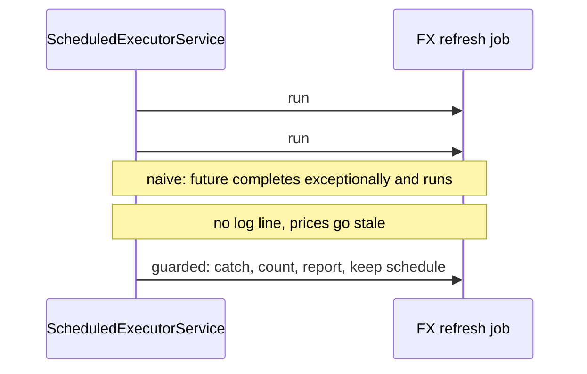

# Module 09 - Concurrency Fundamentals

Package root: `module09`. Domain: settlement workers, balance counters, account transfers, provider call limits.

## Overview
Every payment platform is concurrent: HTTP request threads, settlement workers, schedulers, consumers. This module
builds the fundamentals: thread lifecycle and interruption, `synchronized`/`volatile`/atomics, executors and graceful
shutdown, coordination primitives, and producer-consumer. It then adds two failure modes that cause real incidents:
**periodic jobs that die silently** (`scheduling.ResilientScheduler`) and **request context lost or leaked across thread
pools** (`context.*`).

## Learning objectives
- Explain the guarantees of `synchronized` (atomicity + visibility), `volatile` (visibility + ordering) and atomics.
- Use executors correctly: `Callable`/`Future`, exceptions, timeouts, cancellation, graceful shutdown.
- Coordinate threads with latches, barriers and semaphores, and write deterministic concurrency tests.
- Run periodic jobs that survive failures and make those failures visible.
- Propagate (and clean up) per-request context across thread pools.

## Prerequisites
- Core Java. Module01 (domain model). The JMM theory is in module10; locks and pool sizing are in module11.

## Java version notes
| Feature | Status | Where |
|---|---|---|
| `java.util.concurrent` executors, latches, atomics, `LongAdder` | Java 5/8 | everywhere |
| Records | **Java 17** | `scheduling.ResilientScheduler.JobStats` |
| `ExecutorService` implements `AutoCloseable` (`close()` waits) | **Java 19+** | not used: module compiles with `--release 17` |
| Virtual threads, `ScopedValue` | Java 21 final / 21 preview (19/20 preview/incubator) | module13 |

## Map
| Package | What it proves |
|---|---|
| `threads.ThreadBasics` | start/join, naming, cooperative interruption, `InterruptedException` clears the flag, uncaught handlers, daemon threads |
| `sync.Counters` | `count++` loses updates; `volatile` does not fix it; `synchronized`, `AtomicLong`, `LongAdder` are exact under 8 threads x 50k |
| `sync.VolatileFlag` | the legitimate use of `volatile`: a stop flag |
| `sync.Account` | private lock object, lock ordering for deadlock-free transfers, money conserved under 8 threads |
| `executors.ExecutorDemos` | `invokeAll` order, exceptions via `Future.get`, timeout + `cancel(true)`, graceful shutdown |
| `coordination.Coordination` | `CountDownLatch` start/done gates, `CyclicBarrier` phases with barrier action, `Semaphore` bounded concurrency |
| `producerconsumer.*` | `wait/notifyAll` bounded buffer done right, the broken `if`/`notify` version, poison-pill pipeline with exact totals |

## BAD vs GOOD
```java
// BAD: visibility is not atomicity
private volatile long count; public void increment() { count++; }
// GOOD
private final AtomicLong count = new AtomicLong(); public void increment() { count.incrementAndGet(); }
```
```java
// BAD: if + notify -> stolen wake-ups, spurious wake-ups, overfilled buffer
if (items.isEmpty()) wait(); return items.pollFirst();
// GOOD: while + notifyAll
while (items.isEmpty()) wait(); T item = items.pollFirst(); notifyAll(); return item;
```
```java
// BAD: lock on `this` or a String literal: anyone can lock it, deadlock you, or notify you
synchronized (this) { ... }     synchronized ("LOCK") { ... }
// GOOD
private final Object lock = new Object(); synchronized (lock) { ... }
```
```java
// BAD: two accounts locked in caller order -> A->B and B->A deadlock
synchronized (from.lock) { synchronized (to.lock) { ... } }
// GOOD: global order (by id)
Account first = from.id.compareTo(to.id) < 0 ? from : to; ...
```

## Thread lifecycle in one paragraph
`new` -> `start()` -> RUNNABLE; blocks on monitors (BLOCKED), `wait/join/park` (WAITING / TIMED_WAITING); TERMINATED when `run()` returns or throws.
An uncaught exception kills only that thread and goes to its `UncaughtExceptionHandler`. `interrupt()` sets a flag;
blocking methods throw `InterruptedException` and clear it; CPU loops must poll `isInterrupted()`.

## Executors you should name
| Factory | Queue | Use |
|---|---|---|
| `newFixedThreadPool(n)` | unbounded `LinkedBlockingQueue` | CPU-bound, known parallelism (beware unbounded queue) |
| `newCachedThreadPool()` | `SynchronousQueue`, unbounded threads | short bursty tasks; dangerous under load |
| `newSingleThreadExecutor()` | unbounded | serialise work |
| `newScheduledThreadPool(n)` | delay queue | periodic jobs |
| `new ThreadPoolExecutor(...)` | your choice | production: bounded queue + rejection policy (module11) |

## Key Takeaways
- `synchronized` gives atomicity + visibility; `volatile` gives visibility only; atomics give lock-free atomicity for single variables.
- Always `wait()` in a `while` loop and prefer `notifyAll()`.
- Lock on private final objects; order locks globally when you need more than one.
- Submit `Callable`s and call `get()` so exceptions do not vanish; `execute(Runnable)` sends them to the thread handler.
- Shutdown: `shutdown()` -> `awaitTermination()` -> `shutdownNow()` -> `awaitTermination()`.
- Tests: latches for start/finish, exact totals, bounded waits; never `Thread.sleep` as synchronisation.

## Cheat Sheet
| Primitive | One-shot? | Purpose |
|---|---|---|
| `CountDownLatch` | yes | wait for N events |
| `CyclicBarrier` | reusable | N threads meet, optional action |
| `Semaphore` | n/a | limit permits / admission control |
| `Phaser` | reusable, dynamic | advanced phased work |
| `wait/notifyAll` | n/a | condition waiting on an intrinsic lock |
| `Condition` | n/a | same with `ReentrantLock` (module11) |

## 10 Interview Q&A
1. **Why does `volatile long count; count++` lose updates?** `++` is read, add, write; two threads can read the same value. Volatile only guarantees each read sees the latest write.
2. **What does `synchronized` guarantee?** Mutual exclusion on the monitor and a happens-before edge between unlock and subsequent lock, so writes are visible.
3. **Why `while` around `wait()`?** Spurious wake-ups are allowed by the spec and `notifyAll` wakes threads whose condition may still be false.
4. **`notify` vs `notifyAll`?** `notify` wakes one arbitrary waiter; if it is the wrong kind (a producer when a consumer was needed) the signal is lost. `notifyAll` is safe.
5. **How do you stop a thread?** Interrupt it and have it check `isInterrupted()` / handle `InterruptedException`. `Thread.stop` is removed.
6. **What happens to an exception thrown inside `submit()`?** Captured in the `Future`; rethrown wrapped in `ExecutionException` on `get()`.
7. **Difference between `shutdown` and `shutdownNow`?** `shutdown` stops accepting and drains the queue; `shutdownNow` also interrupts workers and returns queued tasks.
8. **`CountDownLatch` vs `CyclicBarrier`?** Latch counts events and cannot reset; barrier waits for N threads and resets for the next cycle.
9. **Why is `newCachedThreadPool` risky?** Unbounded thread creation under load; prefer a bounded `ThreadPoolExecutor`.
10. **Is `Thread.sleep` a synchronisation tool?** No. It gives no happens-before guarantees and makes tests slow and flaky; use latches/barriers.

## Exercises for the reader
1. Replace `WaitNotifyQueue` internals with `ReentrantLock` + two `Condition`s (`notFull`, `notEmpty`) and keep all tests green.
2. Write a `Phaser`-based version of `phasedSettlement` where workers can leave after phase 1.
3. Add a `Semaphore`-based `RateLimitedProviderClient` with `tryAcquire(timeout)` and test both admit and shed paths.

---

## Production deep dive

### Example 1: `scheduling.ResilientScheduler`, the silent-death trap

**Why it matters.** From the `scheduleAtFixedRate`/`WithFixedDelay` Javadoc: *"If any execution of the task encounters an
exception, subsequent executions are suppressed."* The exception sits inside a `ScheduledFuture` nobody calls `get()` on.
FX rates, interest accrual or timeout sweeps stop silently, which is discovered days later in reconciliation.
**Expected behaviour (tested).** The naive job stops after its first exception (`ExecutionException` visible only via the future).
The guarded job keeps running, and `stats()` exposes `runs`/`failures`, which are what you alert on.
**Trade-offs.** `Error`s are *not* caught: after an `OutOfMemoryError` the JVM state is unknown, so let it crash and restart.
Prefer **fixed delay** for jobs calling external systems; fixed rate "catches up" with bursts after a slow run.
**Distributed caveat.** With three service instances the job runs three times. Singleton jobs (end-of-day interest) need
a DB lease/lock (e.g. ShedLock-style row), and the job itself must be idempotent per business date.

### Example 2: `context.CorrelationContext` + `ContextPropagatingExecutor`
| Bug | Cause | Consequence |
|---|---|---|
| Lost context | `ThreadLocal` is per thread; pool threads start empty | half the payment flow's logs have no trace id |
| Leaked context | task sets the `ThreadLocal`, never removes it; the thread is reused | customer A's data logged under customer B's trace (privacy + audit issue) |

The decorator captures the id **on the submitting thread**, sets it on the worker, and restores the worker's previous
state in `finally`. Tests use a single-thread executor so leaks are deterministic and visible.
Alternatives: `ScopedValue` (Java 21 preview, module13), which is immutable and scope-bound so it cannot leak, or
OpenTelemetry context wrappers in production.

## Concurrency bugs and how to debug them
| Symptom | Likely cause | Tooling |
|---|---|---|
| Totals slightly off under load | lost update (non-atomic read-modify-write) | stress test with exact totals; review compound actions |
| Threads stuck, CPU idle | deadlock or waiting on a never-signalled condition | `jstack <pid>`, `jcmd <pid> Thread.print` (look for "Found one Java-level deadlock") |
| Threads busy, no progress | livelock / spin | repeated thread dumps show changing but useless stacks |
| Some requests always slow | starvation (unfair lock, saturated pool) | pool queue-depth metrics, JFR lock profiling |
| Thread count grows forever | thread leak (executors never shut down, `newCachedThreadPool` under load) | `jcmd Thread.print | grep -c`, JFR thread events |
| Periodic job stopped | exception suppressed the schedule | job run/failure metrics, "last success" timestamp alert |

## Idempotency, ordering and delivery semantics (concepts used throughout modules 04-17)
| Semantics | Meaning | How to get it |
|---|---|---|
| At-most-once | may lose messages, never duplicates | fire-and-forget; acceptable for metrics, **not** for payments |
| At-least-once | never loses, may duplicate | retries + persistence; the default of brokers |
| "Exactly-once" (effectively once) | each message's *effect* applied once | at-least-once delivery **plus** idempotent consumer (dedup by key in the same transaction as the effect) |
| Per-key ordering | events for one account applied in order | single writer per key (partition by account id), see module15 `P17` |

## Common pitfalls
- Swallowing `InterruptedException`, or not restoring the flag.
- Starting threads in constructors (`this` escapes before construction completes).
- `executor.execute(task)` where the exception goes to the uncaught handler and the result is lost; use `submit` + `get`.
- Never shutting down executors, so threads leak and the JVM never exits.
- `Thread.sleep` as synchronisation in tests.
- Periodic tasks without a try/catch; singleton jobs running once per instance.
- `ThreadLocal` without `remove()` on pooled threads.

## Production checklist
- [ ] Every executor is named (thread factory), bounded, monitored and shut down gracefully.
- [ ] Periodic jobs are guarded, emit run/failure/last-success metrics, and are idempotent and leased if singleton.
- [ ] Context (trace id, tenant, user) is propagated explicitly and cleared after use.
- [ ] Concurrency tests use latches and exact invariants, and run repeatedly in CI to catch flakiness.
