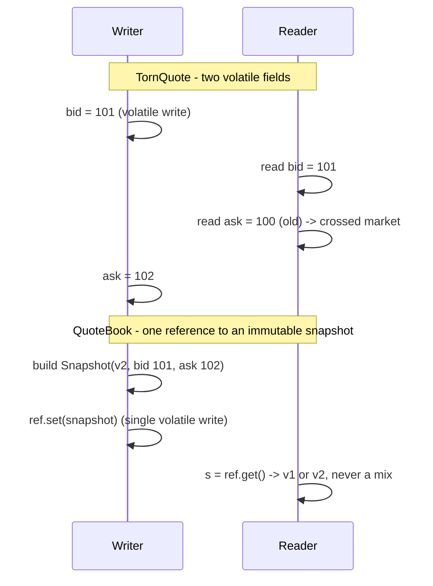

# Module 10 - Java Memory Model, volatile and Atomics

Package root: `module10`. Domain: FX rate publication, balances, request stats.

## Overview
The Java Memory Model (JMM) decides what one thread is *guaranteed* to see of another thread's writes. Most "impossible"
production bugs (a balance that is briefly wrong, a config that never refreshes, a half-built object) are JMM violations
that pass every unit test. This module covers happens-before, `volatile`, `final`-field semantics, safe publication,
double-checked locking, CAS and ABA, and atomics. It then adds two production patterns: **publishing a consistent multi-field
snapshot** (`snapshot.QuoteBook`, versus the broken `TornQuote`) and a **lock-free credit-limit reserver** with `VarHandle`
(`lockfree.CreditLimitReserver`).

## Learning objectives
- List the happens-before rules and use them to prove (not hope) that code is correct.
- Explain why `volatile` fixes visibility but not compound atomicity, nor consistency *across* fields.
- Publish objects safely: immutable snapshot + one volatile/atomic reference.
- Write correct CAS loops for conditional updates (limits, reservations), and know their contention cost and ABA risk.
- Know when lock-free is worth it and when a lock is simpler and just as fast.

## Prerequisites
- Module09 (threads, `synchronized`, atomics basics).

## Java version notes
| Feature | Status | Where |
|---|---|---|
| JSR-133 memory model, `volatile`, `final` semantics | Java 5+ | everywhere |
| `VarHandle` access modes (`getAcquire`, `setRelease`, `compareAndSet`), `Thread.onSpinWait` | Java 9+ | `lockfree.CreditLimitReserver` |
| Records (final fields: safe publication for free) | **Java 17** | `snapshot.QuoteBook` |
| `Thread.ofPlatform()` | **Java 21** final (preview in 19/20) | tests; module compiled with `--release 21` |

## The JMM in five sentences
1. Each thread may cache values and the compiler may reorder instructions unless a **happens-before** edge forbids it.
2. Happens-before edges come from: program order within a thread, monitor unlock -> lock, volatile write -> read, `Thread.start()`, `Thread.join()`, and every `java.util.concurrent` synchroniser (latches, executors, futures, concurrent collections).
3. A data race (two unsynchronised accesses, one a write) makes the read's result unspecified: stale forever, or a half-constructed object.
4. `final` fields written in a constructor are visible to every thread once the constructor finishes, even through a race (as long as `this` does not escape).
5. `volatile` guarantees visibility and ordering, not atomicity of compound actions.

## BAD vs GOOD
```java
// BAD: plain shared field - reader may spin forever on a stale value
private FxRate current;                     void publish(FxRate r) { current = r; }
// GOOD: any of these
private volatile FxRate current;
private final AtomicReference<FxRate> current;
synchronized (lock) { current = r; }
```
```java
// BAD: double-checked locking without volatile
if (value == null) synchronized (this) { if (value == null) value = create(); }   // reader may see non-null, half-built
// GOOD
private volatile T value;  // same code, now correct (Java 5+)
// BEST for statics
private static final class Holder { static final T INSTANCE = create(); }
```
```java
// BAD: CAS on a reference is vulnerable to ABA when the same instance comes back
ref.compareAndSet(observed, next);  // succeeds after A->B->A
// GOOD
AtomicStampedReference<T> ref; ref.compareAndSet(observed, next, stamp, stamp + 1);
```

## What each test proves
| Test | Claim |
|---|---|
| `PublicationTest` | volatile/atomic/locked publication is visible; `final` + defensive copy; volatile DCL constructs once under 16 threads |
| `HappensBeforeTest` (x20) | start, join, volatile, latch, monitor edges all publish a *plain* int |
| `CasTest` | hand-rolled CAS loop exact under 8 x 50k; cap never exceeded; ABA shown and fixed; lock-free stack holds 40k pushes |
| `AtomicsDeepDiveTest` | `AtomicReference<BigDecimal>` balance never negative; `LongAccumulator`/`LongAdder`/`AtomicIntegerArray` exact; `getAndUpdate` vs `updateAndGet` |
| `HeapVsStackTest` | recursion overflow depth, pass-by-value of references, `Integer` cache trap |

## Heap vs Stack
| | Stack | Heap |
|---|---|---|
| Owner | one thread | all threads |
| Holds | frames: locals, operand stack, references | objects, arrays, class instances |
| Lifetime | method return | until unreachable (GC) |
| Failure | `StackOverflowError` | `OutOfMemoryError` |
| Thread safety | inherent | needs synchronisation |
| Size | `-Xss` (default ~512KB-1MB) | `-Xmx` |

Escape analysis lets the JIT scalar-replace objects that never escape a method, so "allocation" of short-lived
`BigDecimal`s in a loop may cost nothing. Do not assume; measure (module14).

## Key Takeaways
- Every shared mutable field needs a happens-before story: lock, volatile, atomic, or a j.u.c. structure.
- Prefer immutable objects + `AtomicReference` swap over mutable objects + locks.
- CAS loops must be short and the function pure; it may be invoked multiple times.
- `LongAdder` for hot counters, `AtomicLong` when you need the exact value on every increment, `LongAccumulator` for max/min.
- ABA is mostly a native-memory/lock-free-reuse problem; in Java GC prevents address reuse while a reference is held, but stamps are still needed for logical ABA.
- `Integer == Integer` is a bug outside -128..127.

## Cheat Sheet
| Need | Tool |
|---|---|
| stop flag | `volatile boolean` |
| counter, exact every time | `AtomicLong` |
| counter, read rarely | `LongAdder` |
| max/min | `LongAccumulator` |
| swap immutable snapshot | `AtomicReference` + `accumulateAndGet`/CAS loop |
| version + value | `AtomicStampedReference` |
| lazy singleton | holder idiom or `volatile` DCL |
| publish object | `final` fields + safe publication |

## 10 Interview Q&A
1. **What is happens-before?** A partial order on actions; if A happens-before B, A's effects are visible to B. Without it, visibility is not guaranteed.
2. **What does `volatile` guarantee?** Reads/writes go to main memory in order; a volatile write happens-before every subsequent read of that field. No atomicity for `++`.
3. **Why does DCL need `volatile`?** Without it, the reference may be published before the object's fields are written; a reader sees non-null but uninitialised state.
4. **How are `final` fields special?** The JMM guarantees their values are visible after construction even without synchronisation, provided `this` does not escape the constructor.
5. **What is CAS?** Compare-and-swap: atomically set a value only if it still equals the expected one. The basis of all lock-free algorithms; backed by a CPU instruction.
6. **Explain ABA.** A CAS sees the expected value A and succeeds even though the state went A->B->A in between. Fix with a version stamp.
7. **`AtomicLong` vs `LongAdder`?** `AtomicLong` is a single contended cell; `LongAdder` stripes across cells and sums on read, trading read cost for write throughput.
8. **Is `AtomicReference<BigDecimal>` thread-safe for balances?** Yes, if updates use CAS loops / `accumulateAndGet` with pure functions; `BigDecimal` is immutable.
9. **Where do local variables live?** On the thread's stack frame; primitives inline, objects referenced from there but allocated on the heap (modulo escape analysis).
10. **Why does `Integer a = 128, b = 128; a == b` return false?** Autoboxing caches -128..127; outside that range new objects are created and `==` compares references.

## Exercises for the reader
1. Implement a lock-free `AtomicMoneyMap` (currency -> balance) using `ConcurrentHashMap.compute` and compare with `AtomicReference<Map>` swap.
2. Add a bounded `LockFreeQueue` (Michael-Scott) and test exact totals under 8 producers/8 consumers.
3. Use `VarHandle` to implement `CasCounter` without `AtomicLong` and explain acquire/release modes.

---

## Production deep dive

### Example 1: `snapshot.TornQuote` (BAD) vs `snapshot.QuoteBook` (GOOD)

**Why it matters.** Pricing, fee schedules, fraud rules and limits are read on every request and updated in batches.
A torn read quotes a price that never existed. That is a conduct risk, and possibly a P&L loss.
**Guarantee.** All fields are written *before* the single volatile write of the reference, and every reader that sees the
new reference sees those fields (happens-before via volatile write and read). Records and `Map.copyOf` make the snapshot
deeply immutable. The concurrency test publishes 20,000 versions while 4 readers check that paired quotes always come from the same version.
**Trade-off.** Copy-on-write costs O(map size) per update. That is fine for hundreds of pairs updated a few times a second,
and wrong for millions of entries updated constantly (use CHM per key, and accept that there is no cross-key consistency).
**Gotcha.** The `updateAndGet` function may run more than once under contention, so it must be side-effect free.

### Example 2: `lockfree.CreditLimitReserver`
**Why it matters.** Card authorisation is a latency-critical hot path: thousands of authorisations per second against
shared limits (corporate card programmes, merchant exposure limits). A lock would serialise them; a CAS loop lets
uncontended updates proceed without blocking.
**Expected behaviour (tested with 16 threads x 20,000 operations, including reversals).** The limit is never exceeded at any
observed instant, the final `reserved` equals the sum of granted minus released, a rejected reservation has no side effect,
long overflow is detected, and releasing more than is reserved throws (corrupt bookkeeping must be loud).
**Why `long` minor units and not `BigDecimal`?** CAS needs a single machine word, and cents in a `long` cover ±92 quadrillion.
Convert at the boundary with explicit currency scale (module02/05).
**ABA?** Not an issue here: the value is a counter, and any interleaving that returns to the same number is a legitimately
equal state. ABA matters for CAS on *references* to reused nodes (see `cas.AbaProblem`).

## Choosing a publication / update mechanism
| Need | Mechanism | Cost |
|---|---|---|
| Stop flag, config reference | `volatile` | cheap reads |
| Single counter, unconditional | `AtomicLong` / `LongAdder` (hot, read rarely) | CAS / striped cells |
| Conditional single-variable update (limit) | CAS loop (`AtomicLong`, `VarHandle`) | retries under contention |
| Several fields consistent together | immutable snapshot + `AtomicReference` | copy per update |
| Several mutable objects updated together | lock (module11) or DB transaction | blocking |

## In-memory vs production
A CAS on a JVM field is atomic *within that JVM*. Card limits enforced by several authorisation nodes must live in one
place: a partition owner per card (single writer), or a database conditional update
(`UPDATE limits SET reserved = reserved + ? WHERE card = ? AND reserved + ? <= limit`). The DB's row lock replaces your CAS.

## Common pitfalls
- Several `volatile` fields that must change together.
- Double-checked locking without `volatile`, which can publish a half-constructed singleton.
- Non-final fields in "immutable" objects shared without synchronisation.
- `this` escaping from a constructor (listeners, threads started in constructors).
- CAS loops with side effects, or unbounded spinning under very high contention (consider `LongAdder` or a lock).
- Using `get()` and `set()` separately on an atomic, which reintroduces the race.

## Production checklist
- [ ] Every shared mutable field is guarded by a lock, `volatile`, an atomic, or is effectively immutable after safe publication; documented with `// guarded by`.
- [ ] Multi-field state is published as one immutable snapshot.
- [ ] CAS loops are side-effect free and covered by a contention test with an invariant check.
- [ ] Limits that span nodes are enforced by a single authority, not per-JVM counters.
