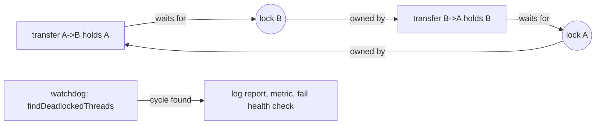

# Module 11 - Locks, Deadlocks and Thread Pools

Package root: `module11`. Domain: account locks, FX cache, reserved balances, settlement workers.

## Overview
When atomics are not enough (several accounts, waiting for a condition, read-mostly caches), you need explicit locks, and
with locks come deadlocks, livelocks, starvation and saturated thread pools. This module covers `ReentrantLock`,
read-write and stamped locks, deadlock causes and fixes, livelock, and `ThreadPoolExecutor` sizing and rejection policies. It adds
**`Condition`-based waiting for funds with deadlines** (`conditions.FundingAwaitAccount`) and **programmatic deadlock
detection** with `ThreadMXBean` (`diagnostics.DeadlockDetector`), proven against a real deadlock in the test.

## Learning objectives
- Choose between `synchronized`, `ReentrantLock`, `ReentrantReadWriteLock` and `StampedLock` with justification.
- Prevent deadlocks (global lock ordering, `tryLock` with timeout and jitter) and *detect* them in a running system.
- Implement condition waiting correctly: `while` loop, `signalAll`, timed and interruptible waits.
- Size a thread pool and choose a bounded queue plus rejection policy for a payment workload.
- Recognise starvation and livelock, and know what fairness costs.

## Prerequisites
- Module09 (threads, executors), module10 (happens-before: lock release happens-before subsequent acquire).

## Java version notes
| Feature | Status | Where |
|---|---|---|
| `java.util.concurrent.locks`, `ThreadPoolExecutor` | Java 5+ | everywhere |
| `StampedLock` | Java 8 | `locks.StampedBalance` |
| `ThreadMXBean.findDeadlockedThreads` (monitors + ownable synchronizers) | Java 6+ | `diagnostics` |
| Records | **Java 17** | `diagnostics.DeadlockDetector.DeadlockedThread` |
| Virtual threads + `synchronized` pinning (fixed in JDK 24) | Java 21 (preview 19/20) | module13; module compiled with `--release 17` |

## Lock selection
| Lock | Use when | Caveats |
|---|---|---|
| `synchronized` | simple critical sections, one condition | no timeout, no interruption, no fairness |
| `ReentrantLock` | `tryLock(timeout)`, `lockInterruptibly`, fairness, multiple `Condition`s | must `unlock()` in `finally` |
| `ReentrantReadWriteLock` | read-mostly shared state (FX rate cache) | writer starvation (use fair mode), no read->write upgrade, downgrade OK |
| `StampedLock` | very read-heavy with cheap validation (optimistic reads) | not reentrant, no conditions, never hold across blocking calls |

## BAD vs GOOD
```java
// BAD: lock order follows argument order -> A->B and B->A deadlock
synchronized (from) { synchronized (to) { ... } }
// GOOD 1: global ordering
Account first = from.id.compareTo(to.id) < 0 ? from : to; first.lock.lock(); second.lock.lock(); ...
// GOOD 2: tryLock with timeout + jittered back-off, release everything on failure
if (from.lock.tryLock(5, MILLISECONDS)) { try { if (to.lock.tryLock(5, MILLISECONDS)) { ... } } finally { from.lock.unlock(); } }
```
```java
// BAD: unlock outside finally - an exception leaks the lock forever
lock.lock(); balance = balance.add(amount); lock.unlock();
// GOOD
lock.lock(); try { ... } finally { lock.unlock(); }
```
```java
// BAD: hidden unbounded queue, OOM under load
Executors.newFixedThreadPool(16);
// GOOD
new ThreadPoolExecutor(core, max, 60, SECONDS, new ArrayBlockingQueue<>(1000), namedThreads("settle"), new AbortPolicy());
```

## Deadlock: the four conditions and how we break one
Mutual exclusion, hold-and-wait, no pre-emption, circular wait. Lock ordering removes circular wait;
`tryLock` with release removes hold-and-wait. `DeadlockDemo` forces the bad interleaving with latches and proves
detection via `ThreadMXBean.findDeadlockedThreads()` (what `jstack` prints as "Found one Java-level deadlock").
Intrinsic locks cannot be interrupted, so the demo threads are daemons.

## Livelock
Threads keep running but make no progress because they react to each other symmetrically
(`LivelockDemo.politeWorkersBad`). Fix with an asymmetric tie-break (lower id wins) or randomised back-off.

## ThreadPoolExecutor decision flow
```
submit -> poolSize < core ? start thread
       -> queue.offer() succeeds ? enqueue
       -> poolSize < max ? start thread          <- only when the queue is FULL
       -> reject (handler)
```
Proven by `ThreadPoolTest.maxThreadsOnlyStartWhenQueueIsFull`: core 1, max 3, queue 2 -> pool stays at 1 until
the 4th task, then grows to 3, then rejects.

### Rejection policies
| Policy | Effect | Payments verdict |
|---|---|---|
| `AbortPolicy` | throw `RejectedExecutionException` | good: explicit load shedding, map to 503 |
| `CallerRunsPolicy` | caller executes the task | good for batch back-pressure; dangerous on request threads |
| `DiscardPolicy` / `DiscardOldestPolicy` | silent loss | never for money |
| custom | count/metric/dead-letter | good when paired with alerting |

### Sizing
- CPU-bound: `cores + 1`.
- I/O-bound: `cores * utilisation * (1 + wait/compute)`. 8 cores, 90 ms waiting per 10 ms compute -> 80 threads.
- Separate pools per dependency (bulkheads) so a slow provider cannot starve settlement.
- Java 21: virtual threads remove most of this arithmetic for I/O (module13).

### Shutdown
`shutdown()` -> `awaitTermination(t)` -> `shutdownNow()` (interrupts) -> `awaitTermination(t)`. Tasks must honour interruption.

## Key Takeaways
- Pick the weakest lock that works; measure before reaching for `StampedLock`.
- Every lock acquisition has a matching `unlock()` in `finally`.
- Never hold a lock while calling out (network, DB, another service) - that is how deadlocks and thread starvation start.
- Impose a global lock order or use `tryLock`; never both styles on the same locks.
- Always configure pools explicitly: bounded queue, named threads, chosen rejection policy, metrics.
- Prefer immutable snapshots + `AtomicReference` over `ReadWriteLock` for small read-mostly state.

## Cheat Sheet
| Symptom | Likely cause | Tool |
|---|---|---|
| threads BLOCKED forever | deadlock | `jstack`, `ThreadMXBean.findDeadlockedThreads` |
| 100% CPU, no progress | livelock / spin | thread dump shows RUNNABLE in the same frames |
| latency grows, queue grows | pool too small or unbounded queue | `ThreadPoolExecutor.getQueue().size()` metrics |
| `RejectedExecutionException` | pool saturated or shut down | check policy, add bulkhead, shed load |
| `IllegalMonitorStateException` | unlock without lock / wrong thread | review `finally` blocks |

## 10 Interview Q&A
1. **`synchronized` vs `ReentrantLock`?** Same mutual exclusion and memory semantics; `ReentrantLock` adds tryLock/timeouts/interruptibility/fairness/multiple conditions at the cost of explicit unlock.
2. **What is lock reentrancy?** The owning thread can re-acquire the lock; a hold count tracks nesting. Both `synchronized` and `ReentrantLock` are reentrant; `StampedLock` is not.
3. **When is `ReadWriteLock` slower than a plain lock?** Short critical sections with few readers: the bookkeeping outweighs the parallelism. Measure.
4. **Can you upgrade a read lock to a write lock?** Not with `ReentrantReadWriteLock` (deadlock). `StampedLock.tryConvertToWriteLock` can.
5. **How do you detect a deadlock in production?** Thread dump (`jstack`, `jcmd Thread.print`) or `ThreadMXBean.findDeadlockedThreads()` from a health check.
6. **Four conditions for deadlock?** Mutual exclusion, hold and wait, no pre-emption, circular wait. Break any one.
7. **Why does `newFixedThreadPool` risk OOM?** Its `LinkedBlockingQueue` is unbounded; under sustained overload tasks pile up until memory runs out.
8. **When do max threads get created?** Only when the queue rejects the offer, i.e. a bounded queue is full. With an unbounded queue `max` is meaningless.
9. **Which rejection policy for a payment API?** `AbortPolicy` mapped to HTTP 503 with `Retry-After`; never discard.
10. **How do you size an I/O pool?** `cores * utilisation * (1 + wait/compute)`; or use virtual threads and size by downstream capacity instead.

## Exercises for the reader
1. Add fairness to `ReadWriteFxCache` and measure writer wait time under 16 readers.
2. Implement a `Bulkhead` wrapper: one bounded pool per provider, exposing queue depth and rejections as metrics.
3. Convert `DeadlockFixes.transferTryLock` to use `lockInterruptibly` and prove that `shutdownNow` unblocks a stuck transfer.

---

## Production deep dive

### Example 1: `conditions.FundingAwaitAccount`, waiting for funds with a deadline
```java
lock.lockInterruptibly();
try {
    while (balance.compareTo(amount) < 0) {          // ALWAYS a loop
        if (remaining <= 0) return false;              // deadline: no partial debit
        remaining = fundsArrived.awaitNanos(remaining); // releases the lock while waiting
    }
    balance = balance.subtract(amount);
    return true;
} finally { lock.unlock(); }
```
**Why it matters.** Payouts, treasury sweeps and margin calls often depend on funds that arrive asynchronously, and they must
proceed before a cut-off or be rejected cleanly.
**Expected behaviour (tested).** A credit that is still insufficient wakes the waiter, which re-checks and waits again. The deadline
returns `false` with no partial debit. With two waiters for different amounts, `signalAll` lets the one that *can* proceed
proceed (`signal` could wake the wrong one and strand the other). Interruption during shutdown throws `InterruptedException`
and leaves the balance unchanged.
**Production caveat.** A blocked thread per pending payout is not durable and does not scale. Persist the payout as
`PENDING_FUNDING` and re-evaluate on a "funds received" event. Use the in-process primitive for short, bounded waits.

### Example 2: `diagnostics.DeadlockDetector`

**Why it matters.** A deadlocked JVM still accepts TCP connections and may still pass a naive liveness probe, while every
transfer touching those accounts hangs. A watchdog turns a silent outage into an alert and an automatic restart.
**Test.** Two threads take their first lock, meet at a latch (making the deadlock deterministic), then request the other lock.
The detector reports both, with owner names. Interrupting `lockInterruptibly()` breaks the cycle. Threads blocked in `synchronized`
**cannot** be interrupted, which is one more reason to prefer `ReentrantLock` where deadlock recovery matters.
**Note.** The detector sees *every* deadlock in the JVM (this module's `DeadlockDemo` leaves some behind on purpose), so the test
filters by thread name, just as you would correlate with a named pool in production.

## Pool sizing and rejection for payments
| Workload | Size | Queue | Rejection |
|---|---|---|---|
| CPU-bound (fraud scoring, crypto) | about #cores | small bounded | `CallerRuns` for natural back-pressure |
| Blocking I/O (DB, PSP calls) | `cores x (1 + wait/compute)`, capped by downstream pool | bounded | `Abort` and return 503 / retry-after |
| Must-not-lose (ledger writes) | n/a | **durable** queue (DB/broker), not an executor | n/a |
| Many short I/O tasks on Java 21 | virtual threads + `Semaphore` limit | none | `tryAcquire(timeout)` then fail fast |

## Deadlock, livelock, starvation
| Problem | Symptom | Prevention |
|---|---|---|
| Deadlock | threads BLOCKED forever, CPU idle | global lock order; `tryLock(timeout)`; lock fewer things; DB: same row order |
| Livelock | threads RUNNING, no progress | randomised (jittered) backoff on retry |
| Starvation | some requests always slow | fair locks (`new ReentrantLock(true)`, at a throughput cost), bounded pools, avoid long critical sections |
| Thread-pool deadlock | tasks wait on tasks queued in the *same* bounded pool | never block on sub-tasks in the same pool; use separate pools or async composition |

## Common pitfalls
- `unlock()` outside `finally`; locking in one method and unlocking in another.
- Holding a lock while calling a remote service, which converts network latency into contention.
- Read lock to write lock "upgrade" with `ReentrantReadWriteLock`: it deadlocks with itself.
- `StampedLock` held across blocking calls, or used reentrantly (it is not reentrant).
- `if` instead of `while` around `await()`; `signal()` when waiters wait for different predicates.
- Unbounded `newFixedThreadPool` queues hiding overload until an OOM.
- Deadlock *within the database* (rows locked in different orders) looks like slow queries in Java. Check the DB's deadlock log.

## Production checklist
- [ ] Multi-resource locking uses one documented global order, or `tryLock` with timeout and jitter.
- [ ] No locks held across I/O. Critical sections are short and measured (JFR lock profiling).
- [ ] Deadlock watchdog plus thread-dump-on-alert are wired into health checks.
- [ ] Pools are bounded, named, monitored (active, queue depth, rejections) and have an explicit rejection policy.
- [ ] Waiting on conditions is bounded by deadlines and interruptible.
