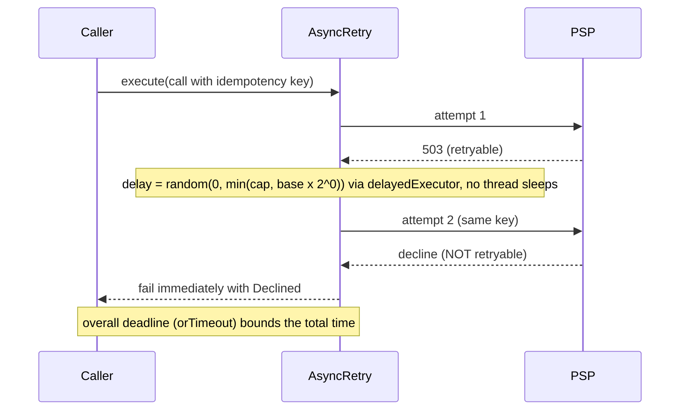

# Module 12 - CompletableFuture and Async Programming

Package root: `module12`. Domain: FX price aggregation, card order fulfilment, async payment workflow.

## Overview
A payment request typically fans out to several services (balance, fraud, limits, FX, PSP) and must answer within an SLA.
`CompletableFuture` composes these calls without blocking threads, but it also makes failure handling, timeouts,
cancellation and back-pressure *your* responsibility. This module covers composition, error handling, timeouts, executors
and three realistic workflows. It adds two resilience building blocks: **non-blocking retry with exponential backoff, full
jitter and deadline** (`retry.AsyncRetry`) and an **async bulkhead** that bounds in-flight calls (`bulkhead.AsyncBulkhead`).

## Learning objectives
- Compose async calls (`thenCompose`, `thenCombine`, `allOf`, `anyOf`) and handle errors on every path.
- Apply timeouts (`orTimeout`, `completeOnTimeout`), and understand that they do **not** cancel the underlying work.
- Choose executors deliberately (never blocking I/O on the common pool).
- Retry safely: retryable classification, backoff with jitter, overall deadline, idempotency keys.
- Add back-pressure to async code with a bulkhead, and release permits on every outcome.

## Prerequisites
- Module09 (executors), module08 (exception design, ambiguous outcomes), module11 (pool sizing).

## Java version notes
| Feature | Status | Where |
|---|---|---|
| `CompletableFuture` core API | Java 8 | everywhere |
| `orTimeout`, `completeOnTimeout`, `delayedExecutor`, `failedFuture` | Java 9 | `timeouts`, `retry`, `bulkhead` |
| `exceptionallyCompose` | Java 12 | `errors` |
| Records, pattern matching for `instanceof` | **Java 17** | `retry`, workflows |
| `resultNow()`, `exceptionNow()`, `state()` on `Future` | **Java 19+** (final in 19) | not used; would simplify tests |
| Structured concurrency as an alternative to fan-out futures | 19/20 incubator, 21 preview | module13 |

## The vocabulary
| Want | Method | Analogy |
|---|---|---|
| transform value | `thenApply` | `map` |
| chain async call | `thenCompose` | `flatMap` |
| combine two | `thenCombine` | `zip` |
| wait for all | `allOf(...).thenApply(v -> join each)` | fan-in |
| first to finish | `anyOf` | race |
| recover | `exceptionally`, `exceptionallyCompose` | catch |
| map both paths | `handle` | fold |
| observe | `whenComplete` | finally/log |
| deadline | `orTimeout`, `completeOnTimeout` | timeout |
| start work | `supplyAsync(s, executor)` | submit |

## BAD vs GOOD
```java
// BAD: nested future
CompletableFuture<CompletableFuture<BigDecimal>> f = accountId.thenApply(this::balanceOf);
// GOOD
CompletableFuture<BigDecimal> f = accountId.thenCompose(this::balanceOf);
```
```java
// BAD: blocking I/O in the common pool (shared by every parallel stream in the JVM)
CompletableFuture.supplyAsync(() -> httpClient.call());
// GOOD
CompletableFuture.supplyAsync(() -> httpClient.call(), ioPool);
```
```java
// BAD: join() inside a stage to "wait" for another future - blocks a pool thread, risks deadlock
.thenApply(v -> other.join())
// GOOD
.thenCombine(other, (v, o) -> ...)   or   .thenCompose(v -> other)
```
```java
// BAD: one failing venue fails the whole aggregate
allOf(a, b, c).thenApply(...)        // if b fails, join() throws
// GOOD: per-branch recovery before fan-in
venue.orTimeout(...).thenApply(Quote::new).exceptionally(ex -> null)   then filter nulls
```

## Threading rules (proven in `AsyncExecutorsTest`)
- `supplyAsync(s)` runs on `ForkJoinPool.commonPool()`; with an executor argument, on that executor.
- `thenApply(f)` runs on whichever thread completes the previous stage, or on the caller if already complete.
- `thenApplyAsync(f, exec)` always hops to `exec`. Use it to leave an I/O pool before CPU work.
- Timeouts (`orTimeout`) are scheduled on a single shared delayer thread: never put work in their callbacks.

## Exceptions
- A throwing stage completes exceptionally; downstream `thenApply` stages are **skipped** until an `exceptionally`/`handle`.
- `join()` throws `CompletionException`, `get()` throws `ExecutionException`; both wrap the cause once. `ErrorHandling.unwrap` walks it.
- `whenComplete` cannot change the outcome; `handle` can.
- `exceptionallyCompose` lets you recover with another async call (secondary provider, retry).

## The three services
- **PriceService**: N venues in parallel, per-venue timeout, failed venues reported, best = min rate, aggregate fails only if nobody answers.
- **OrderFulfilment**: parallel (customer, KYC, reservation) then sequential (fee, dispatch); KYC failure compensates by releasing stock; batch returns per-order outcomes with `handle`.
- **PaymentWorkflow**: fraud score with timeout -> `-1` -> MANUAL_REVIEW; async retry via recursive `exceptionallyCompose`; notification is fire-and-forget with failures logged.

## Key Takeaways
- Pass an executor to every `*Async` call that might block; reserve the common pool for pure CPU work.
- Recover per branch before `allOf` so one failure does not poison the aggregate.
- Always put a timeout on anything that talks to the network, and cancel the source on timeout.
- Never block (`join/get`) inside a stage running on the pool that would complete it.
- Test with completed/failed/never-completing futures and injected executors; no sleeps.
- For straight-line I/O code in Java 21, virtual threads (module13) are often clearer than CF chains.

## Cheat Sheet
| Scenario | Snippet |
|---|---|
| fallback value | `f.exceptionally(ex -> fallback)` |
| fallback async | `f.exceptionallyCompose(ex -> other())` |
| timeout fail | `f.orTimeout(2, SECONDS)` |
| timeout default | `f.completeOnTimeout(v, 2, SECONDS)` |
| all results | `allOf(fs).thenApply(v -> fs.stream().map(CF::join).toList())` |
| already done | `completedFuture(v)` / `failedFuture(ex)` |
| hop thread | `thenApplyAsync(f, executor)` |

## 10 Interview Q&A
1. **`thenApply` vs `thenCompose`?** `thenApply` maps to a value; `thenCompose` maps to a future and flattens. Use `thenCompose` for dependent async calls.
2. **Where does `thenApply` run?** On the thread completing the previous stage, or synchronously on the caller if that stage is already complete. `thenApplyAsync` forces a pool.
3. **Why avoid the common pool for I/O?** It is sized for CPU work and shared JVM-wide; blocking threads there stalls parallel streams and other async code.
4. **How does `allOf` return results?** It returns `CompletableFuture<Void>`; collect by `join()`-ing the inputs in a `thenApply`, which is safe because they are complete.
5. **What happens to stages after an exception?** They are skipped until a recovery stage (`exceptionally`, `handle`, `whenComplete` observes but does not recover).
6. **`join` vs `get`?** `join` is unchecked (`CompletionException`); `get` is checked (`ExecutionException`, `InterruptedException`) and supports a timeout.
7. **How do you implement timeout?** `orTimeout` to fail, `completeOnTimeout` to default; cancel the slow source in the recovery stage.
8. **How do you retry asynchronously?** Recurse through `exceptionallyCompose` with a counter; never loop with `join`.
9. **Is `CompletableFuture` cancellation cooperative?** `cancel()` completes the future exceptionally but does not interrupt the running task; the task must check or be on a cancellable primitive.
10. **CompletableFuture vs virtual threads?** CF composes asynchronous stages without blocking threads; virtual threads make blocking cheap so plain sequential code scales. Prefer the simpler one that meets the latency goal.

## Exercises for the reader
1. Add a per-venue circuit breaker (module08) to `PriceService` so a venue that failed 3 times is skipped for 30 s.
2. Give `OrderFulfilment.fulfil` an overall deadline with `orTimeout` and compensate the reservation on timeout.
3. Replace `PaymentWorkflow.retry` with exponential backoff using `CompletableFuture.delayedExecutor`.

---

## Production deep dive

### Example 1: `retry.AsyncRetry`

**Why it matters.** Retries are the main tool against transient failures, and the main cause of self-inflicted outages
(retry storms) and double payments (retrying non-idempotent calls).
**Expected behaviour (tested).** Delays follow a capped exponential times a jitter factor, with no overflow at large attempt numbers.
Transient errors are retried with the *same* idempotency key. A decline is never retried. Attempts are bounded, and a supplier
that throws synchronously counts as a failed attempt. The overall deadline completes the result even if an attempt hangs forever.
**Trade-offs.** Full jitter minimises synchronised retry waves at the cost of sometimes retrying almost immediately.
"Decorrelated jitter" is an alternative. The retry budget should be shared per downstream (e.g. max 10% extra traffic), which is
beyond this class.
**Caveat.** `orTimeout` completes the *returned* future; the in-flight HTTP call keeps running unless its client supports
cancellation. A timed-out payment is an **ambiguous outcome** (module08 `AmbiguousOutcomeHandler`), not a failure.

### Example 2: `bulkhead.AsyncBulkhead`
**Why it matters.** Without a cap, async code converts a slow dependency into unbounded in-flight requests, connection pool
exhaustion, memory growth and cascading timeouts across *all* dependencies.
**Expected behaviour (tested).** At most N in flight; extra calls fail fast with `BulkheadFullException`; permits are released
on success, failure, cancellation, and when the supplier throws before returning a future; 500 concurrent callers never
exceed the limit, and `ok + rejected == 500`.
**Trade-offs.** Fail-fast gives predictable latency but rejects bursts. A small bounded *wait* (`tryAcquire(timeout)`) absorbs
bursts at the cost of latency. Pair the bulkhead with a circuit breaker (module08) so a dead dependency is not even tried.

## Resilience layering (outermost first)
| Layer | Purpose | Module |
|---|---|---|
| Rate limiter | protect *us* from clients | 04, 15, 16, 17 |
| Deadline / timeout | bound total latency to the caller's SLA | 12 |
| Bulkhead | bound concurrency per dependency | 12 |
| Circuit breaker | stop calling a failing dependency | 08 |
| Retry with jitter + idempotency key | absorb transient faults | 04 (`DelayQueue`), 12 |
| Fallback / graceful degradation | cached FX rate, "payment processing" status | 04, 12 |

## Common pitfalls
- `supplyAsync` without an executor for blocking I/O, which starves the common `ForkJoinPool` for the whole JVM.
- `join()`/`get()` inside a callback running on a bounded pool, which can deadlock the pool.
- Forgetting that `exceptionally`/`handle` receive `CompletionException` wrappers (unwrap the cause).
- Assuming `orTimeout`/`cancel(true)` stops the underlying work; it only completes the future.
- Retrying everything, retrying without jitter, retrying without a deadline, retrying without idempotency keys.
- Losing context (trace id, MDC) across async boundaries (module09 `ContextPropagatingExecutor`, module13 `ScopedValue`).
- `allOf` failing fast while other futures keep running and consuming resources.

## Production checklist
- [ ] Every async call has an explicit executor, timeout and error path.
- [ ] Retries: classified errors, capped exponential backoff with jitter, max attempts, overall deadline, idempotency key.
- [ ] Concurrency to each dependency is bounded (bulkhead) and rejections are metered.
- [ ] Timed-out money movements are resolved via status query or reconciliation, never assumed failed.
- [ ] Trace context is propagated across every async hop.
