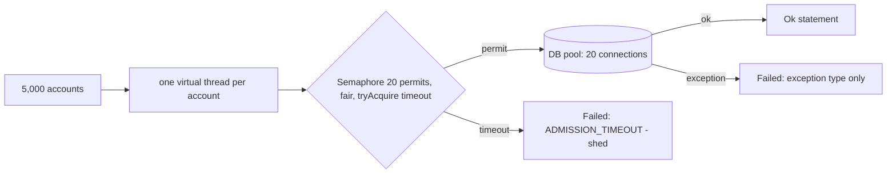

# Module 13 - Java 21 Modern Concurrency

Package root: `module13`. Domain: payment pre-checks, FX venue racing, request context propagation.
Compiled and run with `--enable-preview` because `StructuredTaskScope` and `ScopedValue` are preview APIs in JDK 21.

## Overview
Virtual threads change the economics of blocking I/O. A payment service can again be written as straightforward
sequential code ("call balance, call fraud, call PSP") while handling tens of thousands of concurrent requests. They do
**not** make CPU work faster, do not make downstream systems bigger, and in JDK 21 have pitfalls (pinning). This module covers
virtual threads, structured concurrency, `ScopedValue` and pinning. It adds **admission control for virtual-thread fan-out**
(`throttling.BoundedVirtualFanOut`), the pattern that keeps 10,000 virtual threads from flattening a 20-connection database pool.

## Learning objectives
- Explain mounting/unmounting, carrier threads, and why virtual threads must not be pooled.
- Identify appropriate vs inappropriate virtual-thread workloads in a financial system.
- Bound downstream concurrency with a `Semaphore` (not a thread pool), with timeouts and per-task failure isolation.
- Use structured concurrency for all-or-nothing and first-wins fan-out with deadlines (preview API).
- Replace request-scoped `ThreadLocal` with `ScopedValue` (preview API) and diagnose pinning.

## Prerequisites
- Module09 (executors), module11 (locks, `Semaphore`, pool sizing), module12 (async composition, to compare styles).

## Java 19 / 20 / 21 status of these features
| Feature | Java 19 | Java 20 | Java 21 (this module) | Later |
|---|---|---|---|---|
| Virtual threads (`Thread.ofVirtual`, `newVirtualThreadPerTaskExecutor`) | preview (JEP 425) | 2nd preview (JEP 436) | **final** (JEP 444) | pinning on `synchronized` removed in 24 (JEP 491) |
| Structured concurrency (`StructuredTaskScope`) | incubator (JEP 428) | 2nd incubator (JEP 437) | **preview** (JEP 453) | still evolving; API reshaped in 25 |
| Scoped values (`ScopedValue`) | not available | incubator (JEP 429) | **preview** (JEP 446) | final in 25 (JEP 506) |

This module compiles with `--release 21 --enable-preview`. `throttling.BoundedVirtualFanOut` uses only final Java 21 APIs.
On Java 20 the same code needs `--enable-preview`; on Java 17 there are no virtual threads (use a bounded platform pool, module11).
**Do not ship preview APIs to production** without a plan to track their changes.

## Virtual threads (`module13.virtualthreads`)
- Created with `Thread.ofVirtual()` or `Executors.newVirtualThreadPerTaskExecutor()`; the executor is `AutoCloseable` and `close()` waits for all tasks.
- A blocked virtual thread (sleep, socket, `ReentrantLock`, `BlockingQueue`) **unmounts** from its carrier; the carrier runs another virtual thread. 10 000 tasks each sleeping 50 ms finish in well under a second in the test.
- Carriers are a small `ForkJoinPool` (default parallelism = cores). `distinctCarriersObserved` shows thousands of virtual threads mapped onto a handful of carriers.
- Do not pool virtual threads, do not use `ThreadLocal` caches per thread (millions of them), do not size them: one task = one virtual thread.

```java
// BAD: a bounded platform pool for I/O - back-pressure by starvation, sizing arithmetic (module11)
ExecutorService io = Executors.newFixedThreadPool(80);
// GOOD: one virtual thread per task; limit concurrency with a Semaphore if the downstream needs it
try (var vt = Executors.newVirtualThreadPerTaskExecutor()) { ids.forEach(id -> vt.submit(() -> lookup(id))); }
```

## Structured concurrency (`module13.structured`)
`StructuredTaskScope` treats a group of subtasks as one unit with a clear lifetime:
| Policy | Behaviour | Example |
|---|---|---|
| `ShutdownOnFailure` | first failure cancels siblings, `throwIfFailed()` rethrows | balance + fraud + limits all required |
| `ShutdownOnSuccess<T>` | first success cancels siblings, `result()` returns it | fastest FX venue |
| plain `StructuredTaskScope<T>` | you inspect each `Subtask.state()` | dashboard with partial results |

Guarantees proven by tests: a failing `balance()` cancels a 10-second `fraud()` within milliseconds (`fraudInterrupted`), `joinUntil` enforces a deadline with `TimeoutException`, and the scope cannot leak threads because `close()` waits.

```java
// BAD: unstructured - a failure leaves siblings running, exceptions lose their parent context
var f1 = pool.submit(...); var f2 = pool.submit(...); f1.get(); f2.get();
// GOOD
try (var scope = new StructuredTaskScope.ShutdownOnFailure()) {
    var a = scope.fork(...); var b = scope.fork(...);
    scope.joinUntil(deadline); scope.throwIfFailed();
    return combine(a.get(), b.get());
}
```

## ScopedValue (`module13.scopedvalues`)
Immutable, bound for the extent of `ScopedValue.callWhere(KEY, value, body)`, automatically visible in subtasks forked inside the scope, unbound afterwards. Nested rebinding shadows only within the nested call.
ThreadLocal, by contrast, is mutable, must be `remove()`d, and is not inherited by pooled/virtual subtasks without `InheritableThreadLocal` copying.

## Pinning (`module13.pinning`)
A virtual thread blocking inside `synchronized` (or a native frame) **pins** its carrier in JDK 21; with N carriers, N pinned threads stall the whole scheduler. Diagnose with `-Djdk.tracePinnedThreads=full`. Fix with `ReentrantLock`/`Condition`, or keep monitors short and never block inside them. JDK 24 (JEP 491) removes pinning for `synchronized`, but the pattern "do not block while holding a monitor" remains good advice.

## Key Takeaways
- Virtual threads make blocking cheap: write straightforward sequential code instead of `CompletableFuture` chains for I/O.
- They do not make CPU work faster and do not remove the need to bound downstream concurrency (use a `Semaphore`).
- Structured concurrency gives cancellation, deadlines and error propagation for free; prefer it to ad-hoc `Future` juggling.
- `ScopedValue` is the modern replacement for request-scoped `ThreadLocal`.
- Avoid `synchronized` around blocking calls on virtual threads; prefer `ReentrantLock`.
- Preview APIs change; check the JDK version before relying on them in production.

## Cheat Sheet
| Need | Java 21 tool |
|---|---|
| run a blocking task | `Thread.ofVirtual().start(r)` / `newVirtualThreadPerTaskExecutor()` |
| all-or-nothing fan-out | `ShutdownOnFailure` + `throwIfFailed()` |
| first-wins fan-out | `ShutdownOnSuccess<T>` + `result()` |
| deadline | `scope.joinUntil(Instant)` |
| request metadata | `ScopedValue` + `callWhere` |
| cap downstream load | `Semaphore` around the call, not a thread pool |
| find pinning | `-Djdk.tracePinnedThreads=full` |

## 10 Interview Q&A
1. **What is a virtual thread?** A lightweight thread managed by the JVM, mounted on a carrier platform thread only while running; blocking unmounts it, so millions can exist.
2. **When do virtual threads not help?** CPU-bound work (still limited by cores) and workloads that pin (synchronized + blocking, native calls).
3. **Why not pool virtual threads?** They are cheap to create and pooling defeats the per-task model; use a `Semaphore` for admission control instead.
4. **What problem does structured concurrency solve?** Orphaned subtasks, lost exceptions and unclear lifetimes when fanning out with `ExecutorService`/futures; it ties subtasks to a lexical scope.
5. **`ShutdownOnFailure` vs `ShutdownOnSuccess`?** Fail-fast (all required) vs first-wins (any sufficient).
6. **How does cancellation reach a subtask?** Via interruption; blocking calls throw `InterruptedException`, CPU loops must poll.
7. **ScopedValue vs ThreadLocal?** Immutable and scoped vs mutable and thread-lifetime; inherited by structured subtasks vs not; no `remove()` needed.
8. **What is pinning?** A virtual thread that cannot unmount (monitor held or native frame), occupying its carrier while blocked.
9. **How do you limit concurrent calls to a provider with virtual threads?** Wrap the call in `semaphore.acquire()/release()`; the threads park cheaply while waiting.
10. **Are virtual threads daemon threads?** Yes, always; the JVM will not wait for them at exit - use the executor's `close()` or `join()`.

## Exercises for the reader
1. Add a `Semaphore(10)` around `fetchBalances` and prove with a counter that in-flight lookups never exceed 10.
2. Extend `StructuredPaymentCheck` with a fourth subtask (`sanctions`) and a custom scope that approves when at least 3 of 4 succeed.
3. Convert `module12.PaymentWorkflow` to virtual threads + structured concurrency and compare readability and test complexity.

---

## Production deep dive

### Example: `throttling.BoundedVirtualFanOut`, admission control

**Why it matters.** Virtual threads remove the *thread* bottleneck and expose the *next* one, usually the DB connection pool or
a provider's concurrency limit. Without admission control, thousands of threads queue inside the pool, timeouts become
unpredictable, and the database suffers.
**Expected behaviour (tested).** 5,000 statements run with at most 20 in flight (measured). Failures for individual accounts are
isolated and returned for a targeted rerun, and the failure reason contains only the exception type (no customer data). Results keep
input order. With a short acquire timeout, excess work is shed (`ADMISSION_TIMEOUT`) instead of queueing forever.
`try (var vt = newVirtualThreadPerTaskExecutor())` guarantees no orphaned threads after `run()` returns.

## Virtual threads in financial systems: do and don't
| Workload | Virtual threads? | Why |
|---|---|---|
| REST/gRPC handlers calling DB, ledger, fraud, PSP | **Yes** | mostly waiting on I/O |
| Batch fan-out over accounts (statements, notifications) | **Yes**, with a `Semaphore` | downstream capacity is the real limit |
| Kafka consumers doing blocking processing per record | Yes, but keep per-partition ordering (module15 `P17`) | ordering, not threads, is the constraint |
| Risk / pricing calculations (Monte Carlo, VaR) | **No** | CPU-bound: use a pool of about #cores (or `ForkJoinPool`) |
| Low-latency matching / market-data hot paths | **No** | need pinned platform threads, affinity, no scheduler jitter |
| Code holding `synchronized` across blocking I/O (JDK 21-23) | Fix first | pinning starves carriers (`-Djdk.tracePinnedThreads=full`) |
| Libraries caching heavy objects in `ThreadLocal` | Review first | millions of threads mean millions of copies |
| "Limit to 50 concurrent calls" via a pool of 50 virtual threads | **No** | use a `Semaphore`; never pool virtual threads |

## Async style comparison for the same payment pre-check
| | `CompletableFuture` (module12) | Virtual threads + structured concurrency |
|---|---|---|
| Code shape | callback chains | sequential, `try`-with-resources scope |
| Stack traces | fragmented | complete |
| Cancellation of siblings on failure | manual | automatic (`ShutdownOnFailure`) |
| Thread-local context | must be propagated | `ScopedValue` inherited by forked subtasks |
| Availability | Java 8+, final | VT final in 21; scopes still preview |

## Common pitfalls
- Pooling virtual threads, or using `newFixedThreadPool` of virtual threads to limit concurrency.
- Forgetting that the DB/provider is still the bottleneck: no `Semaphore`, no timeout.
- `synchronized` around blocking calls in JDK 21-23 (pinning). Use `ReentrantLock`.
- Expensive `ThreadLocal` caches (date formatters, buffers) multiplied by millions of threads.
- Treating virtual threads as daemon-safe work: the JVM won't wait for them. Close the executor or join.
- Shipping `--enable-preview` code (structured concurrency, scoped values) to production on a fixed JDK without a migration plan.

## Production checklist
- [ ] Every downstream has explicit concurrency limits (semaphore or bulkhead) and acquire timeouts.
- [ ] No pinning in hot paths (checked with JFR `jdk.VirtualThreadPinned` events or `-Djdk.tracePinnedThreads`).
- [ ] CPU-bound work stays on bounded platform pools.
- [ ] Preview features are isolated behind interfaces and tracked against JDK release notes.
- [ ] Batch jobs report per-item outcomes and support rerunning only the failures (idempotently).
