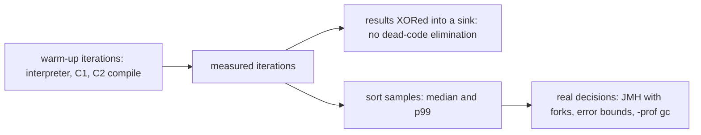

# Module 14 - JVM Internals and Performance

Package root: `module14`. Domain: fee tables, PAN masking, balance stores, request counters.
Tests assert **correctness** of each fast/slow pair; timings are collected but not asserted, because CI hardware varies.
For real numbers use JMH.

## Overview
Payment systems have hard latency budgets: a card authorisation typically has a few hundred milliseconds end to end,
of which your service gets a fraction. Meeting a p99 target depends on understanding the JVM: class loading and warm-up,
JIT inlining, allocation and GC, boxing, false sharing and lock contention. This module demonstrates each with a fast/slow pair
whose **correctness** is tested (timings are never asserted). It adds **minor-unit arithmetic vs `BigDecimal`** with a
200k-case equivalence test, a **mini benchmark harness** explaining what JMH does for you, and a per-thread **allocation probe**.

## Learning objectives
- Explain tiered JIT, inlining, escape analysis and why benchmarks need warm-up and result consumption.
- Relate allocation rate to GC frequency and tail latency; measure allocation per operation.
- Decide when `long` minor units beat `BigDecimal`, and how to keep them provably correct.
- Profile before optimising: JFR, async-profiler, GC logs, `jcmd`, and JMH for micro-benchmarks.

## Prerequisites
- Module10 (memory model: false sharing builds on cache lines), module11 (contention), module02 (`BigDecimal` rules).

## Java version notes
| Feature | Status | Where |
|---|---|---|
| G1 default GC, JFR built in (free since 11) | Java 9 / 11+ | tooling sections |
| ZGC production-ready; Shenandoah in OpenJDK builds | Java 15+ | GC table |
| Generational ZGC (`-XX:+UseZGC -XX:+ZGenerational`) | **Java 21** | GC table |
| `getCurrentThreadAllocatedBytes()` | Java 14+ (HotSpot) | `allocation.AllocationProbe` |
| Records, pattern matching for `instanceof` | **Java 17** | new examples; module compiled with `--release 21` |

## Class loading (`classloading`)
- Hierarchy: bootstrap (java.base) -> platform -> application; **parent-first** delegation, so two child loaders sharing a parent see one `Class` object.
- Loading is lazy; **initialisation** (static blocks, static field initialisers) happens on first *active use*: `new`, static method call, non-constant static field access, `Class.forName(name)` (default `initialize=true`).
- Reading a compile-time constant (`static final String VERSION = "v1"`) is inlined by the compiler and does **not** initialise the class; `LOADED_AT = System.nanoTime()` does.
- Class init is thread-safe and happens once (the JVM holds the init lock): the basis of the holder idiom (module10).

## JIT (`jit`)
- Tiered compilation: interpreter -> C1 (quick) -> C2 (optimised, after ~10k invocations/back-edges). First requests after deploy are slow: warm up critical paths or use CDS/AOT.
- **Monomorphic** call sites (one receiver class) are inlined; **megamorphic** (3+ classes) fall back to vtable dispatch. A `List<FeePolicy>` with many implementations in a hot loop is slower than it looks.
- Dead-code elimination: a benchmark whose result is unused measures nothing. Always consume results (`consumed()` returns it).
- Escape analysis can remove allocations entirely; do not "optimise" allocations you have not measured.

## String pool (`strings`)
```java
"GBP" == "GBP"                     // true  (pooled literal)
"GBP" == new String("GBP")         // false
"GBP" == new String("GBP").intern()// true
final String p = "GB"; p + "P" == "GBP"   // true (constant folding)
String p = args[0];   p + "P" == "GBP"    // false (runtime concat)
```
Loop concatenation is O(n^2); use `StringBuilder` with a capacity hint or `String.join`. `maskPan` edits a `char[]` once.

## GC pressure (`gc`)
- Allocation rate drives young collections; medium-lived objects promote and drive expensive old collections.
- `sumAllocHeavy` allocates one `BigDecimal` per cent plus a list; `sumAllocLight` accumulates a `long` in cents and converts once. Same result, orders of magnitude less garbage.
- Reuse per-thread buffers for formatting hot messages (`ReusableBuffer`); on virtual threads prefer passing the buffer explicitly.
- Read GC behaviour from `GarbageCollectorMXBean` or `-Xlog:gc`; typical collectors: G1 (default), ZGC (low pause), Parallel (throughput).

## Boxing (`boxing`)
- `Long sum = 0L; sum += i;` allocates a `Long` per iteration (outside the -128..127 cache).
- `Stream<Integer>` boxes; `IntStream`/`LongStream` do not.
- `Integer == Integer` is reference equality outside the cache; `Long.equals(Integer)` is always false.
- Unboxing `null` throws NPE: `map.get(k)` into an `int`. Use `getOrDefault`.
- `list.remove(1)` removes the index; `list.remove(Integer.valueOf(1))` removes the element.

## False sharing (`falsesharing`)
Two independent `volatile long`s in one object share a 64-byte cache line; two cores writing them ping-pong the line.
Fix with padding (7 longs between them), `@jdk.internal.vm.annotation.Contended` (needs `-XX:-RestrictContended`), or striping (`LongAdder`).
The test proves both layouts count exactly; the speed-up is visible in the collected timings on multi-core machines.

## Lock contention (`contention`)
| Store | Locking | Scaling |
|---|---|---|
| `CoarseLocked` | one `synchronized` for every account | serialised |
| `Striped(16)` | lock per hash stripe | parallel across stripes |
| `Chm` | `ConcurrentHashMap.merge` (per-bin) | best, and no code to maintain |
Also: shrink critical sections (compute outside, publish inside) and never do I/O while holding a lock.

## Key Takeaways
- Measure with JMH, read the assembly if it matters, never trust `System.nanoTime` micro-loops in a unit test.
- Allocation is the hidden cost in Java hot paths: boxing, varargs, lambdas capturing state, streams in tight loops, string concat.
- Keep hot call sites monomorphic or bimorphic; sealed hierarchies with few types help the JIT.
- Know what triggers class initialisation; it explains "why did my static block run late / twice".
- Contention kills scaling before CPU does: stripe, shard, or go lock-free.

## Cheat Sheet
| Flag / tool | Purpose |
|---|---|
| `-Xlog:gc*` | GC events and pauses |
| `-XX:+PrintCompilation` | see what the JIT compiles |
| `-XX:+UnlockDiagnosticVMOptions -XX:+PrintInlining` | inlining decisions |
| `-Xlog:class+load` | class loading order |
| `-XX:-RestrictContended` | enable `@Contended` for user code |
| `jcmd <pid> GC.heap_info` / `Thread.print` / `VM.flags` | live diagnostics |
| JFR (`-XX:StartFlightRecording`) | allocation, locks, hot methods in production |
| JMH | the only honest micro-benchmark |

## 10 Interview Q&A
1. **What triggers class initialisation?** First active use: instantiation, static method call, non-constant static field access, reflection with initialize=true, or a subclass initialising. Not: loading, constant access, array creation of the type.
2. **Explain tiered compilation.** Interpreter gathers profiles, C1 compiles quickly with light optimisation, C2 recompiles hot code with aggressive optimisation (inlining, escape analysis, loop unrolling); deoptimisation happens if assumptions break.
3. **Why is a megamorphic call slower?** The JIT cannot inline through a site with many receiver types, so each call is a virtual dispatch and blocks further optimisation across the boundary.
4. **Where does the string pool live?** In the heap (since JDK 7); literals and `intern()` results are deduplicated there; `String.equals` is still the right comparison.
5. **How do you reduce GC pressure in a payments hot path?** Primitives in cents, reuse buffers, avoid boxing/streams/varargs, keep objects short-lived, pre-size collections, avoid `String.format`.
6. **What is the difference between young and old generation pauses?** Young collections are frequent and short (copying few survivors); old collections (or mixed in G1) are rarer but longer; promotion of medium-lived garbage is the usual culprit.
7. **What is false sharing?** Independent variables on one cache line cause cross-core invalidation on every write; fix by padding or striping.
8. **Why does `LongAdder` scale better than `AtomicLong`?** It spreads increments over multiple cells (reducing CAS contention and cache-line bouncing) and sums on read.
9. **How would you diagnose a slow endpoint after deploy that gets faster?** JIT warm-up; confirm with `-XX:+PrintCompilation`, mitigate with warm-up traffic, CDS, or GraalVM native image.
10. **How do you find lock contention in production?** JFR "Java Monitor Blocked" events, thread dumps showing BLOCKED threads on the same monitor, or `jcmd Thread.print`.

## Exercises for the reader
1. Write a JMH benchmark for `sumBoxed` vs `sumPrimitive` and report allocation rate with the GC profiler.
2. Run `FalseSharingDemo` with `-XX:-RestrictContended` and a `@Contended` variant; record the speed-up on your machine.
3. Add a `Striped` store with power-of-two stripes using `hash & (n-1)` and explain why `floorMod` was needed before.

---

## Production deep dive

### Example 1: `money.MinorUnitFees`, `long` cents vs `BigDecimal`
| | `BigDecimal` | `long` minor units + basis points |
|---|---|---|
| Correctness by default | high: arbitrary precision, explicit rounding | **your job**: overflow, rounding, scale |
| Allocation per fee | several objects | zero |
| Relative speed (one local run, not asserted) | 1x | about 5x |
| Overflow | impossible | detected with `Math.multiplyExact` / `addExact` |
| Readability | good | requires an API that hides the units |

**Why it matters.** Interest accrual over millions of accounts or fee calculation on the authorisation path can be dominated
by `BigDecimal` allocation. Minor units are a legitimate optimisation, *if* they are proven equivalent.
**How it is proven.** A property-style test runs 200,000 random (amount, rate) pairs (fixed seed, so reproducible) and asserts
identical results to the `BigDecimal` reference, including HALF_EVEN ties (`14.5 -> 14`, `43.5 -> 44`) and negative amounts.
Overflow throws instead of wrapping into a negative fee.

### Example 2: `benchmark.MiniBenchmark`, why JMH exists

**Pitfalls it demonstrates:** measuring cold code, letting the JIT delete unused results, and reporting averages for a
latency SLA. JMH additionally forks JVMs, prevents constant folding, isolates GC noise and reports confidence intervals.
Use `-prof gc` in JMH to see allocation per operation.

### Example 3: `allocation.AllocationProbe`
Measures bytes allocated by the current thread. The test shows 100,000 retained `BigDecimal`s allocate megabytes while
filling a pre-allocated `long[]` allocates almost nothing. Retained objects are used on purpose, because escape analysis may remove
allocations of objects that do not escape (one reason naive allocation benchmarks lie).
In production, use JFR allocation sampling or async-profiler `-e alloc` instead of code instrumentation.

## GC choice for financial services (JDK 17/21)
| Collector | Pause profile | Typical fit |
|---|---|---|
| G1 (default) | tunable target (`-XX:MaxGCPauseMillis`), tens of ms | most services; start here |
| ZGC (generational in 21) | sub-millisecond pauses, more CPU and memory headroom | latency-critical APIs (authorisation, pricing) |
| Parallel | longest pauses, best throughput | batch jobs (EOD reconciliation, statement runs) |
| Serial | single-threaded | tiny containers and tools only |

## Performance investigation checklist
1. **Define the SLO** (e.g. p99 < 50 ms at 2,000 TPS) and reproduce with a load test that uses production-like data.
2. **Look before tuning:** GC logs (`-Xlog:gc*`), JFR (`jcmd <pid> JFR.start duration=60s filename=rec.jfr`), thread dumps.
3. **Find the bottleneck:** CPU (profiler flame graph), allocation (JFR/async-profiler alloc), locks (JFR `jdk.JavaMonitorEnter`), I/O.
4. **Change one thing**, re-measure the same percentile, and keep the JMH or load-test evidence with the change.
5. Containers: set `-XX:MaxRAMPercentage`, check that `availableProcessors()` matches the CPU quota, and avoid swap.

## Common pitfalls
- Micro-optimising code that is 0.1% of the profile; trusting `System.currentTimeMillis()` loops as benchmarks.
- Asserting timings in CI tests (flaky); asserting averages instead of percentiles.
- Allocation in logging (`log.debug("..." + obj)` builds the string even when debug is off; use parameterised logging).
- `double` "for speed" in money code. Use `long` minor units if you need speed, never floating point.
- Huge heaps "to avoid GC", which means longer pauses when it finally runs (with non-concurrent collectors).
- Ignoring warm-up after deploy: the first requests run interpreted. Warm up via readiness gates or use CDS/AOT caches.

## Production checklist
- [ ] Latency SLOs defined as percentiles; dashboards show p50/p99/p99.9 and GC pause time.
- [ ] GC logging and continuous JFR (low overhead) enabled in production.
- [ ] Performance changes backed by JMH or load-test evidence, with a correctness test against the reference implementation.
- [ ] Money optimisations (minor units) hidden behind an API, overflow-checked and property-tested.
