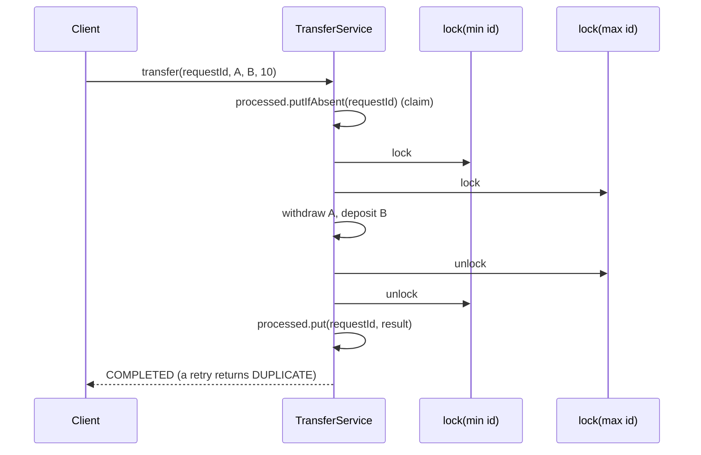

# 03 - Kata: Money transfer (`com.revolut.interview.bankTransfer`)

Prompt: "Transfer money between two accounts. Concurrent transfers in both directions must be safe."

Invariants
- Atomic: debit and credit both happen or neither.
- No negative balance, money conserved across the system.
- No deadlock for A->B concurrent with B->A.
- Idempotent per request id; same account and unknown accounts rejected; currency must match.

Design (`TransferService`)
- Per-account `ReentrantLock` in a `ConcurrentHashMap`, acquired in **id order** (lower id first).
- Idempotency: `processed.putIfAbsent(requestId, placeholder)` claims the id; duplicates get `DUPLICATE`.
- Validation before locking; `InsufficientFundsException` mapped to a typed `Status`.
- Result is a record (`TransferResult`) rather than exceptions for expected outcomes.

Tests (`TransferServiceTest`)
- completed + balances, duplicate request does not move money twice
- insufficient funds / same account / unknown / currency / zero amount leave balances untouched
- 6 threads x 1000 opposing transfers between A, B, C finish within 30 s and total stays 3000

Talking points
- Alternatives to lock ordering: `tryLock` with back-off (module11), single-writer actor per account, optimistic versioning in a DB (`UPDATE ... WHERE version = ?`).
- Distributed version: saga with reserve/confirm/cancel, or a double-entry ledger with an outbox for events.
- Observability: emit `transfer.completed/declined` metrics, trace ids in `TransferRequest`.

## Deeper dive

**New stress test** (`TransferServiceStressTest`, repeated 3x): 8 threads x 1,500 random transfers across 6 accounts, each
submitted twice (client retry). It asserts money is conserved, no overdraft, each request id completes exactly once, and every
account's transaction history replays exactly to its balance, with correct running balances.

**Known limitations of the kata implementation (good to raise yourself).**
- `processed` grows forever. Production keeps idempotency records with a TTL (e.g. 24-72 h) in a table with a unique key.
- A retry that arrives *while the first attempt is in flight* gets `DUPLICATE "in flight"`. The client cannot tell success from
  failure, so offer a `GET /transfers/{requestId}` status endpoint.
- The same `requestId` with a *different* payload is treated as a duplicate. Production should reject it with a conflict (module15 P05).
- Debit and credit are separate `Account` calls under two locks. That is atomic for other transfers, but a reader calling
  `balance()` on both accounts mid-transfer can see the money "in flight". Consistent snapshots need a read-write gate
  (module04 `InMemoryDoubleEntryLedger`) or a DB snapshot.

**Distributed version.** Accounts on different shards or services cannot share a JVM lock. Use a saga
(reserve on A, credit B, confirm A, or compensate), with an outbox for each step and reconciliation for stuck sagas.
