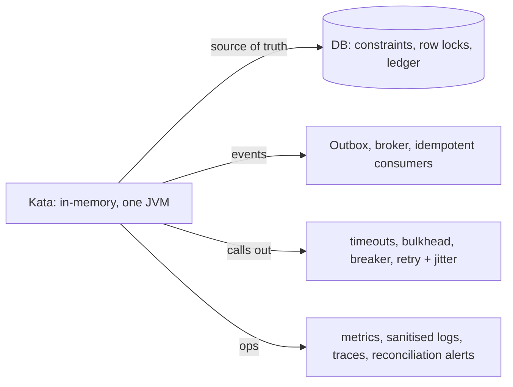

# Module 16 - Revolut Interview Prep

Package root: `com.revolut.interview`. Tests use JUnit 5.10.0 + AssertJ 3.24.2.

## Overview
The capstone for live coding: four katas that fintech interviewers use repeatedly (account, transfer, payment lifecycle,
rate limiter). Each comes with a guide (`docs/02`-`05`), production-quality code and tests, including randomized concurrency
stress tests. Guide `09_production_hardening.md` answers the inevitable follow-up: *"how would this run in production?"*

## Learning objectives
- Deliver a correct, thread-safe, tested solution in about 45 minutes while narrating invariants and trade-offs.
- Prove correctness with concurrency tests (latches, exact totals, repeated runs), not with hope.
- Explain the gap between an in-memory kata and a distributed, regulated production system.

## Prerequisites
- Modules 01-04 (design, value objects, collections), 08 (errors), 09-12 (concurrency), 15 (problem patterns).

## Java version notes
Compiled with `--release 17` (records, switch expressions, `instanceof` patterns). Tests use JUnit 5.10 and AssertJ 3.24.
Nothing requires Java 20/21. If asked, mention that Java 21 virtual threads would change the *serving* model but not these invariants.

## Guide index
| Guide | Topic |
|---|---|
| `01_interview_format.md` | format, timing, how you are scored |
| `02`-`05` | one kata each, with a "Deeper dive" covering edge cases, limitations and production notes |
| `06_concurrency_checklist.md`, `07_testing_checklist.md` | what to walk through before saying "done" |
| `08_system_design_talking_points.md` | design round |
| `09_production_hardening.md` | **new**: from kata to production (DB, outbox, resilience, observability, regulation) |

| Package | Kata | Guide |
|---|---|---|
| `bank` | account with invariants, `Money`, `AccountId`, `Bank` registry | `docs/02_bank_account_kata.md` |
| `bankTransfer` | atomic, idempotent, deadlock-free transfer | `docs/03_bank_transfer_kata.md` |
| `payment` | create/authorise/capture/refund with fraud checks and a clock | `docs/04_payment_service_kata.md` |
| `ratelimiter` | fixed window, sliding log, token bucket behind `RateLimiter` | `docs/05_rate_limiter_kata.md` |

Read `01_interview_format.md` first, then `06_concurrency_checklist.md` and `07_testing_checklist.md`; `08_system_design_talking_points.md` is for the design round.

## BAD vs GOOD (the things that fail candidates)
```java
// BAD: double for money, exceptions for expected outcomes, locking on `this`, get-then-put
double balance; if (balance >= amount) balance -= amount; else throw new RuntimeException();
// GOOD: BigDecimal value object, typed result, private lock, atomic claim
Money balance; synchronized (lock) { if (balance.compareTo(amount) < 0) throw new InsufficientFundsException(...); balance = balance.minus(amount); }
processed.putIfAbsent(requestId, placeholder);
```

## Key Takeaways
- State invariants first; design the lock/CAS around them; test them under N threads.
- Idempotency is a first-class requirement for any money-moving API.
- Lock ordering by id is the default answer to two-account atomicity in memory; sagas/outbox in distributed systems.
- Inject clocks; your rate limiter and payment timestamps become unit-testable in milliseconds.
- Typed results for expected outcomes, exceptions for programmer errors, AssertJ for readable tests.

## Cheat Sheet
| Kata | Must-have | Nice-to-have |
|---|---|---|
| Account | positive amounts, no overdraft, history, thread-safe | overdraft limit, statement paging |
| Transfer | atomic, ordered locks, idempotent, conserved total | tryLock/back-off, saga discussion |
| Payment | state machine, fraud checks, money movement, clock | partial capture, async fraud with timeout |
| Rate limiter | per-key, exact under concurrency, injected clock | distributed (Redis), 429 + Retry-After |

## 10 Interview Q&A
1. **How do you prevent deadlock when transferring between two accounts?** Acquire locks in a global order (account id) or use `tryLock` with timeout and retry; never nest in argument order.
2. **How do you make a transfer idempotent?** Client-supplied request id, atomically claimed (`putIfAbsent` / unique constraint); replay returns the stored outcome.
3. **Why return a `TransferResult` instead of throwing?** Insufficient funds is an expected business outcome; typed results force callers to handle it and keep stack traces for real bugs.
4. **Why is `Money` a record with normalised scale?** Equality and hashing must treat 1.0 and 1.00 as the same; currency safety belongs in the type.
5. **How does the payment hold work?** Authorise withdraws from the customer (hold); capture credits the merchant; refund from AUTHORISED releases the hold without touching the merchant.
6. **Fixed window vs sliding vs token bucket?** O(1)/approximate vs O(N)/exact vs O(1)/bursty-exact; choose by memory, fairness and burst tolerance.
7. **How do you test concurrency deterministically?** Latches to start together and to await completion with a timeout, exact totals, injected clocks; never sleeps.
8. **Where does the fraud check belong?** Behind an interface, composed as a list, evaluated before funds move; failures produce DECLINED with a reason.
9. **What would change for a distributed deployment?** Per-account partitioning, DB constraints for idempotency, outbox for events, sagas for cross-shard transfers.
10. **How do you handle a provider timeout during authorise?** Treat as unknown: do not approve; mark for reconciliation/manual review and query the provider by idempotency reference.

## Exercises for the reader
1. Add an overdraft facility to `Account` and keep every test green.
2. Make `TransferService` emit an event list (outbox) and prove exactly one event per completed transfer under concurrency.
3. Implement a `RedisLikeFixedWindow` using a `ConcurrentHashMap<String, Long>` with TTL semantics and compare with `FixedWindowRateLimiter`.

---

## Production deep dive

### New tests
| Test | Proves |
|---|---|
| `bankTransfer.TransferServiceStressTest` (`@RepeatedTest(3)`) | 8 threads x 1,500 random transfers over 6 accounts, each request sent twice: no deadlock, money conserved, no overdraft, each request completes once, transaction history replays to the balance |
| `payment.PaymentServiceConcurrencyTest` | 16 concurrent captures (and refunds) of one payment: exactly one wins. 50 parallel authorisations against limited funds: exactly `floor(100/7) = 14` succeed |

### Kata limitations worth raising yourself (APIs intentionally unchanged)
| Kata | Limitation | Production fix |
|---|---|---|
| `Account` | balance appears in the exception message | stable error code, no amounts or balances in messages |
| `TransferService` | idempotency map unbounded; in-flight duplicate indistinguishable from completed | TTL'd idempotency table + status endpoint |
| `TransferService` | same request id + different payload = `DUPLICATE` | reject a payload conflict (module15 P05) |
| `PaymentService.create` | silently returns the existing payment for a different amount | compare payloads, return a conflict |
| all | one JVM only | DB constraints and transactions, outbox, partitioning (guide 09) |



## Common pitfalls in live coding
- Starting to type before stating invariants and asking about concurrency and money representation.
- No test for the concurrent path, or a test that sleeps instead of using latches.
- Exceptions for expected business outcomes; or the reverse, swallowing programmer errors into a status code.
- Claiming that the in-memory solution "guarantees exactly once" across services. It does not.

## Checklist before you say "done"
- [ ] Invariants stated and tested (including under N threads).
- [ ] Idempotency, lock ordering and failure atomicity discussed.
- [ ] Clock injected; no sleeps in tests.
- [ ] Production follow-ups ready: DB, outbox, resilience, observability, security (guide 09).
