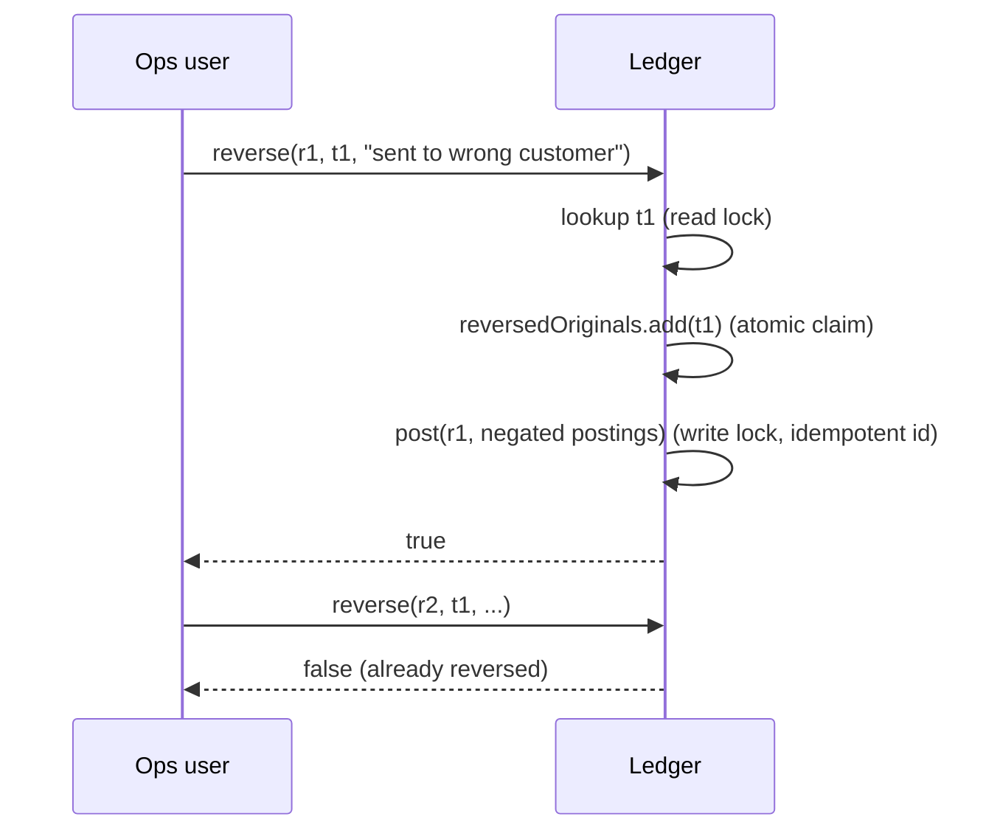

# Module 17 - Revolut "Build It" (study guide)

Package root: `com.revolut.buildit`. See `docs/README.md` for the index and one `approach_NN_*.md` per system.

## Overview
"Build It" rounds ask you to design and implement a small system end to end: requirements, model, concurrency, tests and
trade-offs, in about 45-60 minutes. Eight reference systems cover the usual prompts: load balancer, shopping cart, money transfer,
subscription billing, currency exchange, URL shortener, tiered rate limiter and a double-entry ledger (now with **immutable reversals**).
Each `approach_NN_*.md` has the design and a "Deeper dive" with edge cases, failure scenarios and production notes.

## Learning objectives
- Turn requirements into explicit invariants and choose the minimal concurrency mechanism that protects them.
- Reuse a small set of patterns: immutable values, a single mutable aggregate, versioned snapshots, idempotent claims, typed outcomes.
- State rounding, time and idempotency policies explicitly, and test them with exact numbers.
- Explain which guarantees are in-memory only and what production needs instead.

## Prerequisites
- Modules 01-04, 09-12 and 16. Module15 for problem-solving rhythm.

## Java version notes
Compiled with `--release 17`; tests use JUnit 5.10 and AssertJ 3.24. Records, sealed-free enums for outcomes, switch expressions and
`Stream.toList()` are used. No Java 20/21 features are required.

## The shape of every solution
1. Requirements -> invariants (money conserved, no overdraft, idempotent id, balanced entry).
2. Immutable records for values; one mutable aggregate with a clear lock or atomic swap.
3. Typed outcomes (`enum`) for business results; exceptions for invalid input/config.
4. Injected clock (`Supplier<Instant>`, `Supplier<LocalDate>`, `LongSupplier`).
5. Tests: happy path, every outcome, concurrency with exact totals.

## BAD vs GOOD across the eight
```java
// BAD: random short codes with retry-on-collision        GOOD: base62(sequence) - collision-free by construction
// BAD: rate table mutated in place (torn reads)          GOOD: immutable RateSnapshot in AtomicReference, versioned quotes
// BAD: balances as the source of truth                   GOOD: append-only journal, balances as a reconcilable projection
// BAD: discounts hard-coded in totals()                  GOOD: Discount functions over an immutable Snapshot
// BAD: daily limit read then written (race)              GOOD: checked and updated under the account lock
```

## Key Takeaways
- Idempotency keys appear in 4 of 8 systems; make `putIfAbsent`/unique-constraint claiming a reflex.
- Versioned immutable snapshots solve "atomic config/rate update" without locks.
- A ledger's invariant is per-currency zero sum per entry; everything else is projection.
- Sliding window counter is the pragmatic middle between fixed windows and exact logs.
- Proration and rounding need a stated policy (HALF_EVEN for fairness, DOWN when the house must not lose).

## Cheat Sheet
| System | Core structure | Concurrency tool | Test that matters |
|---|---|---|---|
| Load balancer | COW list + health map | atomic counter | even split under 8 threads |
| Cart | LinkedHashMap lines | synchronized cart | exact pennies with stacked discounts |
| Transfer | per-account lock, id order | putIfAbsent idempotency | opposing transfers conserve total |
| Subscription | records + compute() | CHM compute | proration pennies, cancellation at period end |
| FX | AtomicReference snapshot | per-wallet monitor | stale quote rejected, pockets never overdrawn |
| Shortener | two CHMs + sequence | putIfAbsent race fix | one code for 16 concurrent shortens |
| Rate limiter | sliding counter windows | per-client monitor + global | weighted window, global ceiling exact |
| Ledger | journal + projection | RW lock + id set | reconcile() empty after 4000 concurrent entries |

## 10 Interview Q&A
1. **Why base62 of a sequence rather than a hash?** No collisions, short codes, O(1); hashes need collision handling and are longer.
2. **How do you make rate updates atomic for readers?** Build a new immutable snapshot and swap the reference; quotes carry the version.
3. **Why round FX results down?** The institution must not lose fractions of a cent to rounding; state the policy explicitly.
4. **Why is the journal append-only?** Auditability and rebuildability; corrections are new reversing entries.
5. **What does `reconcile()` protect against?** Bugs in the projection path; in production it compares DB balances to journal sums nightly.
6. **Fixed vs sliding counter vs token bucket for an API?** Counter gives smooth limits with O(1) memory; bucket allows bursts; fixed is cheap but gamed at boundaries.
7. **How do you prorate a plan change?** Price difference times remaining days over period days; credit when negative; apply at the next invoice or immediately.
8. **How does the cart keep totals non-negative?** Cap total discount at subtotal + shipping before subtracting.
9. **How would you scale the transfer system?** Partition by account id; same-shard transfers lock locally; cross-shard via saga with reserve/confirm.
10. **How do you test these without flakiness?** Inject clocks, start threads with a latch, await with a timeout, assert exact totals.

## Exercises for the reader
1. Add weighted round robin to the load balancer and prove the ratio under 8 threads.
2. ~~Give the ledger a `reverse(entryId)`~~ now implemented as `Ledger.reverse(reversalId, originalId, reason)` (try it yourself first, then compare). Next step: support *partial* reversals and prove that the reversed total can never exceed the original.
3. Add quote expiry by time to `CurrencyExchange` in addition to version and test both rejections.

---

## Production deep dive

### New: ledger reversals (`ledger.Ledger#reverse`)

Why: in a regulated ledger, posted entries are immutable. Corrections are visible, attributable, explained and reconcilable.
Tests: history keeps both entries, `reconcile()` stays empty, concurrent reversals post once, a reversal-of-reversal is rejected,
an id clash releases the claim, and a seeded property test with 2,000 transfers plus random reversals reconciles to zero per currency.

### Pattern reuse across the eight systems
| Pattern | Systems | Production equivalent |
|---|---|---|
| Idempotent claim (`putIfAbsent` / key set) | transfer, shortener, ledger (+ reversal) | `UNIQUE` constraint + stored response |
| Versioned immutable snapshot | FX, load balancer backends | config service / rate feed with versions |
| Ordered locks for multi-entity atomicity | transfer, rate limiter (client -> global) | row locks in id order; partitioned single writer |
| Append-only journal + projection | ledger | ledger table + balance table, nightly reconciliation |
| Explicit rounding policy | cart, subscription, FX | documented per product, tested to the penny |

## In-memory vs production
Every system here is correct **inside one JVM**. None survives a restart, and none coordinates across instances. In production:
balances and idempotency keys live in a database with constraints; events leave via an outbox; rate-limit state lives in a shared store
with an explicit fail-open or fail-closed policy; FX quotes are persisted for audit. Say this out loud in the interview, then explain the mapping.

## Common pitfalls
- Designing before stating invariants and policies (rounding, time zone, idempotency window).
- Holding a global lock for everything: correct, but it fails the "how does this scale?" follow-up.
- Editing or deleting ledger history to "fix" mistakes.
- Using random short codes or ids where uniqueness or unguessability matters, without saying which property you need.
- Forgetting the concurrency test, or writing one that sleeps.

## Checklist
- [ ] Requirements -> invariants -> data model -> concurrency -> tests -> trade-offs, in that order.
- [ ] Every money path has an exact-penny test and a concurrency test with conservation.
- [ ] Policies (rounding, time, idempotency, fail-open/closed) are explicit in code and docs.
- [ ] Production mapping prepared (DB, outbox, shared state, observability).
