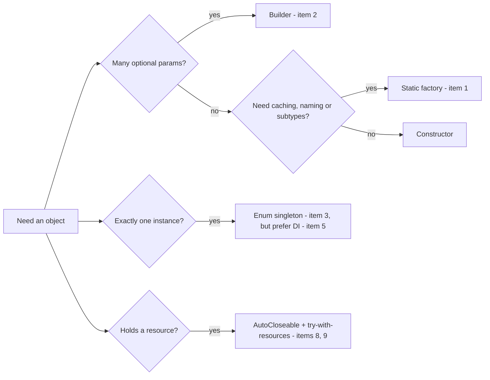

# Chapter 2 - Creating and destroying objects (items 1-9)

Package `module18.ch02`, tests in `Chapter02Test`. Theme: control how objects come into existence (factories, builders,
singletons, injection) and how their resources are released (references, cleaners, try-with-resources).

---

## Item 1 - Consider static factory methods instead of constructors
**In short.** A static factory has a name, can return a cached instance, can return any subtype, and can validate or
normalise before creating anything. Constructors can do none of that.
**Example.** `Item01StaticFactories.Money` has a private constructor and `of`, `ofMinor`, `parse` and `zero`.
`zero("EUR")` always returns the same cached instance, and `ofMinor(1250, "EUR")` cannot be confused with `of("1250", "EUR")`.
**Why it matters in fintech.** Money creation is where scale errors creep in. A named factory makes "minor units" vs "major
units" explicit, and the factory is the one place where scale is normalised.
**Java 17/21.** Records still have a public canonical constructor, so add static factories to records for named variants.
JDK conventions: `List.of`, `Instant.parse`, `BigDecimal.valueOf`, `Currency.getInstance`.
**Pitfalls.** Factories are harder to discover in Javadoc, so use conventional names (`of`, `from`, `valueOf`, `getInstance`,
`newInstance`, `parse`). A class with only private constructors cannot be subclassed (often a benefit; see item 18).
**Proof.** `item01_namedAndCachingFactories`: parsing equals construction, `zero` is the same instance, and sub-cent input throws.

## Item 2 - Consider a builder when faced with many constructor parameters
**In short.** With many optional parameters, telescoping constructors are unreadable and JavaBeans setters leave
half-built mutable objects. A builder names each optional value and validates the cross-field rules once, in `build()`.
**Example.** `Item02Builder.PaymentInstruction.builder(debtor, creditor, amount).reference(..).priority(URGENT).build()`.
`build()` rejects debtor == creditor, instant payments over 100,000, and references over 140 characters.
**Why it matters.** Payment instructions have many optional fields (reference, execution date, priority, instant flag,
purpose code). Positional `true, false, null` arguments are how payments end up sent with the wrong flags.
**Java 17/21.** The product is a **record** (immutable, generated equals/hashCode). For small records with few optional
fields, a couple of static factories may be enough.
**Pitfalls.** Validating in setters instead of in `build()` misses cross-field rules. A builder is mutable and not thread-safe,
so keep it local.
**Proof.** `item02_builderValidatesOnce`.

## Item 3 - Enforce the singleton property with a private constructor or an enum type
**In short.** A single-element enum is the most robust singleton: one instance guaranteed by the JVM, safe under
serialization and reflection. With a private-constructor singleton you must defend against reflection (and serialization;
see item 89) yourself.
**Example.** `PaymentReferenceGenerator.INSTANCE` (enum). `LegacyRegistry`'s constructor throws if called a second time; the
test calls it reflectively and gets `IllegalStateException`.
**Why it matters.** Duplicate "singletons" (two id generators) produce duplicate payment references.
**Java 17/21.** Unchanged. In frameworks, prefer container-managed singletons plus constructor injection (item 5).
**Pitfalls.** Singletons are global mutable state: hard to test and hidden coupling. An enum cannot extend a class.
**Proof.** `item03_enumSingletonAndReflectionGuard`.

## Item 4 - Enforce noninstantiability with a private constructor
**In short.** A utility class of static methods gets a private constructor that throws `AssertionError`. Making it abstract
does not work, because a subclass can still be instantiated.
**Example.** `Item04Noninstantiable.applyBps(amount, bps)`. Reflective instantiation fails with `AssertionError`.
**Why it matters.** Instances of utility classes are meaningless, and they confuse readers and DI containers.
**Java 17/21.** Unchanged. Consider whether the static methods belong on a value type instead (`Money.applyBps`).
**Pitfalls.** Growing a dumping-ground `Utils` class. Keep utilities cohesive (`FxMath`, `IbanValidator`).
**Proof.** `item04_utilityClassCannotBeInstantiated`.

## Item 5 - Prefer dependency injection to hardwiring resources
**In short.** Classes that depend on resources (fee schedules, clocks, rate providers) should receive them through the
constructor instead of creating them or reaching for singletons.
**Example.** `FeeService(FeeSchedule schedule, Clock clock)`. The test injects a weekend fee rule and a fixed Saturday clock.
**Why it matters.** Fee schedules differ per market and product, and time-dependent rules (weekend fees, cut-offs, value
dates) are untestable with `LocalDate.now()`.
**Java 17/21.** `java.time.Clock` is the standard injectable time source. A `Supplier<T>` is a lightweight factory injection.
**Pitfalls.** Service locators (hidden dependencies), and mutable static configuration.
**Proof.** `item05_injectedScheduleAndClock`.

## Item 6 - Avoid creating unnecessary objects
**In short.** Reuse immutable objects that are expensive to create (compiled regex `Pattern`s), and beware hidden
allocations (autoboxing, `String.matches`). Do not pool cheap objects: modern GCs make short-lived allocations cheap.
**Example.** `looksLikeIban` (static `Pattern`) vs `looksLikeIbanSlow` (`String.matches` compiles every call). `sumBoxed`
(Long accumulator) vs `sum`.
**Why it matters.** Validating millions of IBANs or card numbers per day with `String.matches` wastes CPU on every request.
**Java 17/21.** Unchanged. Escape analysis can remove some allocations, but don't rely on it. Measure (module14).
**Pitfalls.** "Optimising" by sharing mutable objects across threads. Skipping defensive copies (item 50) to save allocation.
**Proof.** `item06_sameResultWithoutWastefulAllocation` (identical results; for speed see module14 benchmarks).

## Item 7 - Eliminate obsolete object references
**In short.** When a class manages its own memory (array-backed stacks, caches, listener lists), null out slots that are
logically dead, or the GC keeps them alive forever.
**Example.** `PendingStack.pop()` clears the popped slot (the test checks the slot is null).
**Why it matters.** Long-running payment services leak slowly through unbounded caches, forgotten listeners and stale
array slots, and eventually hit an OOM at month-end peak.
**Java 17/21.** Prefer bounded caches (LRU/TTL; module03/04) and `WeakHashMap` only when keys have identity semantics.
**Pitfalls.** Nulling every local variable "just in case" (pointless). Unbounded `ConcurrentHashMap` caches keyed by customer id.
**Proof.** `item07_popClearsObsoleteReference`.

## Item 8 - Avoid finalizers and cleaners
**In short.** Finalizers and cleaners run unpredictably (maybe never), cost performance and can open security holes. Release
resources with `AutoCloseable`. A `Cleaner` is acceptable only as a safety net that reports a forgotten `close()`.
**Example.** `StatementExport` registers a `Cleaner` action on a static nested `State` (it must not reference the outer
object). `close()` is the real cleanup; the cleaner counts leaks.
**Why it matters.** HSM sessions, DB connections and file handles are scarce; waiting for GC to release them causes outages.
**Java 17/21.** **Finalization is deprecated for removal (JEP 421, Java 18)** and can be disabled with `--finalization=disabled`.
**Pitfalls.** A cleaning action that captures `this` (the object never becomes unreachable). Relying on `System.gc()`.
**Proof.** `item08_closeIsTheRealCleanupCleanerOnlyASafetyNet`.

## Item 9 - Prefer try-with-resources to try-finally
**In short.** try-with-resources closes resources in reverse order and keeps the primary exception, adding `close()`
failures as suppressed exceptions. try-finally lets the close failure replace the real one.
**Example.** `uploadTryFinally` loses "upload failed" (you see only "close failed"). `uploadTryWithResources` keeps it, with
2 suppressed exceptions, and closes `file` before `sftp`.
**Why it matters.** Incident analysis depends on the root cause. "close failed" for a failed settlement-file upload sends
engineers in the wrong direction.
**Java 17/21.** Since Java 9 you can use an effectively final variable: `try (conn) { ... }`. `ExecutorService` is
`AutoCloseable` since Java 19.
**Pitfalls.** Wrapping a resource in another constructor that may throw (`new BufferedReader(new FileReader(f))`); if the outer
constructor fails, the inner resource leaks. Declare each resource separately.
**Proof.** `item09_tryWithResourcesKeepsPrimaryException`.

---
**Say it in an interview.** "I use static factories and builders so object creation is named and validated, enums for
singletons but DI by default, and every resource is `AutoCloseable` in try-with-resources. Finalizers are deprecated for
removal, and cleaners are only a leak detector."
