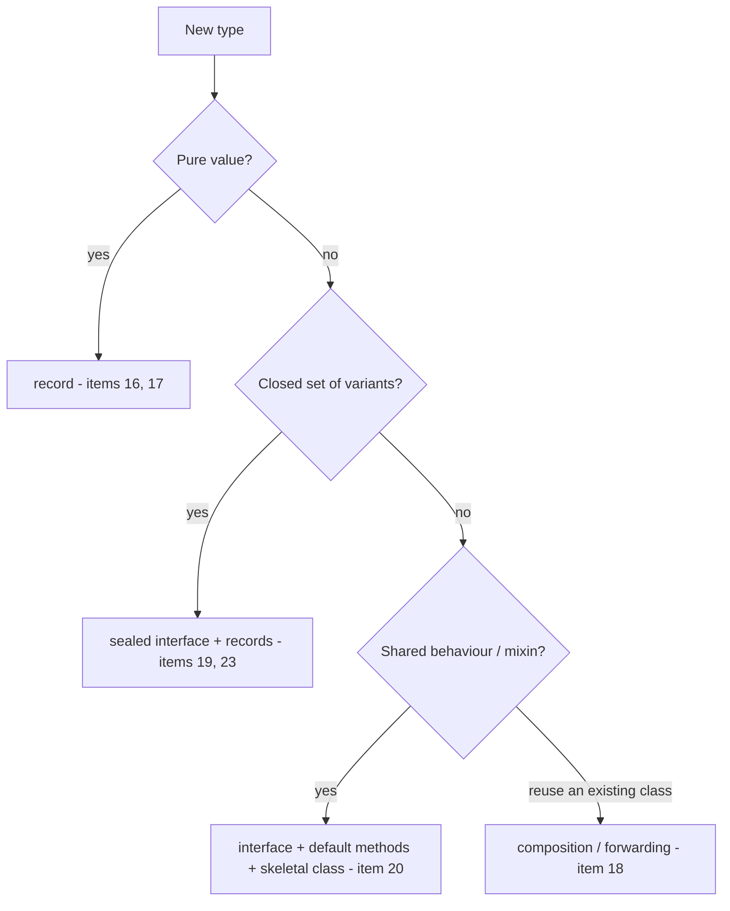

# Chapter 4 - Classes and interfaces (items 15-25)

Package `module18.ch04`, tests in `Chapter04Test`. Theme: encapsulation, immutability, composition, and designing types
that can evolve safely. In Java 17/21 this chapter is where **records** and **sealed types** change the most.

---

## Item 15 - Minimize the accessibility of classes and members
**In short.** Make everything as private as possible. The public API is a permanent commitment; private details can change.
Never expose a mutable array through a `public static final` field.
**Example.** `SUPPORTED_ARRAY` (public final array): the test overwrites an element. `SUPPORTED` (`List.of`) and `supportedCopy()` are safe.
**Why it matters.** A mutable public array of supported currencies or blocked countries can be changed by any library on the
classpath, which is a compliance and security risk.
**Java 17/21.** JPMS modules (`exports` only API packages) add a stronger boundary. Records' components are always exposed via
accessors, so don't make implementation details record components.
**Pitfalls.** Making members package-private "for tests" then public "for convenience". `protected` is also public API for subclasses.
**Proof.** `item15_publicArrayIsMutableListIsNot`.

## Item 16 - In public classes, use accessor methods, not public fields
**In short.** Public mutable fields give up validation, invariants, thread safety and freedom to change representation.
**Example.** `PublicFieldsLimit.dailyLimit = -1` is accepted. `DailyLimit` (record) validates in its compact constructor.
**Why it matters.** Limits, balances and rates must never be writable without checks.
**Java 17/21.** Records are the modern answer for data carriers: final fields, generated accessors, and validation.
**Pitfalls.** Exposing fields in a public nested class "temporarily".
**Proof.** `item16_accessorsEnforceInvariants`.

## Item 17 - Minimize mutability
**In short.** Immutable objects are simple, thread-safe, shareable and great map keys. No mutators, final class, private final
fields, defensive copies, and methods that return new instances. Cache common values.
**Example.** `InterestRate`: `plusBasisPoints` returns a new rate, `ZERO` is cached, and `dailyInterest` is pure.
**Why it matters.** Rates, money, FX quotes and fee schedules are read concurrently everywhere. Immutability removes a whole
class of race conditions (module10).
**Java 17/21.** Records are shallowly immutable; still copy mutable components (`List.copyOf`).
**Pitfalls.** A "final" class with a mutable `Date` or array field; publishing `this` from the constructor.
**Proof.** `item17_immutableWithWithers`.

## Item 18 - Favor composition over inheritance
**In short.** Inheriting from a concrete class couples you to its self-use. A forwarding wrapper depends only on the public
interface and works with any implementation.
**Example.** `CountingHashSet.addAll` of 3 cards counts **6** (`HashSet.addAll` calls `add`). `CountingSet` wraps any `Set`
and counts 3.
**Why it matters.** Audit counters, fraud velocity counters and metrics silently double-count, with wrong alerts as the result.
**Java 17/21.** Unchanged. Sealed hierarchies are for designed-for-extension types you own, not a way to extend JDK classes.
**Pitfalls.** Wrappers are not suitable for callback frameworks that pass `this` (the "SELF problem").
**Proof.** `item18_inheritanceDoubleCountsCompositionDoesNot`.

## Item 19 - Design and document for inheritance or else prohibit it
**In short.** A class meant for extension must document its self-use (`@implSpec`) and must never call overridable methods
from constructors. Otherwise make it `final`, or restrict it with `sealed`.
**Example.** `PremiumFeeCalculator.description()` returns `"fee: premium discount null"`: the base constructor called the
override before the subclass field was initialised. `FeePolicy` is a sealed interface with record implementations.
**Why it matters.** Half-initialised fee calculators produce wrong fees with no exception.
**Java 17/21.** `sealed` (17) lists the permitted subclasses. **`javac -Xlint:this-escape` (21)** warns on exactly the bug above
(this module's lint run reports it).
**Pitfalls.** Calling overridable methods from `clone` or `readObject` too.
**Proof.** `item19_constructorCallingOverridableMethod`.

## Item 20 - Prefer interfaces to abstract classes
**In short.** A class can implement many interfaces but extend only one class. Interfaces allow mixins and non-hierarchical
types; default methods add convenience; a skeletal implementation (`AbstractXxx`) helps implementors without forcing them.
**Example.** `PaymentChannel` (with a default `accepts`), `Refundable` mixin, `AbstractPaymentChannel` skeleton, `CardChannel`
(uses the skeleton), and `SepaInstantChannel` (a record implementing the interface directly).
**Why it matters.** Payment channels evolve independently. Interfaces let a wallet be both `PaymentChannel` and `Refundable`.
**Java 17/21.** Private interface methods (9) share code between defaults. Sealed interfaces can close the set.
**Pitfalls.** Default methods that depend on `equals`/`hashCode` (not allowed to override Object methods).
**Proof.** `item20_interfacesWithDefaultsAndSkeleton`.

## Item 21 - Design interfaces for posterity
**In short.** Adding a default method to a published interface injects behaviour into old implementations, and it may violate
their guarantees.
**Example.** `Journal.postAll` (added "in v2") posts one by one. `StrictJournal` ends up with a partial batch. `AtomicStrictJournal`
overrides it to validate first, so batches are all-or-nothing.
**Why it matters.** Ledger batches must be atomic. A default method can silently break that.
**Java 17/21.** Unchanged (the JDK learned this with `Collection.removeIf` on synchronized wrappers).
**Pitfalls.** Releasing an interface without at least three implementations and client tests.
**Proof.** `item21_defaultMethodBreaksAtomicityUnlessOverridden`.

## Item 22 - Use interfaces only to define types
**In short.** The constant interface pattern leaks implementation details into the type hierarchy. Put constants in the class
or enum that owns them, or in a noninstantiable holder.
**Example.** `PaymentLimitsBad implements PaymentConstants` is now "a PaymentConstants" forever. `SepaLimits` is the fix.
**Java 17/21.** Unchanged. Static imports cover the convenience use case.
**Proof.** `item22_constantInterfaceLeaksIntoTypeHierarchy`.

## Item 23 - Prefer class hierarchies to tagged classes
**In short.** A tagged class (a `kind` field plus fields for every kind plus a switch everywhere) is verbose and error-prone.
Model each variant as its own type.
**Example.** `TaggedFee` vs `sealed interface Fee permits Flat, Percentage, Tiered` with an exhaustive record-pattern `switch`.
The test checks both give the same fee.
**Why it matters.** Fee, payment-method and outcome types grow over time. With a sealed hierarchy the compiler flags every
switch that misses a new variant.
**Java 17/21.** This item is where modern Java shines: sealed (17), records (16), and pattern matching for switch with record
patterns (**21**; preview in 19/20).
**Pitfalls.** Adding `default ->` to a switch over a sealed type, which defeats exhaustiveness.
**Proof.** `item23_taggedAndSealedAgree`.

## Item 24 - Favor static member classes over nonstatic
**In short.** An inner (non-static) class instance holds a hidden reference to its enclosing instance, which costs memory and
can cause leaks when inner objects outlive the outer one.
**Example.** `StatementGenerator.InnerLine` keeps the generator's 1 MB buffer alive; `Line` (static) does not. The test checks the
synthetic `this$0` field.
**Java 17/21.** Since **JDK 18**, javac omits `this$0` if the inner class never uses the outer instance. `InnerLine` uses it (as
real code usually does), so the reference is present. Don't rely on the optimisation.
**Pitfalls.** Anonymous classes and lambdas in instance methods capture `this` too (lambdas only if they use it).
**Proof.** `item24_innerClassHoldsOuterReference`.

## Item 25 - Limit source files to a single top-level class
**In short.** Multiple top-level classes in one file make compilation order-dependent. Use one top-level type per file, and
static nested types for related variants.
**Example.** `Item25SingleTopLevelClass` nests its sealed interface and records. The repo's own `explanations/.../PaymentOutcome.java`
used to violate this item: `javac -Xlint` reported "auxiliary class ... should not be accessed from outside its own source file"
37 times. `Success`, `Failure` and `Pending` now each have their own file, and the warning is gone.
**Java 17/21.** Unchanged; sealed hierarchies make nesting natural.
**Proof.** `item25_nestedTypesInsteadOfExtraTopLevelClasses`.

---
**Say it in an interview.** "Private by default, records for values, sealed interfaces plus pattern switches instead of
tagged classes, composition over inheritance of concrete classes, and I check `-Xlint:this-escape` on Java 21."
