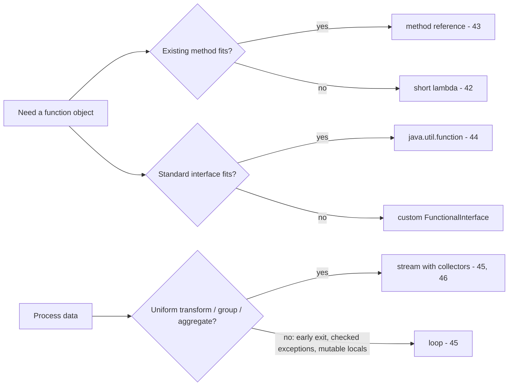

# Chapter 7 - Lambdas and streams (items 42-48)

Package `module18.ch07`, tests in `Chapter07Test`. Theme: functional style where it improves clarity, and not where it
does not. Background: module06.

---

## Item 42 - Prefer lambdas to anonymous classes
**In short.** Lambdas replace single-method anonymous classes with far less noise. Keep them short; name them as methods if
they need explanation. Anonymous classes remain for abstract classes, multiple methods, or `this` referring to the function object.
**Example.** Sorting by amount with an anonymous `Comparator` vs `Comparator.comparing(Payment::amount)`. `RoundingPolicy`
enum constants take a `UnaryOperator<BigDecimal>` lambda (BANKERS, HOUSE_NEVER_LOSES, CUSTOMER_FRIENDLY).
**Pitfalls.** Serializing lambdas (do not). Long multi-line lambdas.
**Proof.** `item42_lambdaAndAnonymousClassAgree`.

## Item 43 - Prefer method references to lambdas
**In short.** `BigDecimal::add` says more with less. Use a lambda when it is clearer (meaningful parameter names, very long class names).
**Example.** `balances` uses `map.merge(account, amount, BigDecimal::add)`; `normalisedRefs` uses `String::strip`, `String::toUpperCase`.
**Proof.** `item43_methodReferences`.

## Item 44 - Favor the use of standard functional interfaces
**In short.** Prefer `Predicate`, `Function`, `Supplier`, `Consumer`, `UnaryOperator`, `BinaryOperator` and primitive variants:
they compose (`and`, `negate`, `andThen`) and are familiar. Write a custom `@FunctionalInterface` only when it adds a
meaningful name, contract or default methods.
**Example.** `largeAmount(..).and(fromCountry("DE").negate())`; a custom `FraudRule` is justified by its audit contract
("returns a reason or null"); `Supplier<Instant>` as an injectable clock.
**Pitfalls.** Boxed variants on hot paths (`Function<Long, Long>` vs `LongUnaryOperator`). Overloading methods that take different
functional interfaces in the same position (ambiguous calls).
**Proof.** `item44_standardInterfacesCompose`.

## Item 45 - Use streams judiciously
**In short.** Streams are great for uniform transformation, filtering, grouping and aggregation. Loops are better for early exit,
mutating locals, checked exceptions, or needing values from several stages. Choose by readability.
**Example.** `spendByMerchant` (stream with groupingBy + reducing) vs `untilBudgetExceeded` (loop with break + running total).
**Pitfalls.** Unreadable mega-pipelines; char streams; reusing a consumed stream.
**Proof.** `item45_streamOrLoopWhicheverReadsBetter`.

## Item 46 - Prefer side-effect-free functions in streams
**In short.** The result should come from the collector, not from `forEach` mutating outside state. Learn `toMap`,
`groupingBy`, `counting`, `partitioningBy`, `joining`, `teeing`.
**Example.** `declinesByReasonBad` (forEach + merge) vs `declinesByReason` (`groupingBy` + `counting`); `partitionHardDeclines`.
**Why it matters.** Side-effecting pipelines break when someone adds `.parallel()`, and they hide the computation.
**Proof.** `item46_collectorsInsteadOfForEachMutation`.

## Item 47 - Prefer Collection to Stream as a return type
**In short.** A Collection supports both for-each and `stream()`; a Stream does not support for-each. Return a List unless the
sequence is huge or lazy. Adapters exist in both directions.
**Example.** `statementLines()` returns `List`; `iterableOf(Stream)` and `streamOf(Iterable)` adapters.
**Java 17/21.** `Stream.toList()` (16) returns an unmodifiable list. `SequencedCollection` (21) is a richer return type for ordered results.
**Pitfalls.** Returning a Stream backed by a DB cursor without documenting that it must be closed.
**Proof.** `item47_collectionSupportsBothStylesAndAdapters`.

## Item 48 - Use caution when making streams parallel
**In short.** Parallel streams help only for large, CPU-bound, well-splittable sources with associative, side-effect-free
reductions, and they share the common ForkJoinPool. Otherwise they are slower or wrong.
**Example.** `totalParallel` (`reduce(ZERO, BigDecimal::add)`) is correct. `collectWithSideEffect` adds to an `ArrayList`
from parallel threads (loses elements or throws). `collectProperly` uses a collector.
**Why it matters.** A "harmless" `.parallel()` on a reconciliation job can lose transactions silently.
**Java 17/21.** For I/O-bound fan-out, use virtual threads (21) instead of parallel streams.
**Proof.** `item48_parallelOnlyWithAssociativeSideEffectFreeOps`.

---
**Say it in an interview.** "Method references and standard functional interfaces by default; streams for transformations,
loops for control flow; results come from collectors, not side effects; Collections as return types; parallel only when
measured, CPU-bound and associative."
