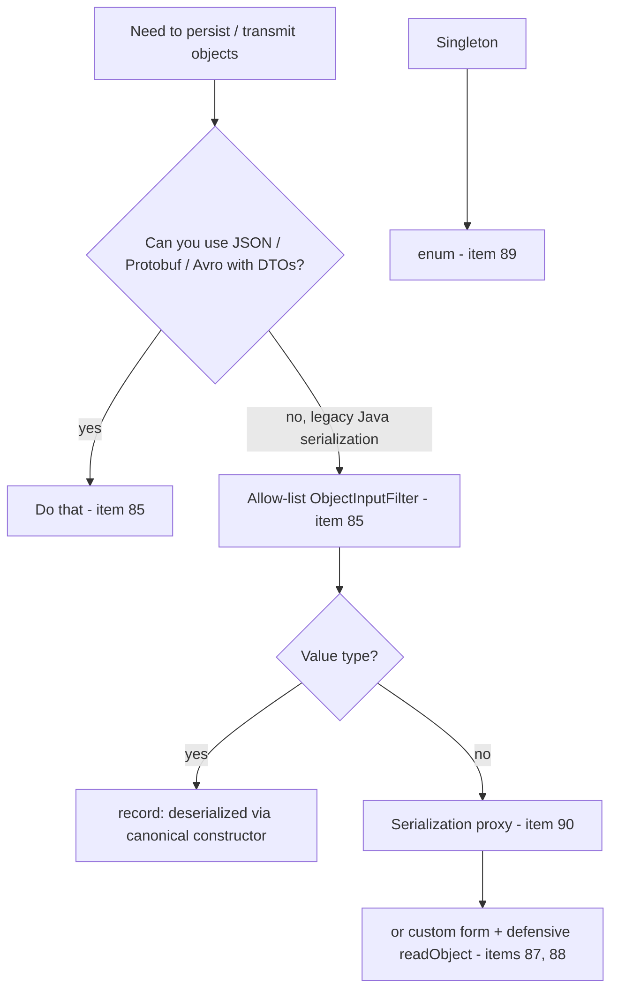

# Chapter 12 - Serialization (items 85-90)

Package `module18.ch12`, tests in `Chapter12Test`. Theme: Java serialization is a hidden constructor that accepts attacker-
controlled bytes. Avoid it; if you cannot, filter it, validate everything and keep the logical form small.

---

## Item 85 - Prefer alternatives to Java serialization
**In short.** Deserializing untrusted data can run gadget chains (remote code execution) or deserialization bombs. Don't
deserialize untrusted bytes; use cross-platform formats with explicit DTOs. If unavoidable, use an allow-list filter with limits.
**Example.** `allowListFilter()` accepts only `PaymentMessage` and `BigDecimal`-related classes, with depth/reference/array limits
and `!*` for everything else; a `HashMap` payload is rejected with `InvalidClassException`. `toJson` shows the preferred representation.
**Java 17/21.** `ObjectInputFilter` (Java 9, JEP 290); context-specific, JVM-wide filter factories (**Java 17, JEP 415**) via
`jdk.serialFilterFactory`.
**Proof.** `item85_allowListFilterRejectsUnexpectedClasses`.

## Item 86 - Implement Serializable with great caution
**In short.** Serializable makes the private representation a permanent public API, bypasses your constructors, enlarges the attack
surface and the testing burden. Always declare `serialVersionUID`; never make inner classes serializable.
**Example.** `SettlementRecord` has an explicit `@Serial serialVersionUID = 1L` (the test checks the stream UID).
`SettlementSummary` is a **record**: deserialization goes through its compact constructor, so its invariant still holds.
**Java 17/21.** `@Serial` (Java 14) lets the compiler check serialization members. **Records (16)** serialize by component and
deserialize via the canonical constructor, which makes them the safest serializable values.
**Proof.** `item86_explicitUidAndRecordValidation`.

## Item 87 - Consider using a custom serialized form
**In short.** The default form writes the physical representation (internal nodes, caches) forever. Write the logical content:
mark implementation fields `transient`, and implement `writeObject`/`readObject`; rebuild derived state on read.
**Example.** `TransactionLog` writes a count and the entries; the running total is transient and recomputed. `readObject` also
rejects absurd counts.
**Proof.** `item87_customFormRebuildsDerivedState`.

## Item 88 - Write readObject methods defensively
**In short.** Treat `readObject` like a public constructor whose argument is attacker-controlled: defensively copy mutable
components first, then validate every invariant and throw `InvalidObjectException`.
**Example.** `InterestPeriod.readObject` copies its `Date`s and checks start <= end. The test forges a stream (it sets `start`
after `end` reflectively and serializes it), and deserialization fails.
**Java 17/21.** Prefer records or proxies (item 90), which reuse the constructor's validation.
**Proof.** `item88_readObjectRevalidatesTamperedState`.

## Item 89 - For instance control, prefer enum types to readResolve
**In short.** Deserialization creates new instances, which breaks singletons. `readResolve` can fix it, but all fields must be
transient to be safe. Enums get instance control for free.
**Example.** `SystemAccount.SUSPENSE` (enum) and `SuspenseAccount.INSTANCE` (readResolve) both round-trip to the same instance;
the enum needs no code and has no loopholes.
**Proof.** `item89_enumKeepsSingletonPropertyReadResolveToo`.

## Item 90 - Prefer serialization proxies to readObject
**In short.** Serialize a private static nested proxy (`writeReplace`) holding the logical state; its `readResolve` recreates the
object through the public constructor; the outer `readObject` throws, so forged streams cannot bypass validation. The outer class
keeps final fields.
**Example.** `Mandate` (SEPA direct-debit mandate) with `Proxy`. A round trip goes through the constructor's validation of
mandate id and positive max amount.
**Java 17/21.** Records give most of this automatically and are the modern default for serializable values.
**Proof.** `item90_proxyRoundTripsThroughPublicConstructor`.

---
**Say it in an interview.** "I don't deserialize untrusted data. External formats use JSON or Protobuf DTOs. If Java serialization
is unavoidable: allow-list filters with limits, records or serialization proxies so validation always runs, explicit
`serialVersionUID`, and enums for singletons."
